# 安装 LaTeX 发行版并完成首次编译

安装 LaTeX 时，一般会选择一个 TeX 发行版。发行版把日常排版需要的程序、宏包、字体和辅助工具放在一起，方便安装和维护。

通常会用到：

- 编译命令：`xelatex`、`pdflatex`、`lualatex`。
- 自动构建工具：[latexmk](https://ctan.org/pkg/latexmk)，用于组织编译过程。
- 宏包：`xeCJK`、`amsmath`、`enumitem` 等。
- 字体文件和其他辅助工具。

具体安装哪些组件，取决于所选发行版和安装方式。

## 1. 打开 LaTeX 官网

打开 [LaTeX 官网](https://www.latex-project.org/)。

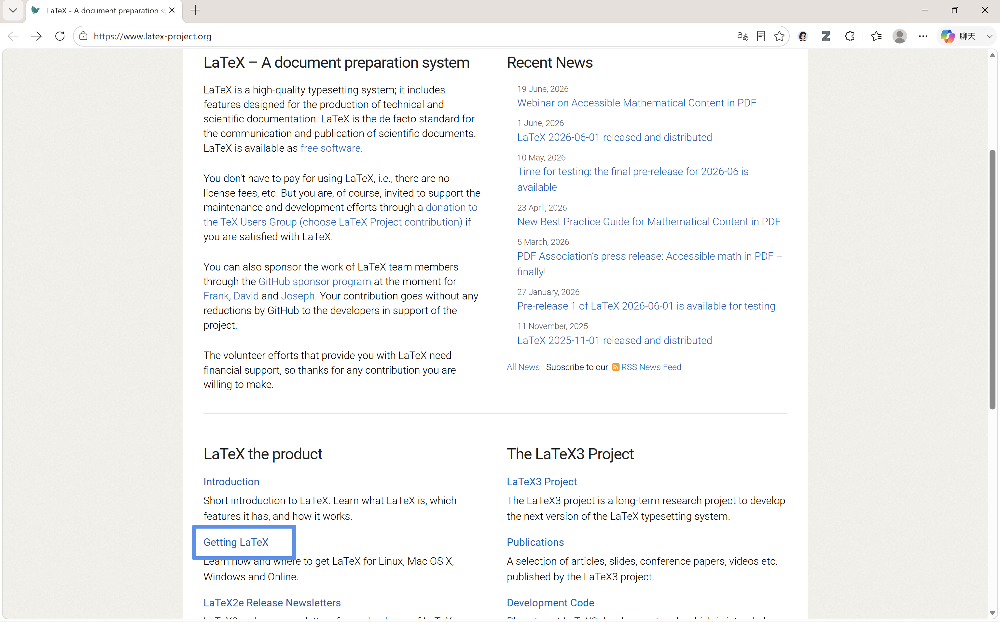

## 2. 进入 Getting LaTeX

点击 **Getting LaTeX**，进入[发行版获取页面](https://www.latex-project.org/get/)。

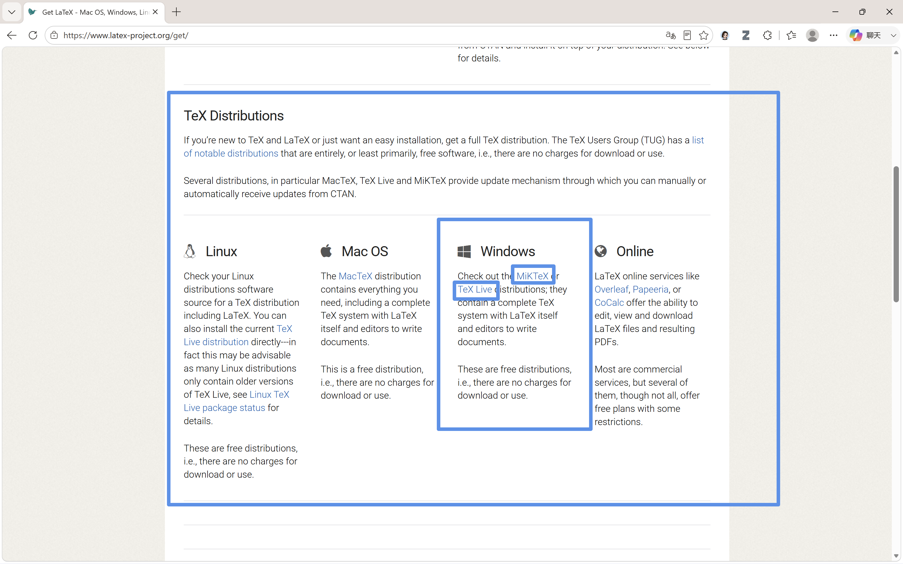

## 3. 选择发行版并下载安装

Windows 可以选择 MiKTeX 或 TeX Live。这里以 MiKTeX 为例：基础安装较精简，需要的宏包可以按需补装，具体步骤见 [MiKTeX 官方安装说明](https://miktex.org/howto/install-miktex)。

进入 MiKTeX 下载页面，点击 **DOWNLOAD**，下载并运行适合自己系统的安装程序。

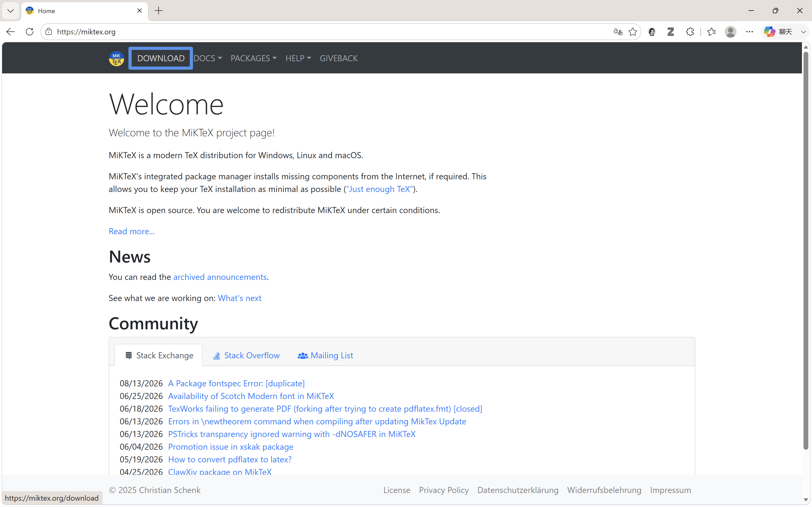

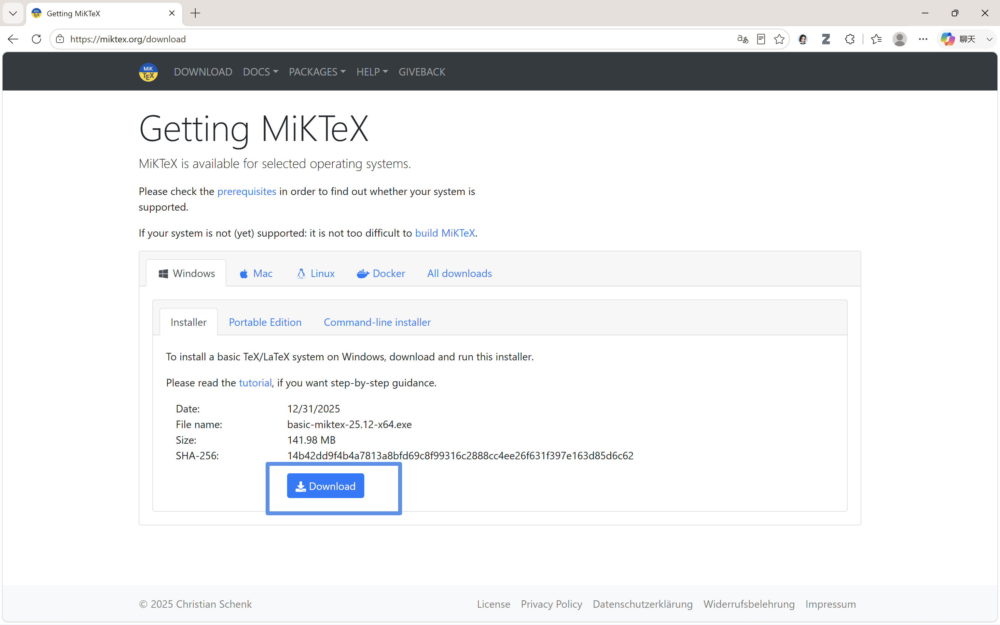

## 4. 检查环境变量

把编译程序所在目录加入 `Path` 后，就可以在终端中直接执行编译命令。系统会通过 `Path` 找到对应的程序。

先重新打开一个终端，检查命令是否已经能识别：

```powershell
xelatex --version
```

如果能显示版本信息，说明当前终端已经能找到它。如果提示找不到命令，再将自己安装目录中实际包含 `xelatex.exe` 的目录加入用户 `Path`，保存后重新打开终端。

例如，我这里的路径是：

```text
D:\MiKTeX\miktex\bin\x64\
```

路径以自己的安装位置为准。

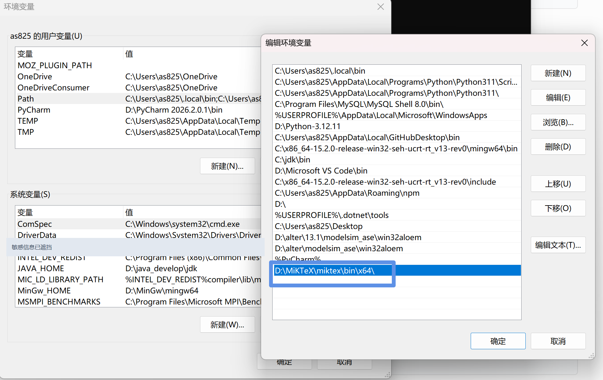

比如使用 `xelatex` 编译时，系统就会找到对应的程序。

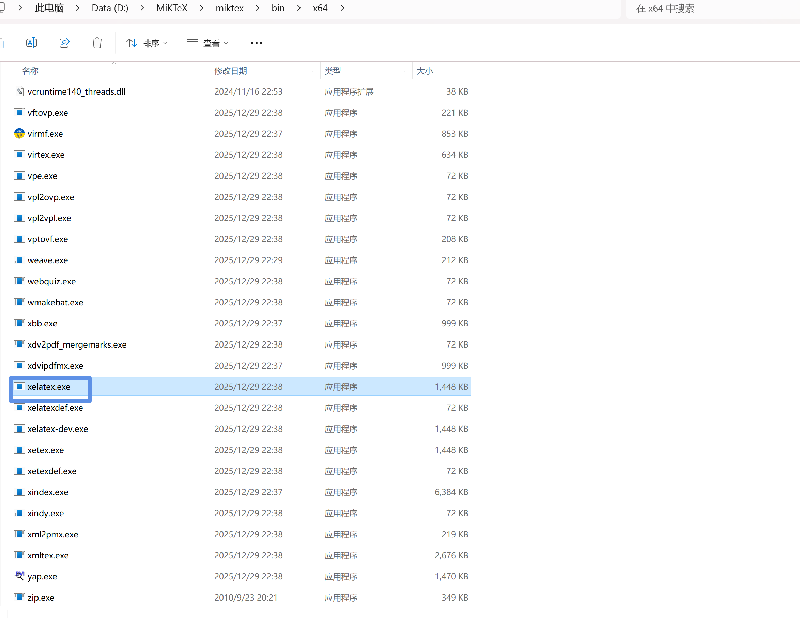

## 5. 创建并编写 main.tex

创建一个 LaTeX 源文件，文件名为 `main.tex`，扩展名是 `.tex`。

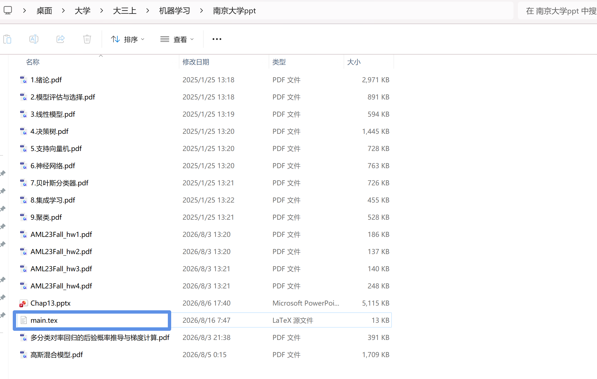

在记事本中写好 LaTeX 源代码，并以 UTF-8 编码保存。下面是当时编辑源文件的画面。

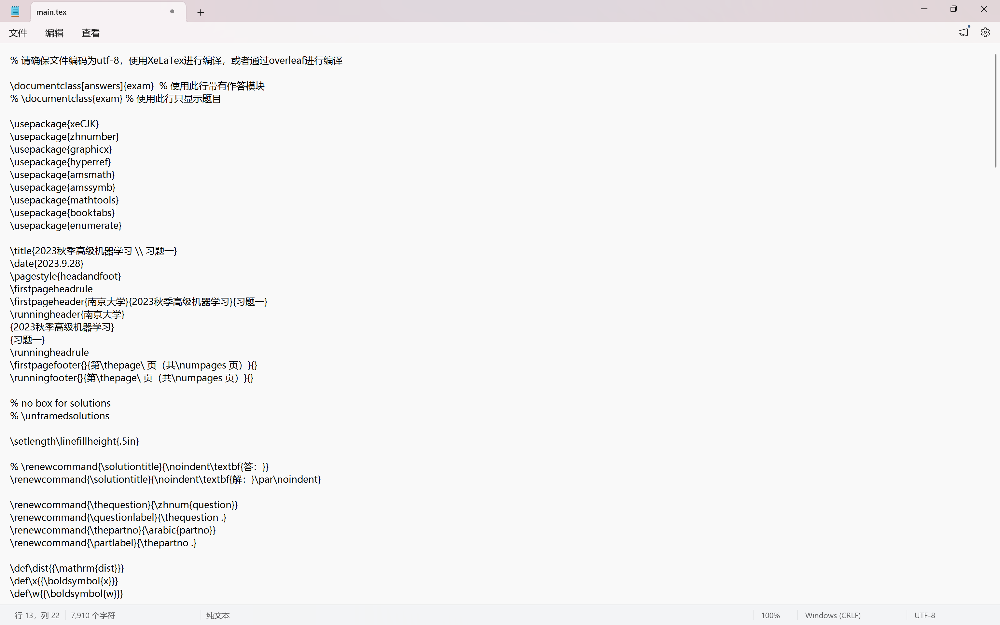

## 6. 编译 main.tex

在终端中进入 `main.tex` 所在文件夹，输入：

```powershell
xelatex main.tex
```

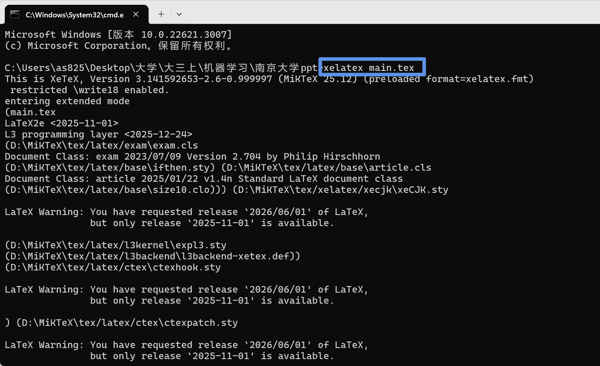

编译成功后，会生成 PDF 和相关辅助文件。常见文件包括：

| 文件 | 作用 |
| --- | --- |
| `main.tex` | 编写的 LaTeX 源代码 |
| `main.pdf` | 编译后的排版结果 |
| `main.log` | 编译过程的日志 |
| `main.aux` | 编译时使用的辅助信息 |

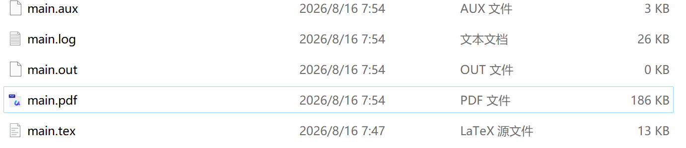

打开 `main.pdf`，就可以查看排版结果。

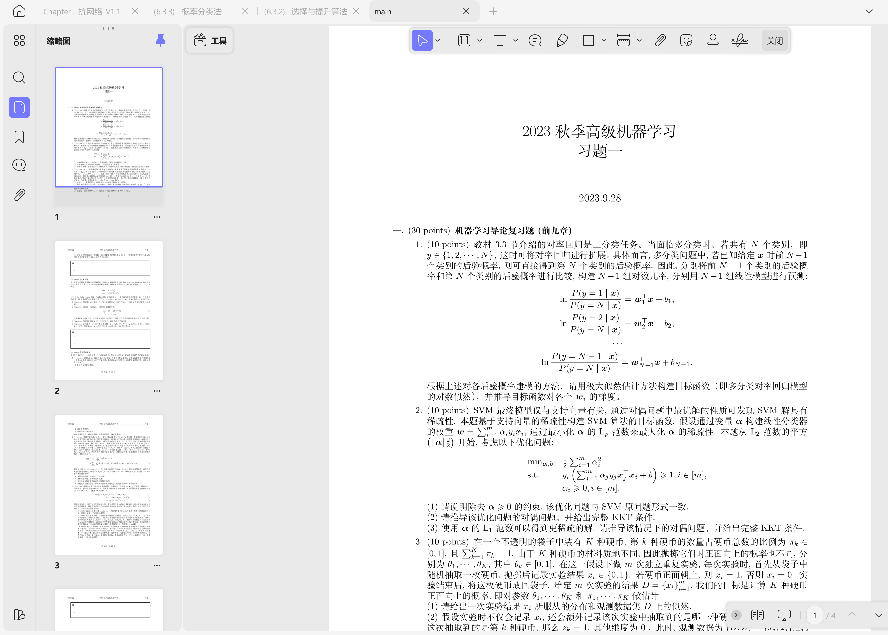

至此，完成一个 LaTeX 文件从编写到编译的过程。
