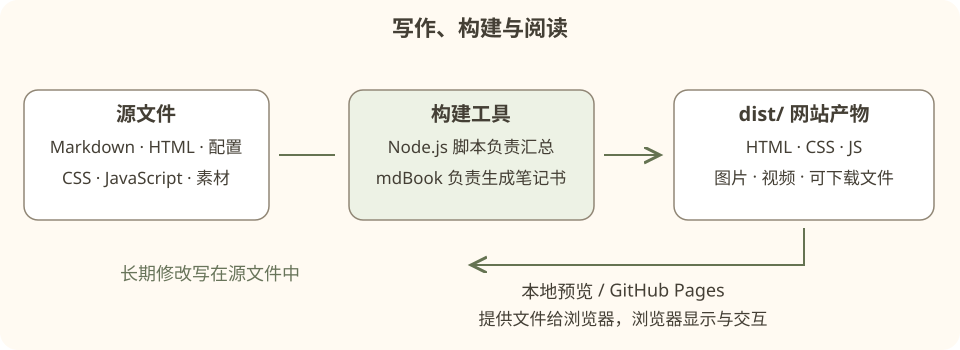

# 01 网页、网站与 my_cs

先从每天看得到的东西开始：在浏览器里打开 my_cs，能看到介绍文字、课程入口、插画和视频。点击课程，又会进入一本有左侧目录的笔记书。

这些页面有不同的来源。理解来源，之后修改网页时就知道该找哪个文件。

## 1. 网页、网站、仓库分别是什么

**网页**是浏览器展示的一份页面。例如 my_cs 的首页，或者“算法设计与分析”的某一篇笔记。

**网站**由多个互相关联的网页和资源组成。课程笔记、生活、资源，以及它们使用的图片和脚本，一起组成 my_cs 网站。

**仓库**保存开发这个网站所需的文件和修改历史。你的本地仓库在 `D:\ml_learning\my_cs`，GitHub 上也有一份。仓库除了网页内容，还有构建脚本、配置和说明文件。

可以对照这几个地址：

| 位置 | 作用 |
| --- | --- |
| `D:\ml_learning\my_cs` | 本地项目文件夹，用编辑器修改 |
| `https://github.com/fangdawei33/my_cs` | GitHub 仓库，查看源码和提交历史 |
| `http://localhost:3000/` | 启动预览服务后，在本机查看网页 |
| `https://fangdawei33.github.io/my_cs/` | 发布后的在线网站，别人也能访问 |

GitHub 仓库页面上显示的 README，是项目的说明。在线网站的首页，则由根目录的 `index.html` 模板生成。两边可以有不同的内容和外观。

## 2. 浏览器拿到什么，才能显示页面

以访问首页为例，可以把过程拆成下面几步：

1. 在地址栏输入网站地址。
2. 浏览器向提供网站文件的服务器请求首页。
3. 收到 HTML，读出标题、段落、导航、图片等结构。
4. 按 HTML 中写的地址，继续取得 CSS、JavaScript、图片等文件。
5. 用 CSS 排版、绘制颜色；执行 JavaScript，让按钮、搜索和轮播工作。

因此，一个页面通常会用到多个文件。HTML 里的一句图片引用，表示“到这个位置拿图片”，图片本身不必塞进 HTML 文本中。

这也解释了“文字有了，图片却显示不出来”：HTML 可以正常到达，但图片的地址、文件名或文件上传出了问题。

## 3. HTML、CSS、JavaScript 各做什么

用当前首页的课程入口举例：

| 技术 | 负责的问题 | 对应现象 |
| --- | --- | --- |
| HTML | 页面有什么内容、如何组织 | 有一个叫“课程笔记”的链接 |
| CSS | 内容长什么样、放在哪里 | 卡片是圆角，四张卡片排成一行 |
| JavaScript | 用户操作后如何变化 | 点击切换素材，输入关键词筛选课程 |

先看一个非常小的 HTML 片段：

```html
<a class="module-card" href="./courses/">
  <h3>课程笔记</h3>
  <p>把知识一点点想明白</p>
</a>
```

它表达的是：这里有一个链接，内部有标题和介绍，点它去 `./courses/`。圆角、背景和间距由 `.module-card` 对应的 CSS 规则决定。

普通链接的跳转由浏览器完成，不需要给每个链接再写 JavaScript。JavaScript 用在需要额外处理的交互上，例如本项目的课程过滤和展示窗口轮播。

第 03 章会用一个可以实际运行的小网页，把这三种文件逐步拆开。

## 4. 为什么平时写 Markdown，也能得到网页

手工写每篇笔记的完整 HTML，会不断重复目录、导航、代码样式等内容。my_cs 使用 **mdBook** 处理课程笔记：你写正文和目录，mdBook 生成配好阅读界面的 HTML。

例如，写作时的文件是：

```text
courses/web开发/src/first-note.md
```

构建后得到：

```text
dist/web开发/first-note.html
```

浏览器访问的是后面的网页。Markdown 是你便于维护的写作源文件。

这里的“构建”，就是运行工具，把源文件整理、转换为可发布的网站文件。



上面的流程图省略了测试、缓存处理等细节；后面的章节会对应到具体脚本。

## 5. 当前网站有哪几类页面

可以按用途理解，而不必一开始就背文件夹名称。

- **首页**：介绍站点和作者，放四个板块入口、图片与视频展示。
- **课程目录页**：汇总所有课程，提供课程搜索。
- **课程笔记页**：每门课独立生成一本 mdBook，管理自己的文章和搜索。
- **生活笔记**：单独一本 mdBook，用于随笔和日常。
- **资源页**：把资料元信息整理成可搜索的清单，提供下载入口。

每门课有自己的内容，但课程和生活共用根目录的阅读主题。首页、课程目录、资源清单，则使用 `web/` 中的页面样式。

## 6. “静态网站”为什么也能播放视频和搜索

当前 my_cs 发布时会提前生成 HTML 等文件。访客打开页面时，GitHub Pages 将这些文件提供给浏览器。这种组织方式属于静态站点。

这里的“静态”描述的是网页文件的生成和提供方式。收到文件后，浏览器依然可以执行 JavaScript、播放视频、切换主题和过滤课程。

例如课程搜索，在浏览器里检查已经生成的课程卡片，隐藏不匹配的项目。这个功能无需每输入一个字就向一个专用数据库查询。

如果以后做“登录后保存个人笔记”“多人评论”“跨设备同步”等功能，就需要另外设计账户、数据存储和服务接口。当前这些功能并未包含在项目里。

## 7. 运行网站时，用的是谁的电脑

不同阶段，执行工作的地方不同：

| 阶段 | 主要使用的资源 |
| --- | --- |
| 本地运行构建、预览 | 你的电脑，运行 Node.js 和 mdBook |
| GitHub Actions 自动构建 | 工作流配置的 GitHub 托管运行器 |
| 访问线上网页、执行搜索和视频播放 | 访客的浏览器；网站文件由托管服务提供 |
| 下载 Notebook 后运行 | 所选 Python/Jupyter 内核所在的本机或远程环境 |

因此，把 `.ipynb` 放进仓库，并不等于已经为读者提供在线算力。网页提供下载，与运行其中的 Python 代码，是两个不同环节。

## 8. 先建立四个习惯

1. 写笔记时编辑课程的 `src/`，改完在 `SUMMARY.md` 加入口。
2. 改首页时编辑根目录 `index.html`、`site.json` 或 `web/`。
3. 在 `dist/` 查看构建结果，回到源文件做长期修改。
4. 区分保存文件、构建网页、提交历史、推送仓库和部署网站，每一步都有自己的作用。

接下来阅读[项目目录与网址](my-cs/目录结构与网址.md)，把这些概念对应到你电脑里实际能看到的文件。
