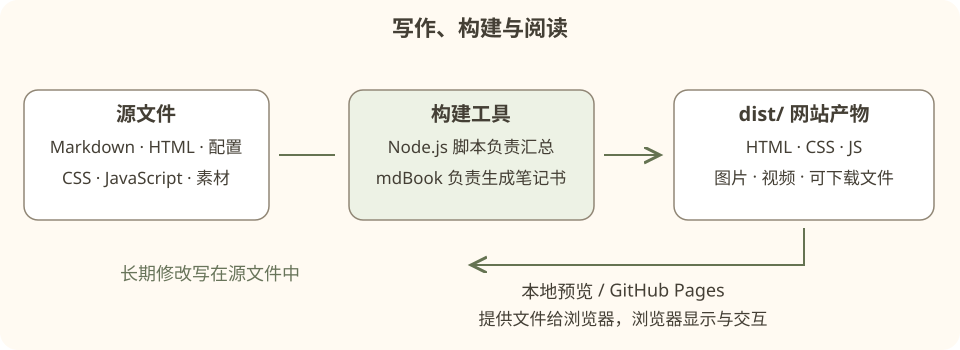

# 04 Markdown 与 mdBook 怎样变成一本书

my_cs 中的大多数课程内容，用 Markdown 写作，再交给 mdBook 生成网页。这个过程把“文章内容”和“整本书的阅读界面”分开维护。

本章跟着一篇新笔记走一遍，从创建文件到加入左侧目录。

## 1. Markdown 文件负责文章内容

`.md` 是 Markdown 文件常用的扩展名。你在纯文本中写标题、段落、列表、代码块等，工具将这些标记转换成 HTML。

先掌握下面几种写法：

````markdown
# 一级标题：文章标题

这里是一段正文。**这部分强调显示**，`index.html` 是行内代码。

## 二级标题：某一个主题

- 列表第一项
- 列表第二项

1. 先做这一步
2. 再做下一步

[链接文字](目标地址)


```javascript
const message = '你好';
console.log(message);
```
````

其中，三个反引号包住代码块；开始位置后面的 `javascript` 告诉阅读工具代码属于什么语言，便于高亮。正文段落、列表和代码块之间保留空行，源码会更清楚。

`#` 表示标题层级。不要为了把文字变大，就把普通句子都写成一级标题：标题应体现内容之间的结构。

## 2. mdBook 又负责什么

mdBook 根据目录、正文和配置，生成一组网页。你在课程里看到的左侧目录、页面之间的导航、主题和搜索等，属于阅读界面的组成部分。

一门课的基本输入是：

```text
book.toml            这本书的设置
src/SUMMARY.md       有哪些文章、顺序和层级
src/文章.md          实际正文
src/images/...       文章使用的图片
```

my_cs 让多门课程分别构建为独立的书，再把它们汇总进同一个站点。修改机器学习课程的目录，不会把它自动变成 Web 开发课程的目录。

## 3. 三种“目录”不要混在一起

| 名称 | 由什么产生 | 显示在哪里 |
| --- | --- | --- |
| 全部课程的清单 | 扫描各课程 `course.json` | 网站的课程目录页 |
| 一本课程的文章目录 | 本课程 `src/SUMMARY.md` | 书的左侧 |
| 当前文章内的小节目录 | 正文的 `##`、`###` 等标题 | 阅读主题的页内目录区域 |

例如你在一篇文章中增加 `## 常见错误`，会影响这篇文章的结构；想让另一篇新文章出现在左侧，需要修改 `SUMMARY.md`。

## 4. SUMMARY.md 怎样写

先看一个教学示例：

```markdown
# 目录

[课程介绍](introduction.md)

- [基础知识](基础/README.md)
  - [HTML 入门](基础/HTML入门.md)
  - [CSS 入门](基础/CSS入门.md)
- [我的实践记录](实践记录.md)

[学习资料](resources.md)
```

这里的每一个方括号是左侧显示的文字，后面的括号是 Markdown 文件路径。路径从 `src/` 开始计算。

缩进表示父子关系。`HTML 入门` 和 `CSS 入门` 缩进在“基础知识”下面，于是形成子章节。这里使用两格缩进，与本项目现有目录习惯一致。

mdBook 对 `SUMMARY.md` 的格式有特定要求，完整结构见 [mdBook 官方目录说明](https://rust-lang.github.io/mdBook/format/summary.html)。本项目会在构建前核对目录引用的 `.md` 是否存在，拼错路径会直接报错。

### 保存了文章，为什么左侧还没有

因为创建文件和登记目录是两个动作。一本书需要知道要把哪些文件作为章节，以及它们的顺序。

反过来，只在目录里写一个名字，却没创建对应正文文件，也不能完成一篇笔记。

## 5. book.toml 是这本书的配置

当前 Web 开发课程的配置主要包括：

```toml
[book]
title = "Web 开发"
authors = ["my_cs"]
language = "zh-CN"
src = "src"

[output.html]
theme = "../../theme"
additional-css = ["theme/custom.css", "theme/my-cs.css"]
additional-js = ["theme/site.js"]
default-theme = "light"
no-section-label = true
mathjax-support = true
```

逐项理解：

- `[book]`：这一组设置描述书本身。
- `title`：书名，在课程阅读界面使用。
- `authors`：作者列表，方括号表示可以有多个值。
- `language`：内容语言。
- `src`：正文源目录。
- `[output.html]`：这一组设置描述 HTML 输出。
- `theme`：使用项目共用的阅读主题。
- `additional-css`、`additional-js`：额外加载的样式和脚本。
- `no-section-label`：当前项目关闭默认章节编号显示。
- `mathjax-support`：启用数学公式支持。

这是 TOML 配置格式。它与 JSON 都可以保存设置，但语法不同；照着各自文件的现有格式修改。完整配置入口见 [mdBook 官方配置文档](https://rust-lang.github.io/mdBook/format/configuration/index.html)。

## 6. course.json 为什么还要存在

mdBook 本身主要管理一本书。my_cs 还要有一个“所有课程放在一起”的入口，因此增加了自己的课程元信息文件：

```json
{
  "title": "Web 开发",
  "description": "记录前端基础与自己的建站实践。",
  "order": 200
}
```

这段是教学示例。实际值以本课程 `course.json` 为准。

- `title`：课程卡片名称。
- `description`：卡片上的介绍。
- `order`：排序依据，较小的数字排在前面。

例如 `book.toml` 的书名与 `course.json` 的标题分别由不同环节读取。如果修改课程名称，希望卡片和书内都一致，就需要检查这两个位置。

## 7. 实际添加一篇笔记

假设想记录“我第一次修改网站的过程”，可以按下面的步骤操作。

### 第一步：创建正文文件

在 VS Code 左侧找到：

```text
courses/web开发/src/my-cs/
```

新建 `我的第一次修改.md`，写入：

```markdown
# 我的第一次修改

## 我想做什么

修改首页的介绍文字。

## 我修改了哪里

编辑了根目录 site.json 中的 introduction。

## 我观察到什么

保存后等待本地重新构建，刷新浏览器，看到了新的介绍。
```

### 第二步：登记到课程目录

打开 `courses/web开发/src/SUMMARY.md`，在合适位置加一行：

```markdown
- [我的第一次修改](my-cs/我的第一次修改.md)
```

文件名和目录里的路径要完全一致。英文大小写也要一致，避免本地 Windows 看似能用，部署到区分大小写的环境后失效。

### 第三步：预览

启动项目预览服务，或让已运行的服务完成重新构建，再刷新课程页面。查看左侧是否出现标题、点击后是否能打开正文。

这个完整流程在第 05 章讲解。现在先记住：**正文文件、课程目录、构建预览**要连起来看。

## 8. 图片放在哪里，怎么写路径

本课程的构建流程图位于：

```text
courses/web开发/src/images/my-cs/网站构建流程.svg
```

若在当前这种 `src/my-cs/某篇文章.md` 中引用它，写法是：

```markdown

```

原因是当前文章位于 `my-cs/` 子目录，需要先向上一层回到 `src/`，再进入 `images/`。

如果文章直接位于 `src/`，例如 `first-note.md`，则写：

```markdown

```

图片不应只存在于原来编辑器的缓存或个人桌面路径里。读者访问的是网站能提供的文件，因此要把公开使用的配图一起放进项目。

## 9. README.md 生成后的名字有点特殊

mdBook 会把书内的 `README.md` 作为目录入口输出为 `index.html`。例如：

```text
src/基础/README.md
        ↓
dist/web开发/基础/index.html
```

`SUMMARY.md` 中仍按源文件登记：

```markdown
- [基础知识](基础/README.md)
```

而从正文链接到那个专题入口时，在适当位置使用目录路径：

```markdown
[进入基础知识](基础/)
```

上面的相对路径适用于正文在课程根层的例子；正文更深时仍要调整层级。这能避开把入口错误地链接成 `README.html` 的问题。

## 10. 代码与 HTML 演示怎么保留

代码很适合放在 Markdown 的代码块中。希望读者下载运行的 `.py`、`.ipynb` 等文件，可以放到课程的 `experiments/`。

AI 生成的完整 HTML 演示可以单独放到 `src/demos/`，再从文章链接或用 iframe 嵌入。这样它自己的样式和脚本留在独立页面中。

第 03 章的三文件网页就是这种做法：HTML、CSS、JavaScript 都保存在 `src/demos/mini-site/`，构建后也一起提供给浏览器。

本课程展示示例源码时，使用了 mdBook 的文件引入功能：在代码围栏里使用 include 指令，并指定示例文件的相对路径。这样修改示例文件后，书里的代码块也能跟着更新。平时写普通笔记，可以先直接粘贴代码块，熟悉后再使用这一功能。

下一章阅读[构建脚本与本地预览](构建与本地预览.md)，看这些输入是怎样被组织成网站的。
