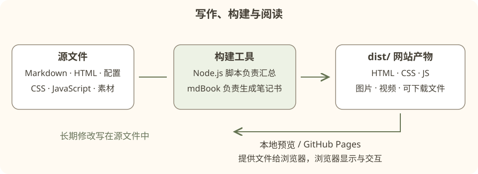

# 08 常见问题与动手练习

遇到问题时，先判断它发生在哪个环节：编辑源文件、构建、浏览器读取、Git 提交，还是线上部署。

这一章先给出可复用的排查步骤，再安排几个由浅入深的练习。

## 1. 先记录四条信息

发生错误时，先留下：

1. 我在哪个文件夹执行命令？
2. 我输入的完整命令是什么？
3. 终端的第一处具体错误是什么？
4. 我打开的完整网址是什么？

例如“网页没变”还不够具体。补充成“我改了 `site.json`，本地构建已完成，但打开的是线上 `/my_cs/`”，就能发现还没有经过提交、推送和部署。

## 2. 找不到 package.json：ENOENT

可能看到类似：

```text
npm error code ENOENT
Could not read package.json
```

`ENOENT` 表示要访问的文件或路径不存在。先检查当前目录，再切换回项目：

```powershell
Get-Location
cd D:\ml_learning\my_cs
Get-Item .\package.json
npm.cmd run dev
```

应从包含本项目 `package.json` 的目录执行命令。`D:\ml_learning` 是项目的父目录，与 `D:\ml_learning\my_cs` 是两个位置。

## 3. npm.ps1 被阻止运行

如果 PowerShell 提示无法执行 `npm.ps1`，可以先换用：

```powershell
npm.cmd run dev
```

其他命令同理，例如 `npm.cmd run build`。这种处理让当前任务继续使用 npm，通常不需要为了它修改整台电脑的脚本执行策略。

## 4. mdBook 缺失、版本不对或下载失败

项目的工具准备命令是：

```powershell
npm.cmd run setup
```

脚本要求的项目版本为 0.4.52。确认工具位于本项目 `.tools/`，不要将“另一个目录里有一个 mdBook”当成当前项目已准备好。

下载失败时，先看是否是网络错误、HTTP 错误或解压错误。保留具体日志，再根据出错阶段处理。不要通过删除课程正文来修复工具下载问题。

## 5. 页面直接显示双大括号里的变量

如果首页出现昵称占位符，先检查你是不是直接打开了根目录的首页源模板。

完整首页需要构建脚本读取配置，再填充模板。正常预览方式是运行 `npm.cmd run dev`，然后从它输出的 `http://localhost:端口/` 打开。

也要确认这个端口对应的是本项目服务。另一个工具即使也能提供文件，也未必执行 my_cs 的模板替换。

## 6. 图片只有文字，或者出现破损图标

按这条顺序排查：

1. 图片是否已经复制进项目，而不是仅存在于桌面或原编辑器缓存？
2. 文件名、扩展名、英文大小写是否与引用完全一致？
3. 文章放在哪一层？相对路径需要几个 `../`？
4. 图片应该归课程 `src/images/`、网站 `web/`，还是 README 的 `assets/`？
5. 构建之后，`dist/` 的对应位置是否有这个图片？
6. 线上版本是否已经包含图片文件和引用它的提交？

比如当前文章在 `src/my-cs/`，引用课程图片要写：

```markdown

```

而首页的 `web/media/旅行.jpg` 构建后对应 `assets/media/旅行.jpg`。不要只因为两个位置都能“放图片”，就混用同一个路径。

## 7. 正文写好了，左侧目录没有更新

先看源文件：

```text
courses/目标课程/src/SUMMARY.md
```

确认新文章已经登记，而且路径确实存在。然后确认构建已完成，浏览器打开的是你修改的课程。

本项目会给生成的目录资源加入随内容变化的版本标识，以减少旧缓存带来的影响。部署完成后仍出现旧界面，可以再尝试 `Ctrl+F5` 强制刷新。

页面内的右侧小节目录由正文标题产生，与左侧 `SUMMARY.md` 不同。想增加一个小节，用 `##` 等标题；想增加一篇文章，创建 `.md` 并登记到 `SUMMARY.md`。

## 8. 我改了 dist，怎么下一次又变回去了

因为 `dist/` 是输出目录，构建脚本会重新生成。

按改动目标回到源文件：

| 想保留的修改 | 应编辑 |
| --- | --- |
| 首页某句话 | `site.json` 或根目录 `index.html` |
| 首页卡片样式 | `web/home.css` |
| 课程正文 | 对应课程 `src/文章.md` |
| 课程左侧目录 | 对应课程 `src/SUMMARY.md` |

重新构建后再观察结果。

## 9. git push 说已经最新，GitHub 却没变化

先运行 `git status`。如果文件仍在修改区或暂存区，说明还没有把这份修改作为提交推送出去。

对照第 07 章，按“选中文件 → 暂存 → 中文提交 → 推送”处理。如果仓库已经有新提交，但网站没变，再到 Actions 看对应部署。

仓库文件、工作流产物、浏览器中的页面分属不同环节，逐个确认比反复刷新同一页面更有效。

## 10. LF、CRLF 警告是什么

它们是文本换行的两种表示方式。Git 可能提示某个文件下次处理时会进行换行转换，这类 warning 本身不等同于提交失败。

my_cs 已有 `.gitattributes` 约定文件处理方式。先看命令是否真正报错、`git status` 是否符合预期，不必仅因看到换行警告就批量重写所有文件。

## 11. dubious ownership 是什么意思

Git 检测到仓库所属的系统账号与当前执行账号不同，会要求确认这个目录是否可信。你之前由不同账号创建或操作本地文件时，可能遇到过它。

如果已经确认 `D:\ml_learning\my_cs` 是自己信任的项目，可按 Git 提示只为这个目录增加例外：

```powershell
git config --global --add safe.directory D:/ml_learning/my_cs
```

这是 Git 的可信目录配置，不是在上传文件，也不会替代 `add`、`commit` 或 `push`。只有出现这个具体问题、确认目录可信时才需要处理。

## 12. 换一台电脑，怎样重新搭建现有项目

准备好 Git 和满足项目要求的 Node.js 后，取得仓库源码，再准备 mdBook 和启动预览。

如果想在当前电脑另外练习一份，可以使用不同的文件夹和端口：

```powershell
cd D:\ml_learning
git clone https://github.com/fangdawei33/my_cs.git my_cs-practice
cd my_cs-practice
npm.cmd run setup
npm.cmd run dev -- --port 3001
```

然后访问 `http://localhost:3001/`。已有 `my_cs-practice` 时不要把它当作空目录重复克隆，选择另一个清楚的练习目录即可。

克隆会保留原仓库的远程地址。它适合练习和继续开发同一项目；如果想发布成另一个独立网站，需要另外准备自己的 GitHub 仓库和对应远程配置。

## 13. 从空白开始做同类网站，可以分几个阶段

现在已经有完整的 my_cs，不必一开始重写所有脚本。想学习建站过程，可以按这些小阶段逐步重建：

| 阶段 | 做什么 | 能观察到的结果 |
| --- | --- | --- |
| 一个页面 | 按第 03 章建立 HTML、CSS、JS 三个文件 | 能显示标题、换样式、点击按钮 |
| 一本笔记 | 准备 mdBook，写 Markdown、目录和配置 | 出现有导航和搜索的课程书 |
| 多本笔记 | 每门课独立目录，汇总链接 | 一个首页能进入不同课程 |
| 统一构建 | 用 Node.js 读取配置、调用工具、复制素材 | 一次命令生成完整 `dist/` |
| 本地预览 | HTTP 服务提供生成的文件 | 从 localhost 查看整站 |
| 在线发布 | Git 记录源码，Actions 构建，Pages 托管 | 别人能从网址访问 |

每完成一层，就观察输入文件和输出结果。这样再读 `scripts/build.mjs`，就能理解它是在把前面几件小事连接起来。

## 14. 建议按顺序完成的练习

### 练习一：改三文件教学网页

位置：`courses/web开发/src/demos/mini-site/`。

修改标题、背景颜色和按钮每次增加的次数。预期结果：能分别指出 HTML、CSS、JavaScript 的改动对应哪个现象。

### 练习二：增加一篇自己的学习记录

在 `src/my-cs/` 中创建一篇 `.md`，登记到 `SUMMARY.md`。预期结果：左侧目录出现新文章，能点进去阅读。

### 练习三：给文章放一张本地图片

把准备公开的图片复制到本课程 `src/images/`，从文章按相对路径引用。预期结果：构建后图片能显示，引用不依赖个人桌面路径。

### 练习四：修改首页介绍

只编辑 `site.json` 的 `introduction`，等待重新构建并刷新。预期结果：首页介绍变化，昵称与布局仍能正常显示。

### 练习五：为一个展示窗口增加素材

把素材放进 `web/media/`，按第 06 章修改 `web/gallery.json`。预期结果：窗口有多个素材，出现切换控件，素材可以依次展示。

### 练习六：完成一次发布

先更新相关说明、确认改动范围，再执行中文提交和推送。预期结果：GitHub 出现相应提交，Actions 部署成功，线上对应页面更新。

这些练习供后续自己操作。本次写入的教程没有自动创建练习用课程，也没有替你修改首页配置。

## 15. 阅读源码时的检查问题

打开一个文件，试着回答：

- 它的输入是什么？比如一个 JSON、一批 Markdown 或浏览器中的点击事件。
- 它什么时候运行？构建时、启动服务时，还是读者打开网页后？
- 它输出或改变了什么？磁盘文件、HTML 字符串，还是页面上一段文字？
- 想长期保留这次修改，应该编辑哪一个源文件？

把这几个问题对应到实际文件，比一开始就背下所有函数名称更容易形成完整认识。

需要进一步查概念时，回到[学习资料](../resources.md)按主题阅读官方文档。
