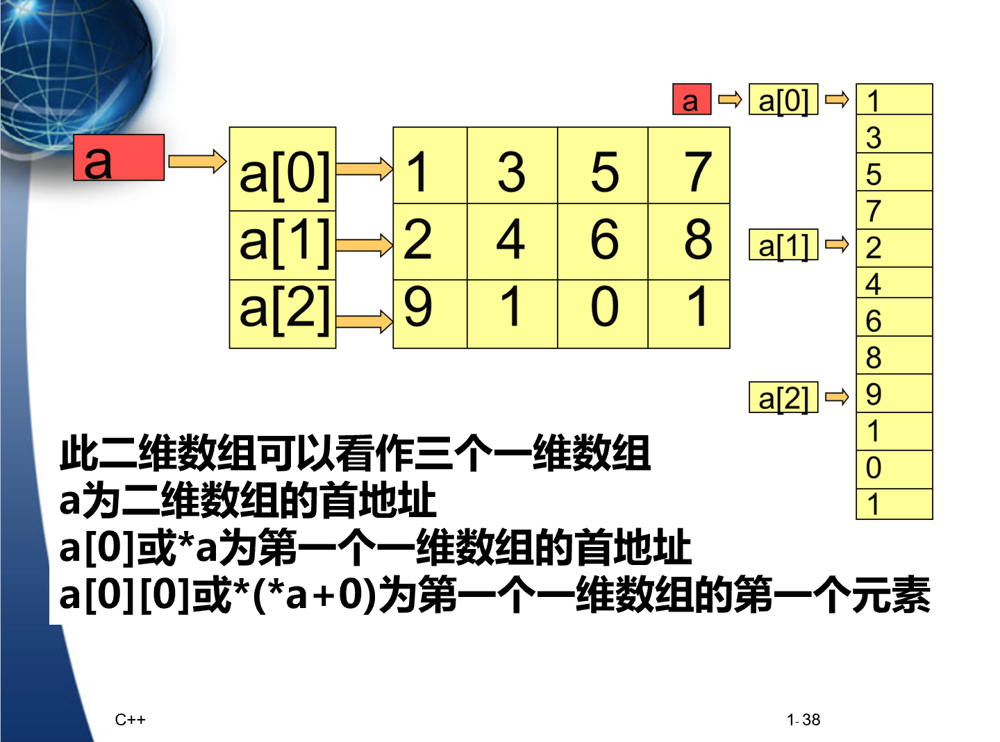

# 二维数组初探

<!-- 原笔记：二维数组初探.md -->




> a
a指向的是整个一维数组(数组元素由首列元素构成)，由于步长是一行的长度，这样就可以理解为指向的是第0列元素组成的数组，参与运算或者打印出来，也是退化成指向一维数组（数组元素由首列元素构成）

*a为第一行数组的首地址

tips：这个一维数组不是一行，可以理解为一列

a+1  指向2
a[0]+1 指向3

> a[i]
a[i]表示第i行的整个一维数组，参与运算或者打印&a[i]时，a[i]会退化为指向第i行第0个元素的指针，里面存的是该元素的地址


> ```cpp
> a[i][j]==*(a[i]+j)==*(*(a+i)+j)
> ```
如：*(a[i]+j)  这时这样理解，a[i]是第i列第0个元素的指针，存储的是该元素的地址,+j，步长是一个元素所占的字节数  ， *运算符把里面的内容取出来，就是元素了，
等价于a[i][j]

```cpp
*(*(a+i)+j)

```

a指向第0行,a+i指向第i行     *(a+i)指向第i行第0个元素，变成了一级指针， *(a+i)+j指向第i行第j个元素，
