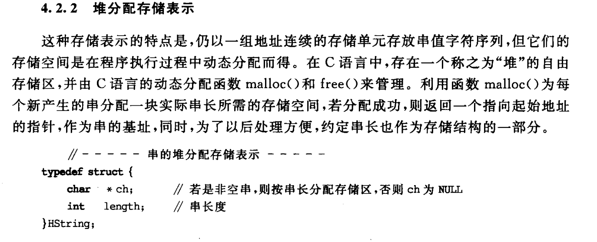
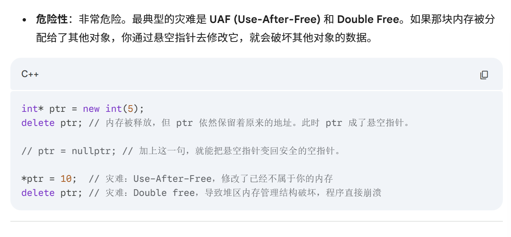

# 内存与指针综合笔记

<!-- 原笔记：内存分区.md -->

写在之前，不要妄想学完所有知识，你是学不完的，所以要脚踏实地。


静态内存分配
static memory allocation

在编译阶段，就已经确定了内存的大小

局限性内存浪费、不够用

典型的例子就是静态数组

静态数组采用的是顺序映像，也就对应着顺序存储结构，即逻辑地址是连续的，物理地址也是连续的：用一组地址连续的存储单元顺序存放数组中的元素


动态内存分配

dynamic memory allocation


数据结构 第4章 串和第8章 动态存储管理

c语言使用系统提供的库函数来实现对内存的动态分配，c++也兼容此做法
主要的库函数
- malloc
- calloc
- realloc
- free


c++还提供new和delete操作符来实现动态内存分配


## new 和 new []

new 用来分配一个对象（并非面向对象中的对象，可以是面向对象中的对象，也可以是普通对象）的内存，返回的是内存空间的地址

new []用来分配一段连续的内存空间，指向数组的第一个元素

```cpp

//申请一个int 型大小的堆内存空间
int *p1 = new int;

//申请一个int型大小的堆内存空间，并初始化为10
int *p2 = new int(10);

//申请5个int 型 大小的堆内存空间
int *p3 = new int [5];

// ❌ 语法错误！C++ 不支持这种动态数组初始化
int *p4 = new int[5]={1,2,3,4,5};

// ❌ 语法错误！C++ 不支持这种动态数组初始化
int *p5=new int [5]={1};

```


## delete 和 delete[]


```cpp


delete p1;

delete [] p3;

```


## NULL和 nullptr

NULL
在 C++ 中，NULL 通常被宏定义为整数 0（而在 C 语言中，它可以是 (void*)0）。
在本质上是一个整型，而不是指针。这会导致在函数重载时产生严重的二义性。

nullptr 类型是std::nullptr_t  可以隐式转化为任何类型的指针，但绝对不能转换成整型。

```cpp

void func(int x) {
    cout << "调用了 func(int)" << endl;
}

void func(int* ptr) {
    cout << "调用了 func(int*)" << endl;
}

int main() {
    func(NULL);    // 编译器会调用 func(int)，这通常违背了程序员传递空指针的本意！
    func(nullptr); // 准确无误地调用 func(int*)
    return 0;
}

```


## 野指针、空指针和悬空指针

空指针（Null Pointer）
被明确赋值为 nullptr（或 NULL）的指针。

野指针(Wild Pointer)
未初始化的指针

```cpp

int *ptr; //野指针
*ptr=10;

```

悬空指针 (Dangling Pointer)
曾经指向一块有效的动态内存（堆区），但是那块内存被 delete 或 free 释放了，而指针本身没有被置空。

先背一下八股




防野指针：指针声明时，必须立刻初始化。哪怕不知道指向哪，也要写 int* p = nullptr;。

防悬空指针：delete 释放内存后，必须紧跟着把指针置为 nullptr。


1. 栈区 Stack

存放局部变量和函数形参
函数结束时自动释放

特点：连续内存、先进后出/后进先出/FILO、空间小、速度快


如：线性表的顺序表示即静态数组


2. 堆区 Heap

可以“手动”管理的存储区

new delete malloc realloc free等实现

特点：不连续、空间大、速度慢、易产生碎片


3. 全局区/静态区

存放已/未初始化的全局变量：
- static修饰的或者
- 在函数外定义的变量

.data 段：存放已初始化且初始值不为 0 的全局变量和静态变量。

.bss 段：存放未初始化或初始化为 0 的全局变量和静态变量。操作系统在加载程序时，会自动将 BSS 段所在的内存区域清零，因此这部分在可执行二进制文件中不占用实际的磁盘空间。


4. 常量区(.rodata)

read only data
- 字符常量
- const修饰的常变量

5. 代码区(.text)
这里存放着程序编译后的机器指令序列。只读的。


```cpp

#include <iostream>
using namespace std;

class Student
{
public:
    Student(int = 0);
    Student(Student &);
    ~Student();

private:
    int age;
};

Student::Student(int age)
{
    this->age = age;
    cout << "Constructor " << this->age << endl;
}
Student::Student(Student &s)
{
    age = s.age + 30;
    cout << "Copy Constructor " << this->age << endl;
}
Student::~Student() { cout << "Destructor " << age << endl; }

void test()
{
    Student s4(4);
    static Student s5(5);
    Student s6(6);
    Student s7(s4);
    cout << "test is called" << endl;
}

Student s1(1);
int main()
{
    Student s2(2);
    static Student s3(3);
    Student s8(8);
    Student s9(s2);
    test();
    cout << "main end" << endl;

    return 0; // 然后析构主函数其他的对象，最后析构全局对象s1和静态对象s3和s5。
}

```
