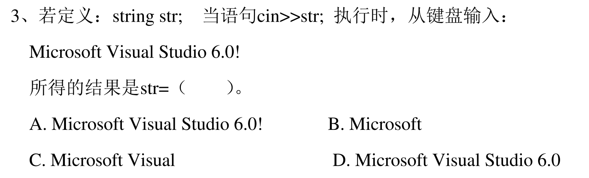
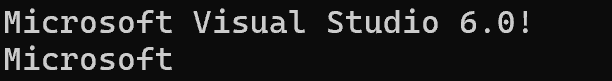
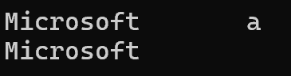
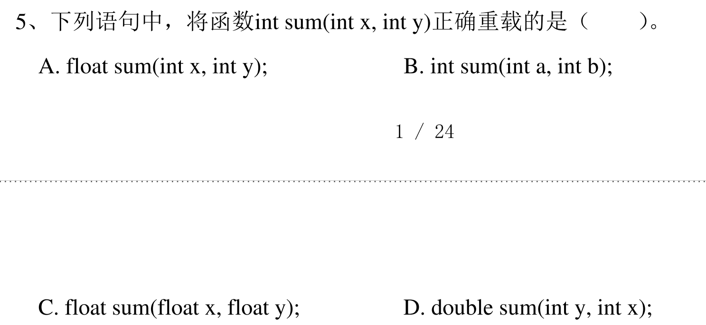
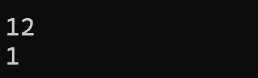

# 输入输出与语法细节

<!-- 原笔记：小知识点.md -->

1. cin遇到空白字符停止读取



```cpp
#include <iostream>
#include <string>

using namespace std;

int main(){
    string str;
    cin>>str;
    cout<<str;

    return 0;
}

```


tab键，其实就是空格


2. 能否函数重载的判断



做的时候选对了，但是在D选项纠结了，我之前记得是，光返回值类型不同是不能重载的，然后，判断依据是参数不同，与返回值无关
参数不同，分为：参数的数量不同，参数的类型不同和参数的位置不同这三个

我以为参数位置不同是包括了形参名不同，但其实就是参数类型不同的一个子集，即相同位置的参数类型不同

3. c中两个字符相减

c中，两个字符相减时，会自动隐式转换成ASCLL码参与计算

第二个要注意的时，数组名是一个指针变量，里面存储的是数组中第一个元素的首地址


```cpp
#include <iostream>
#include <string>

using namespace std;

int main(){

    char str1[10]="a";
    char str2[10]="b";

    //c中两个字符相减的结果返回的是int型

    int res=*str1-*str2;
    //数组名是一个地址常量，


    cout<<"str1-str2:"<<res;

    return 0;
}

```

接下来实现一个库函数strcmp

> 这个函数在string.h 而不是string中


是这样比较的，第一个不相同的字符相减，三种情况，大于0，小于0，等于0
而不是看谁的字符多

```cpp
#include <iostream>
#include <string.h>

using namespace std;

int my_strcmp(char * str1,char * str2){

    while(*str1==*str2&&*str1!='\0'){
        str1++;str2++;
        //这里的数组名就变成了指针变量
    }

    return *str1-*str2;
}

int main(){
    char str1[10]="an";

    char str2[10]="abc";

    cout<<my_strcmp(str1,str2)<<endl;

    cout<<strcmp(str1,str2);


    return 0;
}

```


我们可以看到，输出结果是不同的，这是由编译器决定的，库函数中只管正负还是0

3. 数组作为函数的参数

```cpp

type a(char * a,char a[]);
//这两个是等价的，传实参时，传地址就可以
//传数组名也可以
```

```cpp
#include <stdio.h>

int my_strcmp(char *a, char *b) {
    while (*a == *b && *a != '\0') {
        a++;
        b++;
    }
    return *a - *b;
}

int main() {
    char str1[] = "an";
    char str2[] = "abc";

    // 方式1：传数组名（最常用）
    int res1 = my_strcmp(str1, str2);

    // 方式2：传&数组元素（显式地址）
    int res2 = my_strcmp(&str1[0], &str2[0]);
    在 C/C++ 中，对一个 char 类型取地址（&），编译器规定它的结果的数据类型就是 char *。
    // 方式3：传指针变量（你问的这种）
    char *p1 = str1;  // p1是指针变量，存str1首元素地址
    char *p2 = str2;  // p2是指针变量，存str2首元素地址
    int res3 = my_strcmp(p1, p2);  // 传指针变量

    // 三种方式输出结果完全一样
    printf("res1=%d, res2=%d, res3=%d\n", res1, res2, res3);
    return 0;
}

```

4. 数组名是常量指针，代表数组首元素地址，而不是指针变量

int a [10] ={1};
//相当于把&a[0]赋值给了数组名

当数组名做函数实参传递给函数时，他会自动退化成成指向第一个元素的指针，不再是常量

在 C/C++ 中，对一个 char 类型取地址（&），编译器规定它的结果的数据类型就是 char *。

总结
> 必须传同类型的，一切与这个规则相悖的，都是编译器在作祟
