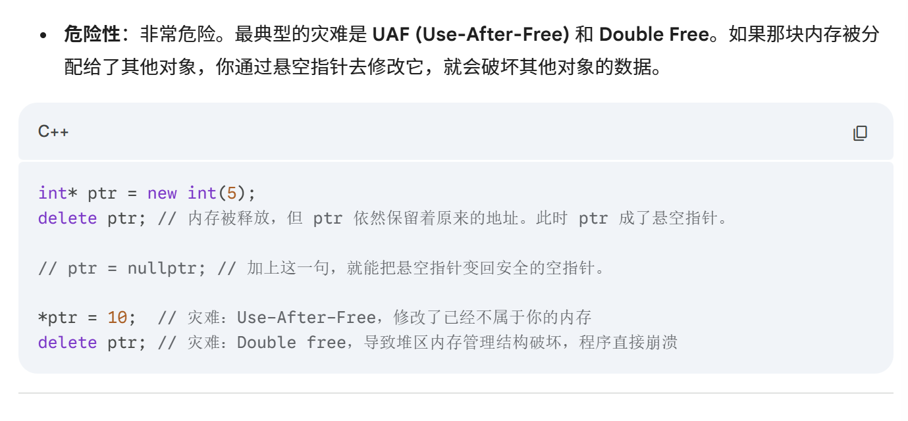

# 野指针、空指针与悬空指针

<!-- 原笔记：野指针、空指针和悬空指针.md -->

空指针（Null Pointer）
被明确赋值为 nullptr（或 NULL）的指针。

野指针(Wild Pointer)
未初始化的指针

```cpp

int *ptr; //野指针
*ptr=10;

```

悬空指针 (Dangling Pointer)
曾经指向一块有效的动态内存（堆区），但是那块内存被 delete 或 free 释放了，而指针本身没有被置空。

先背一下八股




防野指针：指针声明时，必须立刻初始化。哪怕不知道指向哪，也要写 int* p = nullptr;。

防悬空指针：delete 释放内存后，必须紧跟着把指针置为 nullptr。
