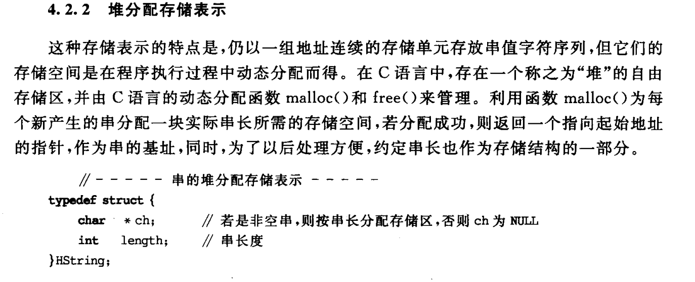

# 静态与动态内存分配

<!-- 原笔记：静态内存分配和动态内存分配.md -->

静态内存分配
static memory allocation

在编译阶段，就已经确定了内存的大小

局限性内存浪费、不够用

典型的例子就是静态数组

静态数组采用的是顺序映像，也就对应着顺序存储结构，即逻辑地址是连续的，物理地址也是连续的：用一组地址连续的存储单元顺序存放数组中的元素


动态内存分配

dynamic memory allocation


数据结构 第4章 串和第8章 动态存储管理

c语言使用系统提供的库函数来实现对内存的动态分配，c++也兼容此做法
主要的库函数
- malloc
- calloc
- realloc
- free


c++还提供new和delete操作符来实现动态内存分配


## new 和 new []

new 用来分配一个对象（并非面向对象中的对象，可以是面向对象中的对象，也可以是普通对象）的内存，返回的是内存空间的地址

new []用来分配一段连续的内存空间，指向数组的第一个元素

```cpp

//申请一个int 型大小的堆内存空间
int *p1 = new int;

//申请一个int型大小的堆内存空间，并初始化为10
int *p2 = new int(10);

//申请5个int 型 大小的堆内存空间
int *p3 = new int [5];

// ❌ 语法错误！C++ 不支持这种动态数组初始化
int *p4 = new int[5]={1,2,3,4,5};

// ❌ 语法错误！C++ 不支持这种动态数组初始化
int *p5=new int [5]={1};

```


## delete 和 delete[]


```cpp


delete p1;

delete [] p3;

```
