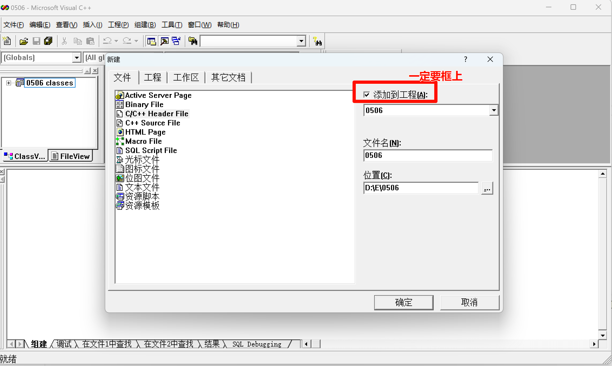
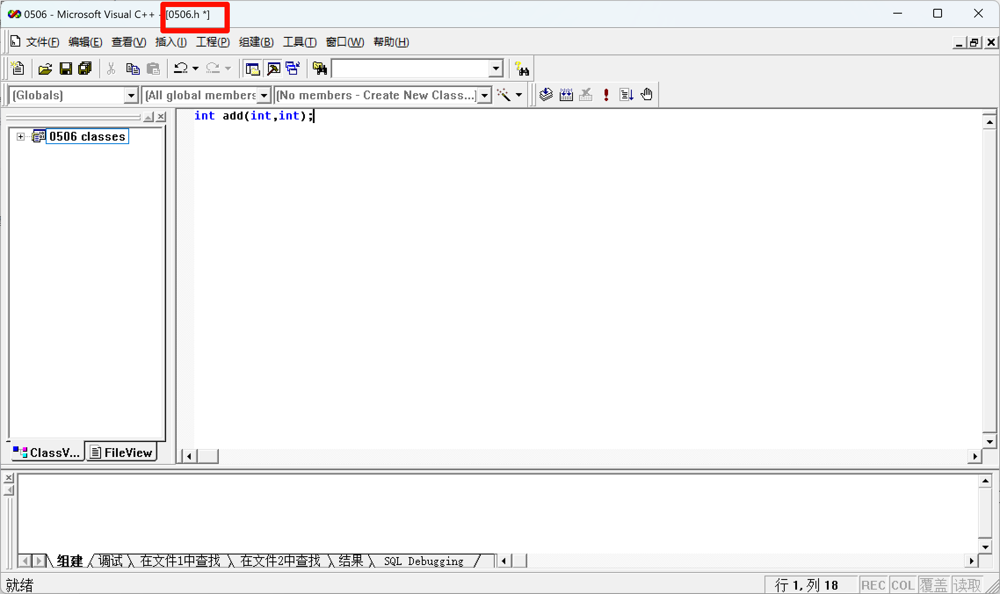
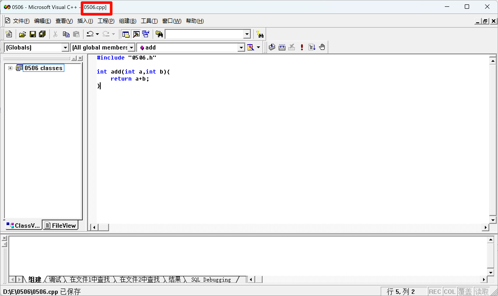
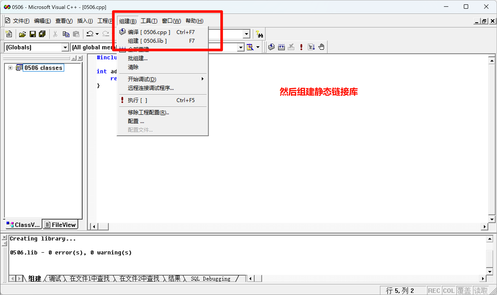
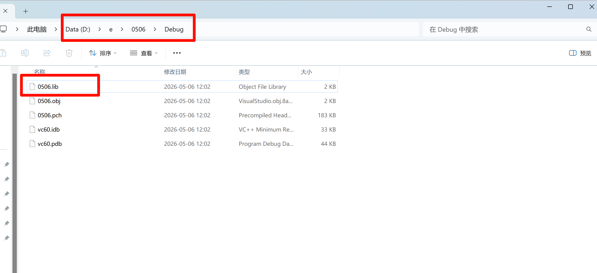
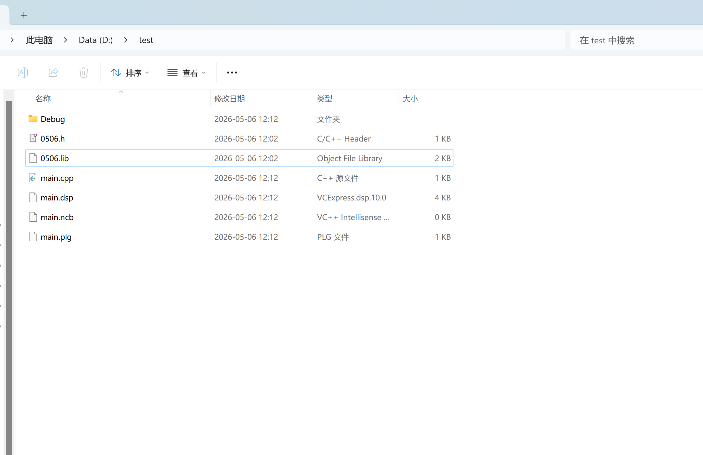
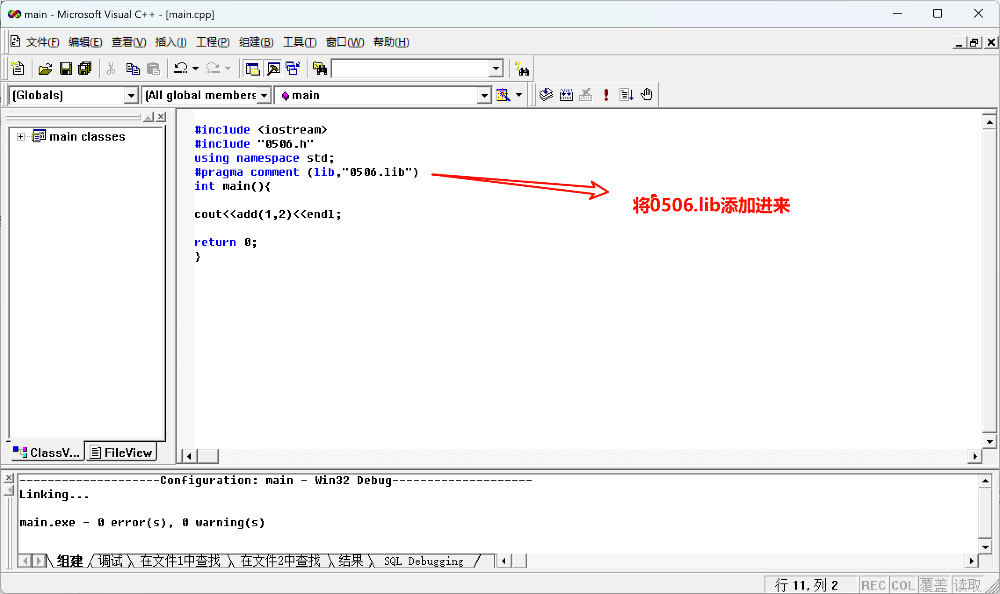
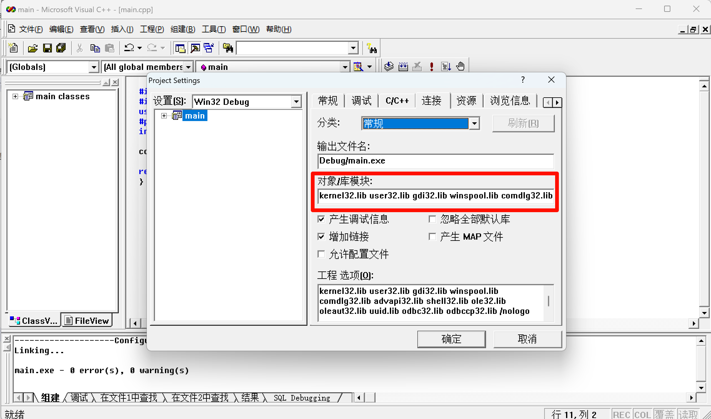

# DLL 与 LIB 课堂笔记

<!-- 原笔记：第十周_周三笔记.md -->

一节课多一点讲的第十章输入输出流和第十一章异常处理
剩下的时间在讲动态链接库和静态链接库
这两张内容太多了，暂时没听懂

## DLL和LIB
C:\Windows\System32

user32.dll
kernel32.dll
gdi32.dll
kernel32：内核・程序 & 文件
user32：用户・窗口 & 输入
gdi32：图形・绘图 & 文字

lib静态链接库
dll动态链接库

### 静态链接库
文件->新建->工程->win32 static library

在e文件夹，创建win 32 static library项目后
创建头文件

声明一个add()函数

实现add()函数

组建静态链接库

此时，e\\debug文件夹下会生成一个0506.lib文件

给别人用时要把0506.lib文件和0506.h文件都发给别人

新建test测试文件夹
把0506.h和0506.lib文件放到test文件夹

编译链接得到输出结果

如果不在代码中写，可以通过 工程->设置->连接->对象/模板库 最后面 加一个空格在输入你要添加的lib库

