# String 与 STL 寒假笔记

<!-- 原笔记：寒假学习-cnblog.md -->


https://www.icourse163.org/course/PKU-1002029030


## String类和标准模板库

这个是大二寒假开的一个章目，我不知道期末考不考，因为下学期学校的教材上是没有的。

我之所以想学，一是因为想刷力扣，二是机试。

之前有了解过迭代器、泛型编程和那个容器类以及粗略的看过标准模板库，但是呢，心里不踏实，为避免重复造轮子以及开学后的杞人忧天，故打算看书严谨的学一遍。

参考c++ primer plus 第16章

讲真，适应一本书挺难的。尽量有教材就用熟悉的教材吧。像线性代数的那个黄皮书也是要花很久才能适应的，虽然书的质量很高，但是得不偿失。


### 16.1 String 类

创建对象时如何初始化
1. 括号法（函数式初始化，Functional Notation）C++98起

> 语法：类名 对象名（初始化参数列表）；
> Address myAddress("123 Main St","City","Country");

2.波形括号法 (Uniform Initialization / Brace Initialization) —— 【现代 C++ 推荐】用{}代替()，也叫列表初始化和统一初始化，C++11起

3.等号赋值法 (Copy Initialization)，通常适用于单参数构造函数，或者C++后的聚合类型。也叫拷贝初始化,C++98起
> 语法：类名 对象名 = 值;

```cpp
//几个等价的string类初始化
string s="hello world!";

string s={'h','e','l','l',' ','w','o','r','l','d','!'};

string s{'h','e','l','l',' ','w','o','r','l','d','!'};

string s("hello world!");

string s{"hello world!"};

string s=string("hello world!");


```

#### 16.1.1 构造字符串
c语言在string.h(c++中为cstring)中提供了一系列的字符串函数

cstring 和string.h支持对c风格字符串进行操纵的c库字符串函数，但不支持string 类

```cpp
#include <iostream>
#include <string>

//using string ctor-constructors

int main(){

    using namespace std;
    string one("Lottery Winner!");

//	cout << one <<one.size()<< endl;

    string  two(20,'$'); //c中，''才是字符
    cout <<two << endl;

    string three(one);
    cout<< three << endl;


    return 0;
}
```
反正很多，也很难，之后再看


#### 16.1.2 string 类输入

**c-风格的字符串有三种输入方式**

```cpp

#include <iostream>

int main(){

    using namespace std;

    //char数组用来存储字符串时，被称为c风格字符串
    //下面三种，虽然缓冲区里面有\n但是不会把回车符\n放进数组
    //而是会在读到最后一个有效字符后，自动追加一个'\0'

    char info[100];
    cin >> info;      //读取一个单词
    /*>>运算符读取字符串时，默认以
    空白字符（空格、制表符Tab、换行符\n(enter键)）
    作为结束标志，并把后面的内容留在缓冲区

    */
    for(int i=0;info[i]!='\0';i++)
    cout << info[i] << endl;
    cin.getline(info,100);   //读取一行，丢弃换行符\n
//	getline() 会读取输入缓冲区直到遇到换行符 \n（最多读取 99 个字符，最后一位留给字符串结束符 \0）。

    for(int i=0;info[i]!='\0';i++)
    cout << info[i] << endl;

    cin.get(info,100);
    //读取一行，将换行符\n留在输入队列（缓冲区）中

        for(int i=0;info[i]!='\0';i++)
    cout << info[i] << endl;
    return 0;
}
```

**对于string对象有两种方式**

```cpp
string stuff;
cin >> stuff;      //read a word
getline(cin,stuff);      //read a line, discard \n

```


#### 16.1.3 使用字符串


**字符串的运算**
String 类对全部6个关系运算符都进行了重载。
1.比较字符串

```cpp
#include <iostream>
#include <string>
int main(){

using namespace std;

    string snake1("cobra");
    string snake2("coral");

    char snake3[20]	= "anaconda";
    if(snake1<snake2)
    //oprator<(const string &,const string &)
    {
        cout<<"snake1 的字典序小于snake2 的字典序\n";
    }
    if(snake1==snake3){

    }
//	operator == (const string &,const char *)

    if(snake3!=snake2)
    //operator != (const char * ,const string &)
    {
    }

    if(snake1.length() == snake2.size())
    cout<< "Both strings have the same length. \n";


    return 0;
}
```

#### 16.1.4 string 还提供了哪些功能

先用文字告诉我们string库还有哪些功能，等之后用到再去具体查一下吧。

然后呢，第二段以及后面的内容讲的是内存分配机制，以及与c语言接口的兼容。
看情况，老师讲到就补充学习，不讲之后再说

gemini

📝 笔记总结（期末重点）
size() 是字符的实际个数，capacity() 是分配的内存空间总大小。通常 capacity >= size。

动态扩容机制：内存不够时重新分配更大的一块并复制。为了性能，string 会预分配大于实际需要的内存。

reserve(n)：用于主动请求分配至少 n 个字符的内存容量，用于优化性能，减少内存重新分配次数。

c_str()：用于将 C++ string 转换为 C 语言风格的 const char*，以兼容旧版 C 语言函数库（如文件读写）。

#### 16.1.5 字符串种类

插播：

模板类的实例化:在 C++98 到 C++14 标准中，只要你用模板类创建对象，就必须带上 <> 告诉编译器具体类型

如：add<char,int> b('a',4);

C++17引入了一个新特性CTAD（类模板参数推导），编译器会自动推导出参数是什么类型的
add a(3,4);//这样就不用写<>了

正文

string 后面为什么不加<>
string 本质是一个别名:
> typedef basic_string<char> string;

```cpp
string h("hello");
//等价于

basic_string <char> h("hello");
```

泛型编程，string文件里提供了“通用字符串模板类”,basic_string

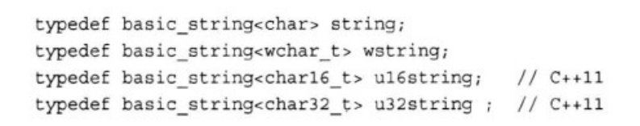
几乎包含了所有类型，这样我们就可以省略<>来显示指定类型了
（貌似c++17可以不用，其实也不然，看大家习惯用哪个吧）

2.size()和length()成员函数都返回字符串中的字符数

c++中，字符串也以\0结尾，但是不依靠\0作为判断字符串结束
里面有内部变量size专门记录
注意：字符串长度是有效字符的个数，不包括'\0'

关于为什么会有两个方法实现相同的功能

体现了c++的冗余性，既要向下兼容又要向上适配

length ()成员来自较早版本的string类，而size()则是为提供STL兼容性而添加的


```cpp

#include <iostream>
#include <string>
int main(){

using namespace std;

    string h("hello");
    cout<<"字符串的长度为："<<h.size()<<endl;
    cout<<"字符串长度为："<<h.length<<endl;
    return 0;
}
```

3. find()方法

可以搜索子字符串和字符


### 16.3 标准模板库

> 头文件、标准头文件、库文件

头文件(Header File)，文本文件,(.h,.hpp,或无拓展名)

标准头文件(Standard Header File)，头文件的一个子集，特指由 ISO C/C++ 标准委员会强制规定，并由编译器厂商（如 GCC、Clang、MSVC）随编译器打包提供的头文件。如，<iostream>,<string>,<vector>,<cmath>

库文件(Library File)
二进制文件，Windows上拓展名为.lib(静态库)或.dll(动态库),Linux上.a(静态库)或.so(动态库)

ai生成的一个：
```txt
逻辑串联：一段代码的生成推导
假设你写了 #include <string> 并在 main 里调用了 s.length()：

预处理：编译器将 <string> 标准头文件中的 length() 函数声明（文本）复制进你的 main.cpp。

编译：编译器检查语法。发现 length() 在头文件里有声明，类型合法，编译通过，生成只包含你写的逻辑的二进制目标文件 main.o。此时，length() 的具体机器码还不在 main.o 里。

链接：链接器介入。它扫描 main.o，发现有一个未决议的符号（Unresolved Symbol）string::length。链接器自动去 C++ 库文件（如 libstdc++.a 或 msvcprt.lib）中查找，提取出计算字符串长度的库函数的机器码，将其合并到最终的程序中。

```

接下来是正文

Standard Template Library，提供了一组表示容器、迭代器、函数对象和算法的模板。

我们在复习一遍类模板，这本书也叫模板类，模板类的实例化也就是创建该模板类的对象

> 模板类名 <类型名>  对象名 (参数列表);

#### 16.3.1 模板类 vector

> vector <type> 对象名 (需要多少矢量);

vector 模板使用动态内存分配。所以通常叫他动态数组。


```cpp
#include <vector>
#include <iostream>

int main(){

    using namespace std;
    vector <int> ratings (5);

    int n;
    cin>>n;

    vector <double> scores(n);

    return 0;
}
```

运算符[]被重载。可以使用数组表示法来访问各个元素


```cpp
ratings[0]=9;
for(int i=0;i<n;++i){
    cout<<ratings[i]<<endl;
}

```

程序清单 16.7
```cpp
// introducing the vector template
#include <vector>
#include <iostream>
#include <string>

const int NUM = 5;

int main(){
    using std::vector;
    using std::string;
    using std::cin;
    using std::cout;
    using std::endl;

    vector <int> ratings(NUM);
    vector <string> titles(NUM);

    cout<< "You will do exactly as told.you will enter\n"
        <<NUM<<"book titles and your ratings (0-10).\n";
    //cout<< "你要严格按照要求做。你将输入 \n"
    //<<NUM<<"个书名以及你的评分（0-10）。\n";

    int i;
    for(i = 0;i<NUM;i++){
    cout << "Enter title #"	<< i+1 <<":";
    getline(cin,titles[i]);
    cout << "Enter your rating(0-10):";
    cin >> ratings[i];
    cin.get();
    }
    cout<< "Thank you. You entered the following:\n"
    << "Rating\tBook\n";
    for(i=0;i<NUM;i++){
        cout<< ratings[i]<<"\t" << titles[i] << endl;
    }
    return 0;
}
```

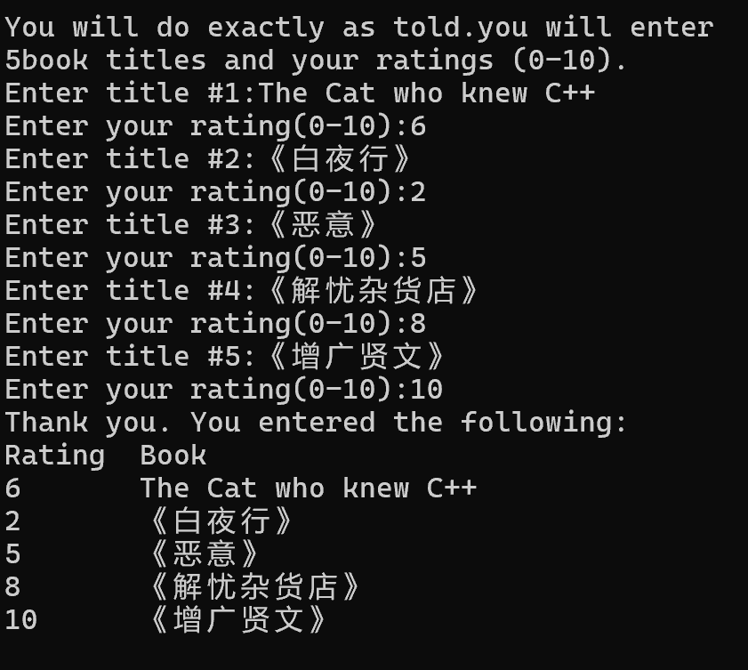


**分配器allocator**

像 vector 这样的动态数组，随着你不断往里面添加数据（比如调用 push_back()），它底层需要不断地向操作系统申请新的内存、释放旧的内存。
默认做法，使用new和delete来申请和释放内存，对于要求高的场景如：3A游戏引擎等，这个速度太慢，且容易产生内存碎片，这样呢，就会自己写一个更高效的内存分配算法，所以，vector用来默认参数模板

```cpp
template <class T, class Allocator = allocator<T> >
class vector { ... };


vector<int> v;
省略了第二个参数，那么就默认用new和delete来分配内存

//高级程序员自己写了一个极速内存分配器，就可以指定
vector<int, FastAlloc<int>> v;


```


#### 16.3.2 可对矢量(vector)执行的操作

除了上面分配存储空间，所有的STL容器都提供了一些基本方法

- size()--返回容器中元素的个数
- swap()--交换两个容器的内容
- begin()--返回一个指向容器中第一个元素的迭代器
- end()--返回一个指向最后一个有效元素的下一个位置的迭代器
- erase()--删除矢量中给定区间的元素，需传入连个迭代器参数，第一个迭代器指向区间的起始处，第二个迭代器位于区间终止的后一个位置（怎么说呢，这里的区间指的是左闭右开吧，和后面“stl区间概念”这张图的区间不同，或者说下面这张图想表达的意思是闭区间在stl中该怎么表示）

- insert()--
- empty()--判断容器是否为空。如果里面没东西返回 true，否则返回 false。

```txt

来看gemini帮我总结的

1. 尾部操作（最常用，O(1) 复杂度）
v.push_back(x)：在数组最末尾追加一个元素 x。（绝对的重点，写代码天天用）

v.pop_back()：删除数组最末尾的一个元素。（注意：它只删除，不返回那个元素的值）

2. 容量与大小（图 16.4 讲过的核心概念）
v.size()：返回当前容器里实际有几个元素。

v.capacity()：返回当前容器总共分配了多大的底层内存空间。

v.empty()：判断容器是否为空。如果里面没东西返回 true，否则返回 false。（比写 v.size() == 0 执行效率更高）。

3. 元素访问（查 / 改）
v[i]：像普通 C 数组一样访问下标为 i 的元素。⚠️ 考点陷阱：如果不小心下标越界（比如一共 3 个元素你访问 v[10]），程序会直接崩溃，编译器不检查。

v.at(i)：安全访问下标为 i 的元素。✅ 优点：如果越界，它会抛出一个 out_of_range 异常，程序不会直接死掉。

v.front()：获取第一个元素的引用（相当于 v[0]）。

v.back()：获取最后一个元素的引用（相当于 v[v.size() - 1]）。

4. 迭代器与区间操作（配合 <algorithm> 算法使用）
v.begin()：返回指向第一个元素的迭代器。

v.end()：返回指向最后一个元素后面那个位置的迭代器（即我们讨论过的“区间终止的后一个位置”）。

v.erase(first, last)：删除 [first, last) 左闭右开区间内的所有元素。

v.insert(pos, x)：在迭代器 pos 指向的位置之前，插入一个新元素 x。

v.clear()：清空容器里的所有元素（调用后 size() 变为 0，但 capacity() 通常保持不变）。


```


迭代器：广义指针：可以是指针，也可以是类似执行指针的操作，如解除引用

声明一个迭代器

```cpp
vector <double>::iterator pd;
vector <double> scores;

pd = scores.begin();
*pd = 22.3;
++pd;   //指向scores的下一个元素

//c++11后直接这样搞
auto pd = score.begin();

```

push_back()方法

将元素添加到矢量vector末尾

```cpp
vector <double> scores;  //创建一个空的vector

double temp;

while(cin>>temp&&temp>=0){
    scores.push_back(temp);
}
cout<<"You entered "<<scores.size() <<"scores:\n";

```
这样通过循环，就无需提前了解元素的数目。


#### c实现一下vector

```cpp


//泛型 vector
//核心逻辑，剔除空间配置器allocator(内存池技术减少内存碎片)和元编程模板
//template metaprogramming
#include <iostream>

template <typename T>
class myVector{

    private:
        T* data;
        int size;
        int capacity;
    public:
        //构造函数，初始化内存
//	myVector(int initial_capacity=2){
//		data=new T[initial_capacity];
//		size=0;
//		capacity = initial_capacity;
//}

    myVector(int initial_capacity=2):size(0),capacity(initial_capacity){
        //初始化列表 ，但是书上没有这种写法，之前那个对象成员最后也是这样解决的


        data=new T[capacity];

    }
        //析构函数：释放内存
        ~myVector(){
            delete[]data;
        }


        //push_back方法

        void push_back(T value){
            if(size == capacity){
                capacity=capacity * 2;
                T*new_data = new T[capacity];  //扩容

                for (int i=0;i<size;i++){
                    new_data[i]= data[i];
                }

                delete[]data;
                data=new_data;
            }
            data[size]=value;
            size++;
        }

        void print(){

            for(int i =0 ;i<size;i++){
                std::cout<<data[i]<<"\t";
            }
            std::cout<<"\n";
        }

};


int main(){

    using namespace std;

    myVector <int> a;
    a.push_back(2);

    a.print();
    myVector <double> b;
    b.push_back(3.2);

    b.print();

    return 0;
}


```
感触：“工业界”......还有就是以后不会去看源码了，因为看不懂，python估计也不会去看，本想着开源要加上一个看源码的负担，这样就打破这种焦虑了


#### 16.3.3 对矢量执行的其他操作

c++在标准模板库（<algorithm>）中定义了容器的很多分成员函数。

> vector <int> a;
> a.sort();//报错,vector没有sort()成员函数
> 应该导入algorithm库，并sort(a.begin(),a.end());

介绍三个常用的非成员函数
1. sort()

```cpp
#include <iostream>
#include <vector>
#include <algorithm>


int main(){

    using namespace std;

    vector <int> a;

    //vector <int> a={0};c++98不支持初始化列表
    a.push_back(2);
    a.push_back(2);
    a.push_back(1);
    sort(a.begin(),a.end());


//c++98也不支持atuo和范围for循环
    vector<int>::iterator it;
    for(it=a.begin();it != a.end();++it){
        cout<<*it<<endl;
    }

//	for(int i:a){
//		cout<<i<<endl;
//	}

    return 0;
}


```
**对数组也适用**
在16.4会解释原因

```cpp
int arr[6]={5,3,2,4,5,6};
sort(arr,arr+6);
//+0 +1....+5 +6
// 5 3 .... 6 空
```

2. 随机打乱算法：random_shuffle()

```cpp
vector <int > a ={80,29,100,23};
random_shuffle(a.begins(),a.end());

```

3.遍历执行算法for_each()

介绍几种遍历vector的方式


```cpp

#include <iostream>
#include <vector>
#include <algorithm>
using namespace std;

// 先自己定义一个“动作”函数
void printScore(int x) {
    cout << x << "分 ";
}

int main() {
    vector<int> scores = {90, 50, 80};

    // 把区间和“动作的名字”传给 for_each

    //1.for_each()非成员函数
    for_each(scores.begin(), scores.end(), printScore);

    // 输出：90分 50分 80分


    //2.下标遍历法
    for( int i=0;i<scores.size();++i){
        cout << socres[i] << "分" <<endl;	}

    //3.迭代器法
    for(vector<int>::iterator it = a.begin(),it != a.end();++i){

        cout<<*it<< "分" <<endl;
    }

    //4范围for循环
    for(auto i:scores){
        cout<<i<<"分"<<endl;
    }


     return 0;
}
```


#### 16.3.4 基于范围的for循环(c++11)

for(容器元素类型 变量名：容器名){statement}

取容器中单个元素赋值给变量，注意不是迭代器


```cpp
vector <int> a={1,2,4};
for(auto i:a){
    //i不是迭代器也不是指针
    cout<<i<<endl;
}
//修改矢量中的元素
for(auto & i:a){
    i++;
    cout<<i<<endl;
}
```


### 16.4 泛型编程


### 16.5 容器

这块小标题有点混乱，16.5是我自己加上去的，原书上没有，但说来也奇怪，一本出版的书应该不会出现这种低级的错误吧

#### 16.4.5 容器种类

c++11之前11个容器类型：deque、list、queue、priority_queue、stack、vector、map、multimap、set、multiset和bitset

c++11后新增了forward_list、unordered_map、unordered_multimap、unordered_set和unordered_multiset，并不将bitset视为容器


容器是存储其他对象的对象，被存储的对象必须是同一种类型的。


> gemini总结

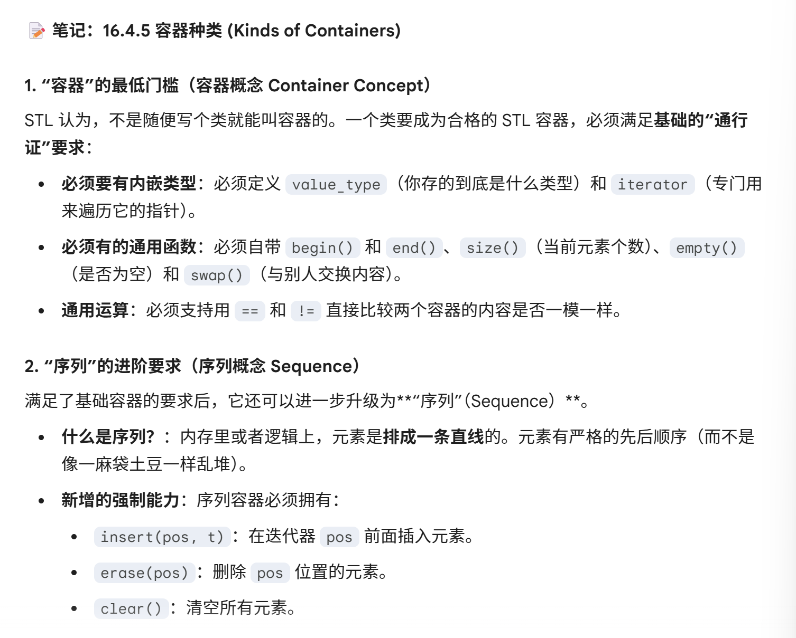
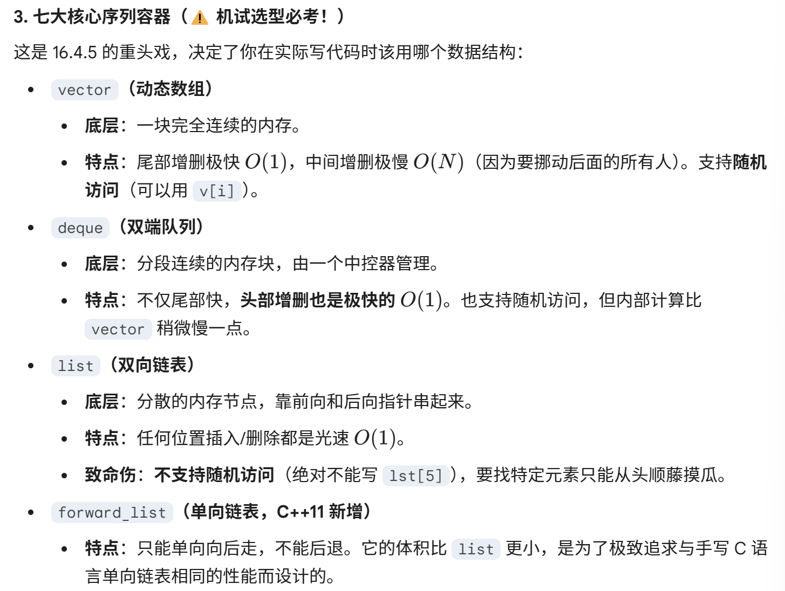
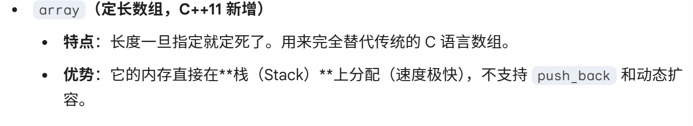
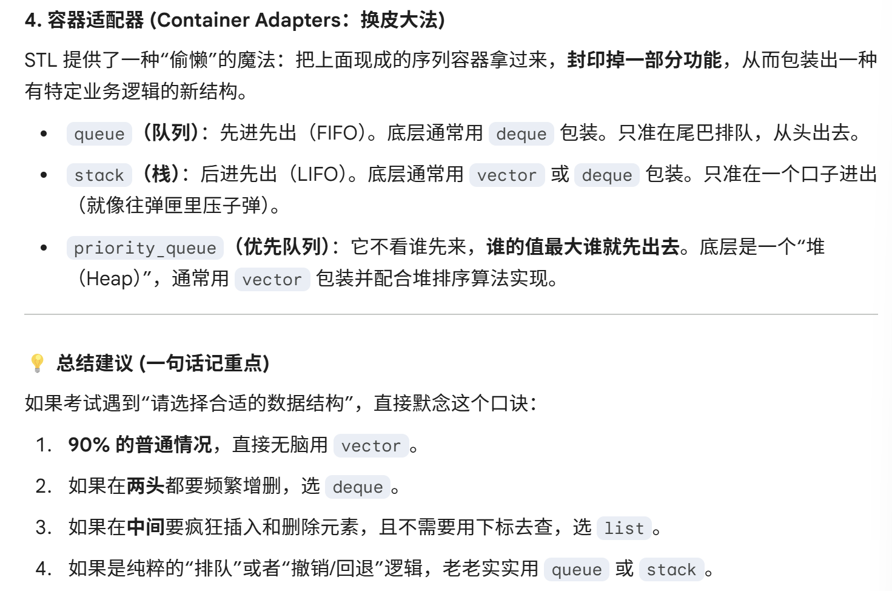


下面是我自己的笔记

容器必须支持基本操作和特征

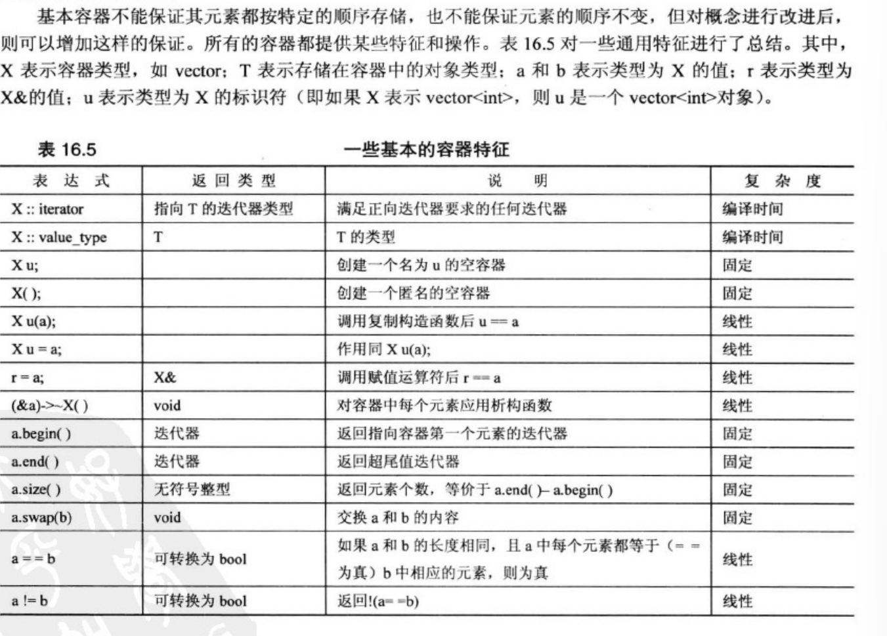

c++11新增的基本容器要求

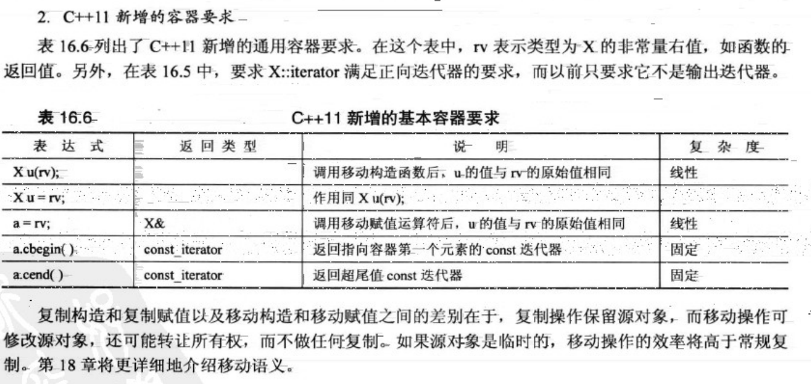


比较重要的是后几个，a.begin()、a.end()、a.size()、a.swap(b)、a==b、a!=b


**序列容器**

sequence
> 补充：
> 序列要求元素严格按照线性顺序排列，也就是严蔚敏老师线性表第一段：除第一个元素和最后一个元素外，每个元素都有一个前驱，也都有一个后继。

deque、C++11新增的forward_list、list、queue、priority_queue、stack和vector这7种STL容器类型都是序列。array也被归为序列容器，但他不是STL容器(没有push_back()、insert()但是有成员函数operator[]()和at())

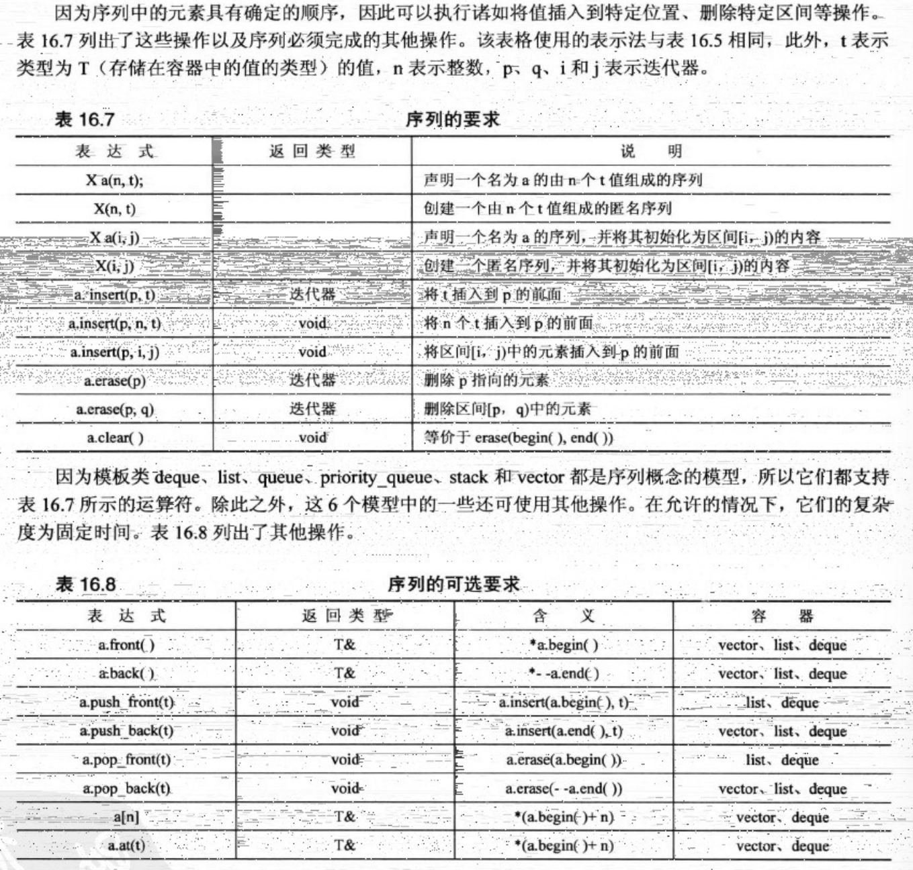

X a(n,t);//声明一个名为a序列容器，里面有n个元素，元素值为t

empty()一般也是序列的成员函数

##### 常用序列容器

###### 1.矢量（向量） vector

底层是动态数组，一般也可以叫动态数组

重载了[]运算符，可以像数组一样访问向量中的元素

> 初始化

支持 X a(n,t);//我叫他静态初始化，n个值为t的空间
X a(n);  //n个为初始化的空间

还有个就是动态初始化

先用到容器的基本特征X u;创建一个空容器，然后再调用方法push_back()

来个笔记

```cpp
#include <iostream>
#include <vector>
#include <algorithm>

using namespace std;

int main(){
    //vector<元素类型> 容器名(长度,[初值])

    //静态初始化--指定容器长度

    vector <int> arr1(100);
    vector <int> arr2(100,3);

    //动态初始化--不指定容器长度，通过push_back()内置成员函数进行动态扩容

    vector <int> arr3;
    arr3.push_back(1);
    arr3.push_back(2);
    arr3.pop_back();

    //vector的遍历

    //1。基于内置成员函数size()的传统for循环
    //for(size_t i = 0; i < arr3.size(); ++i)
    for(int i = 0;i<arr3.size();++i){
        cout << arr3[i]<<endl;
        //对[]进行了重载，可以像数组一样使用vector
    }

    //2.基于迭代器
    vector<int>::iterator it;
    for(it=arr3.begin();it!=arr3.end();++it){
        cout<<*it<<endl;
        //容易混淆的是迭代器是指针，要解引用与后面范围for循环容易混乱
    }

    // 3.c++11新特性 范围for循环

    for(auto i : arr3){
        cout<<i<<endl;
    }

    //4.for_each()

    // 4. for_each() 配合 Lambda 表达式 (需要 <algorithm> 头文件)
for_each(arr3.begin(), arr3.end(), [](int x) {
    cout << x << endl;
};
    return 0;
}

```
for(int i = 0;i<arr3.size();++i){
        cout << arr3[i]<<endl;
        //对[]进行了重载，可以像数组一样使用vector
    }

这段代码是有问题的

size()返回的是无符号正整数size_t
应该是这样
for(size_t i = 0; i < arr3.size(); ++i)


###### 2.栈stack

所在库文件stack
```cpp
# include <stack>
```

**常用方法**

```cpp
#include <stack>

int main(){
    //构造
    //stack<类型名> 栈名;
    stack<int> stk;

    //入栈
    stk.push(1);

    //出栈
    stk.pop();

    //取栈顶元素

    int a=stk.top();

    //判空
    bool b= stk.empty();

    //查看大小
    int c= stk.size();//这是每个容器都必须有的成员函数

    //清空

    stk.clear();

    return 0;
}

```

###### 3.队列 queue


###### pair 二元组，不是容器

一个工具库utility

```cpp
#include <utility>
```


#### 16.4.6 关联容器

关联容器将键与值关联起来，底层基于树结构

STL提供了4种关联容器：set、multiset、map和multimap，set在头文件set.h中定义，multiset在头文件multiet.h中定义，后两个在map.h（以前分开定义）


#### 16.4.7 无序关联容器（C++11）

无序关联容器也将键与值关联起来，并使用键来查找值，底层基于数据结构哈希表

4中无序关联容器：unordered_set、unordered_multiset、unordered_map和unordered_multimap

##### unordered_set

无序集合，**不保证插入的顺序，也不保证从小到大的顺序，顺序是随机的**，底层是哈希表，查找、插入、删除一个元素的时间复杂度是O(1)

成员函数:
insert()插入元素,参数是你的容器中元素的类型
erase() 删除元素，参数是你的容器中元素的类型
find()，参数是你要查找的元素，返回指向该元素的迭代器，找不到返回最后一个迭代器
count(),要么返回1（存在），要么返回0（不存在）
size(),无参，返回容器中元素的个数
初始化：

```cpp
unordered_set <int> mySet={10,23};

//遍历

for(auto x: mySet){
    cout<<x <<endl;
}
```


### 16.6 算法

STL将算法库分为4组

- 非修改式序列操作
- 修改式序列操作
- 排序和相关操作
- 通用数字运算

这个操作就相当于任务，用函数实现，也就是调用库函数

前3组在头文件algorithm中，第4组专用于数值数据，在numeric中


来个易混淆总结笔记

> sort()、find()这些函数是库函数，在<algorithm>库文件中，容器是没有这个成员函数的（当然，有的是有的，效率更好）
> vector<int> a(199);
> a.sort();是错误的
> a.sort(a.begin(),a.end());//参数是迭代器

```cpp

#include <algorithm>
#include <numeric>

```


### 16.7 其他库


## C++新特性

[现代 c++ 一：c++11 ~ c++23 新特性汇总 - 知乎](https://zhuanlan.zhihu.com/p/697040239)


## 第一章 从C到C++

引用


### 迭代器


可以理解为广义指针

```cpp
vector <int> a={1,2,4};
//end()始终指向容器、数组等的有效元素的后一个位置
for(auto i=a.begin();i<a.end();++i){
    cout<<*i<<endl;
}

```


### 范围for循环


for(容器元素类型 变量名：容器名){statement}

取容器中单个元素赋值给变量


```cpp
vector <int> a={1,2,4};
for(auto i:a){
    //i不是迭代器也不是指针
    cout<<i<<endl;
}
```


## stl

standard template library

c++标准模板库是一套功能强大的 C++ **模板类和函数的集合**，它提供了一系列通用的、可复用的算法和数据结构。

STL 的设计基于泛型编程。

STL 分为多个组件，包括容器（Containers）、迭代器（Iterators）、算法（Algorithms）、函数对象（Function Objects）和适配器（Adapters）等。


### 容器

#### vector

```cpp
    vector<int> twoSum(vector<int>& nums, int target) {
vector--类模板名
<int---模板参数值表>
twoSum对象名

vector <int>  arr;
arr对象名


```


## 回归书本


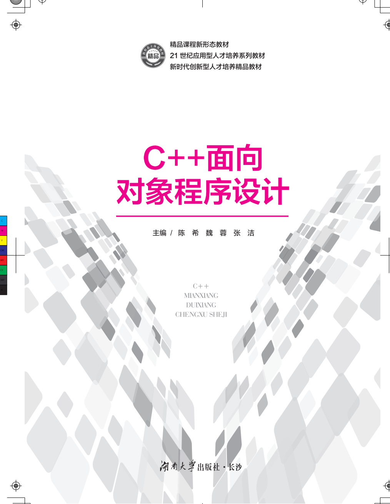


### 第一章 概述

 ### 1.1 C++语言概述


##### 1.1.2 C++语言的特点

> 一是兼容c语言，二是具有面向对象的语言特性质。


##### 1.1.3 C++语言的版本

[现代 c++ 一：c++11 ~ c++23 新特性汇总 - 知乎](https://zhuanlan.zhihu.com/p/697040239)

C++语言的标准化工作是从1989年开始的。

2011年8月12日，ISO C++标准委员会发布了C++标准第三版，这是一个major（有重大变化）版

2022年12月25日，c++20也是一个major版本


#### 1.2 认识c++语言程序


##### 1.2.1 简单的C++程序

> 例 1.1 屏幕上输出"Hello world!"

```cpp
#include <iostream>

using namespace std;

int main(){

    cout<<"Hello world!\n";

    return 0;

}

```


> 例1.2 计算两个数a,b之和，并输出结果c

```cpp
#include <iostream>

using namespace std;

int main(){
    int a,b,c; //声明
    a=1,b=2; //赋值
    //初始化=声明+赋值
    //有时初始化也指对变量赋值
    c=a+b;
    cout<<"c="<<c<<endl;
    return 0;
}
```


> 例 1.3 输入两个整数，比较后输出较大的数

```cpp
#include <iostream>

using namespace std;

int main(){
    int a,b;
    cin>>a>>b;
    if(a>b)
    cout<<"较大的数是"<<a<<endl;
    cout<<"较大的数是"<<b<<endl;
    return 0;
}
```

```cpp
#include <iostream>

using namespace std;

int max(int x,int y);
int main(){
    int x,y,z;
    cout<<"input two numbers:"<<endl;
    //cout<<"input two numbers:\n";
    cin>>x>>y;
    z=max(x,y);
    cout<<"max="<<z<<endl;
    return 0;
}

int max(int a,int b){
    if(a>b)
    return a;
    else
    return b;
}
```


> 例1.5 包含类的C++程序


```cpp
#include <iostream>
using namespace std;

class Student{
    private:
        int num;
        int score;
    public:
        void setdata(){
            cout<<"input information of student"<<endl;
            cin>>num>>score;
        }
        void display(){
            cout<<"num="<<num<<endl;
            cout<<"score="<<score<<endl;

        }
};
int main(){
    Student stu1,stu2;
    //stu1.num=10
    //stu2.score=20语法错误
//	stu1.setdata();
    stu1.display();

    return 0;
}
```

被private修饰的成员变量/成员函数，只能在类的内部被访问/修改


##### 1.2.2 C++语言的字符集

C++语言字符集由字母、数字、空白符、标点和特殊字符组成

- 字母：小写字母a-z共26个，大写字母A-Z共26个
- 数字：0-9共10个
- 空白符：空格符、制表符、换行符等统称为空白符
- 标点：如，？！等；特殊字符：如@&$等


##### 1.2.3 C++语言的词汇

标识符、关键字、运算符、分隔符、常量、注释、控制语句等

- 标识符由字母、数字和下划线组成，且数字不能做开头

tips：大小写敏感；命名时做到见名知意。


#### 1.3 使用开发工具编写C++语言程序

##### 1.3.1 C++语言程序的开发步骤

C++语言程序的开发步骤：编辑（源程序*.cpp）->编译（目标程序 *.obj）->链接(可执行程序 *.exe)->运行

目标程序和可执行程序均为机器语言


#### 练习题


### 第二章 数据类型、运算符和表达式


#### 2.1 c++语言的数据类型


分为基本数据类型和非基本数据类型

基本数据类型

- 整型 int
- 实型：单精度型 float 双精度型 double
- 字符型 char
- 布尔型 bool
- 空类型 void

非基本数据类型

- 数组 type []
- 指针 type *
- 引用 type &
- 类 class
- 结构 struct
- 联合 union
- 枚举 enum


#### 2.2 常量与变量


常量：在程序运行过程中，其值不能改变的量称为常量

变量：在程序运行过程中，其值可以改变的量称为变量

##### 2.2.1 常量

常量可以分为：整型常量，如0,-1;实型常量：4.6，-1.23；字符常量‘d’；字符串常量，如“a”

又可以分为字面常量（直接）和符号常量

通常符号常量用大写，变量名用小写

像define PI 3.1415926   PI不能直接判别这个常量就叫做符号常量


> 例 2.1 符号常量的使用

```cpp
#include <iostream>
using namespace std;

#define PI 3.1415926

int main(){
    float r,s;
    r=5.0;
    s=PI*r*r;
    cout<<"Area is "<<s<<endl;
    return 0;
}
```


#### 2.2.2 变量

变量有两个要素：变量名和变量值

变量名在命名时应遵循**标识符命名规则**，在定义变量名时应做到**见名知意**。

变量值存储在内存中

```cp
int i=j=0;//报错，
int i,j=0;//不报错
int i=0,j=0;//不报错
```


#### 2.2.3  常变量


长变量：用const 定义的变量叫常变量

> 语法：const <数据类型> 常变量名 =常量表达式；

eg: const float pi=3.1415;

在定义常变量时必须进行初始化，而且和#define一样，其值不能被修改

pi=3.23;是错误的；会报错


一个必错题，大一老师也讲过

define N 1+2

int a=N/2；

结果是2而不是3/2=1.5


### 2.3 整型数据

#### 2.3.1 整型常量

c++中整型常量有**十进制形式**%d、**八进制形式**%o、**十六进制形式**%x

```cpp
#include <stdio.h>
void print_int_binary(short num);


int main(){
short x=10;
print_int_binary(x);

    return 0;
}
//打印short型二进制
void print_int_binary(short num) {
    for (int i = 15; i >= 0; i--) {
        printf("%d", (num >> i) & 1);
        if (i % 2 == 0) printf(" ");
    }
    printf("\n");
}
```


#### 2.3.2 整型变量（含地址与变量的讨论）

我是这理解变量的，就是个小房子，相当于地址的别名，地址标识了存储单元，变量也一样

%p地址占位符

变量不是地址，变量就是个小房子（多个存储单元组成），他的唯一属性就是地址
也就是说存数据的地方有两个属性一个是地址另一个就是变量

```c
#include <stdio.h>

int main(){
    int a;//声明或称为定义
    a=10;//赋值
    //初始化=声明+赋值
    int *p=&a;
    printf("p的地址%p\n",&p);
    printf("p所指向的地址%p\n",p);
    printf("a的地址%p\n",&a);

    return 0;
}
```

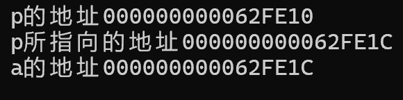

可以看到p也是一个变量（多个存储单元），里面存储的是变量a（a这个房子的地址），a里面存的是10的二进制形式，p是直接指出a的地址，&a是a本身自带的地址

整型变量的分类

- 基本整型
- 短整型
- 长整型
- 无符号整型

##### c语言占位符大全

```txt

%a:十六进制浮点数,字母输出为小写。
%A:十六进制浮点数，字母输出为大写。
%c:字符。
%d:十进制整数。
%e:使用科学计数法的浮点数，指数部分的e为小写。
%E:使用科学计数法的浮点数，指数部分的E为大写。
%i:整数，基本等同于%d。
%f:小数（包含 float 类型和 double类型) 。
%g:6个有效数字的浮点数。整数部分一旦超过6位,就会自动转为科学计数法,指数部分的e为小写。
%G:等同于%g,唯一的区别是指数部分的E为大写。
%hd:十进制 short int型。
%ho:八进制 short int型。
%hx:十六进制 short int类型。
%hu: unsigned short int型。
%ld:十进制 long int类型。
%lo:八进制 long int类型。
%lx:十六进制 long int类型。
%lu: unsigned long int。
%lld:十进制 long long int类型。
%llo:八进制 long long int类型。
%llx:十六进制 long long int型。
%llu: unsigned long long int型。
%Le:科学计数法表示的long double类型浮点。
%Lf: long double类型浮点。
%n:已输出的字符串数量。该占位符本身不输出，只将值存储在指定变量之中。
%0:八进制整数。
%p:指针。
%s:字符串。
%u:符(unsigned int)。
%x:十六进制整数。
%zd: size_t类型。
%%:输出一个百分号。
————————————————
版权声明：本文为CSDN博主「坊钰」的原创文章，遵循CC 4.0 BY-SA版权协议，转载请附上原文出处链接及本声明。
原文链接：https://blog.csdn.net/Gao123456fy/article/details/134750608
```

##### 各类整型数据所分配的内存字节数及数的表示范围

C++ 标准并没有硬性规定每种类型必须占用多少字节，而是只规定了**最小范围**和**相对大小关系**：

- `short` 至少 16 位（2 字节）
- `int` 至少和 `short` 一样长
- `long` 至少和 `int` 一样长
- `long long` 至少 64 位（8 字节）

> 乱的很

**现代32位系统**：int和long都是4字节

**64 位 Linux/macOS（GCC/Clang）**：`long` 是 8 字节，范围会变成 `-9223372036854775808 ~ 9223372036854775807`，和表格里的不同

**64 位 Windows（MSVC）**：`long` 仍然是 4 字节，和表格保持一致


> 例 2.2 整型变量的定义与使用

```cpp
#include <iostream>
using namespace std;
/*混合相加时，
编译器会先把有符号整型（int）
转换成无符号整型（unsigned），
再执行加法；*/
int main(){
    int num1,num2,sum;//c语言不能连续赋值i=j=10，但是可以int i=10,j,k=1;
    unsigned int num3=10;
    num1=-50;
    num2=200;
    sum=num1+num2+num3;
    int sum2;
    sum2=num1+num3+num2;
    cout<<"sum="<<sum<<endl;
    cout<<"sum2="<<sum2<<endl;


    return 0;
}
```

> 例2.3 数据的溢出

```cpp
#include <iostream>
using namespace std;

//-2^15~2^15-1
//0111 1111 1111 1111
//1000 0000 0000 0000
int main(){
short a,b;
a=32767;
b=a+1;
cout<<"b="<<b<<endl;
    return 0;
}
```

#### 2.4 浮点型数据


##### 2.4.1 浮点型常量

（1）小数形式

由数字和小数点组成（小数点不可以省略，如果小数部分是零，那么零也可以省略）

如：0.123、1.、1.0均是浮点型常量

（2）指数形式

> 十进制数+阶码标志(E或e)+阶码
>
> aEn---->a*10^n
>
> 当a的小数点左侧只有一位非零的数字时，称为规范化的指数式

2.1E5

-2.8E-2

0.5E7---->5E7

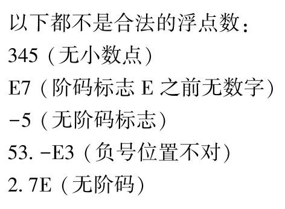

##### 2.4.2 浮点型变量

C++中的浮点型变量分为 **单精度型（float）、双精度型（double）、长双精度型（long double）**

C++编译系统将浮点型常量默认为双精度浮点型

```cpp
#include <iostream>

using std::cout;
using std::endl;


int main(){
    double a=3.12111233121111111111121;
    cout<<"a="<<a<<endl;
    return 0;
}
```


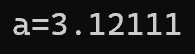

显示小数点后5位

#### 2.5 字符型数据


#### 2.6 C++语言数据类型转换


```cpp
#include <bits/stdc++.h>
using namespace std;

int main(){
    double a=1.;
    cout<<"a="<<a<<endl;
    double b=1;
    cout<<sizeof(b)<<endl;
    cout<<sizeof(a)<<endl;
    //
    return 0;
}
```


### 第三章 程序设计的基本结构

程序可以分为三种基本结构：顺序结构、选择结构、循环结构


#### 3.3 循环结构


##### 3.3.3 for语句

语法格式

> for(表达式1，表达式2....表达式n；表达式n+1...表达式2n；表达式2n+1...表达式3n){
>
> 循环体；
>
> }

```cpp
for ( init; condition; increment )
{
   statement(s);
}
```

各种特殊形式的for循环

1. for(;表达式2;表达式3)
2. for(表达式1；；表达式3)

3. for(表达式1；表达式2；)

4. for(；表达式2；)

##### c++11新特性-----范围for循环

适用于数组、容器类（如vector、array）

```cpp

double prices[5]={4.99,10.99,6.87,8.23};//第五个默认初始化为0.0

//prices中每个元素的副本依次赋值给x
for(double x:prices){
cout<<x<<std::endl;
}
//涨价了，每件涨1毛，原来免费的也涨
//直接在原始数据上修改
for(double &x:prices){
    x+=0.1;
    cout<<x<<std::endl;
}
```


### 第四章 数组和指针


> 数组的大小必须是整数
>
> define MAXN 2E3  其中MAXN是浮点型

```cpp
#define MAXN  2000
#defien MINN  1E1

int main(){
    int a[MINN];//报错
    int a[MAXN]={0};
```


#### 4.4 引用

引用是一定义变量的别名，在引用建立时不许进行初始化

> 语法：类型标识符 & 引用名 -目标变量名；

eg:

```cpp
int a; int & b=a;

void movezeros (vector <int > & nums){
    //传来参数时相当于初始化
    //vector <int> array;
    //movezeros(array);
    //vector <int > & nums=array;
    函数体;
}
```


我们可以用引用名修改原变量的值，也可以直接修改原变量的值


### 第五章 函数

#### 5.1 函数的定义

从用户角度，函数分两种：**标准库函数、用户自定义函数**
根据有无参数，可以分为有参函数和无参函数
> 例5.1 编写一个程序计算两个数的平均值，并将计算过程用上下两排“*”进行分隔

tips:看下示例就好了，题目不严谨
```cpp
# include <bits/stdc++.h>
using namespace std;

float average(int a,int b);
void printstars();
int main(){
    printstars();
    cout<<"please intput two integers:"<<endl;
    int a,b;
    cin>>a>>b;
    float c=average(a,b);
    cout<<"the average of tow integers:"<<c<<endl;
    printstars();

    return 0;
}

void printstars(){

    cout<<"********************"<<endl;
}
float average(int a,int b){
    return (a+b)/2;
}
```
5.2 大致讲的是函数的调用，比较抽象。
#### 5.3 函数的参数传递
函数间传递参数的形式包括按值传递和地址传递，若按值传递，则是单向值传递，即被调用函数的执行不会影响调用函数的实参；若传递的是地址，形参对应单元的内容的更改会影响实参内容的更改，二者指向同一块内存单元/存储空间。

##### 5.3.1 数组与函数

###### 5.3.1.1 数组元素做函数的参数

数组元素做函数实参时，其等同于普通变量：在函数调用时，把数组元素的值传送给形参，实现单向值传递。不会修改实参。

> 例 5.9 输入一个字符串，计算出其中字母的个数。

```cpp
# include <bits/stdc++.h>
using namespace std;

bool isalp(char c)//判断是不是字母
{
    if(c>='a'&&c<='z'||c>='A'&&c<='Z')
    return true;
    return false;
}
int main(){
    char str[255];
    int cnt;
    cout<<"please input a string:"<<endl;
    cin.getline(str,255);
    //读取一行的输入，遇到换行符时结束
    for(int i=0;str[i]!='\0';++i){
        if(isalp(str[i])){
            cnt++;
        }
    }
    cout<<"the alp of string is:"<<cnt<<endl;

    return 0;
}

```

###### 5.3.1.2 数组名做函数的参数
用一维数组作形参时可以不指定数组元素的个数
数组名是数组的首地址

> 例 5.10 输入一组（10个以内）整型数据，将其逆序存放，要求使用数组名作为函数的参数。

```cpp
#include <iostream>
using namespace std;

void reverse(int array[],int n){
    int i=0,j=n-1;
    while(i<j){
        int temp;
        temp=array[i];
        array[i]=array[j];
        array[j]=temp;
        i++,j--;
    }
}

int main(){
    int array[10];
    cout<<"请输入个数："<<endl;
    int n;
    cin>>n;
    cout<<"请输入"<<n<<"个数字"<<endl;
    for(int i=0;i<n;i++)cin>>array[i];
    reverse(array,n);
    cout<<"逆置后的数组:"<<endl;
    for(int i=0;i<n;i++)cout<<array[i]<<" ";


    return 0;
}
```
##### 5.3.2 指针与函数

###### 5.3.2.1 指针变量作为函数的参数
直接在原地址上修改

> 例5.11 编写一个函数实现两个数的交换

```cpp
#include <iostream>
using namespace std;

void swap(int *x,int *y){
    int t;
    t=*x;
    *x=*y;
    *y=t;
}
int main(){
    int a=1,b=2;
    int *p1=&a,*p2=&b;
    swap(p1,p2);
    return 0;
}

```
和引用混合写法
```cpp
#include <iostream>
using namespace std;
void swap(int *a,int *b){
    int *temp;
    temp=a;
    a=b;
    b=temp;

}
int main(){
    int a=1,b=2;
    swap(&a,&b);
    return 0;
}
```
###### 5.3.2.2 数组的指针作为函数的参数
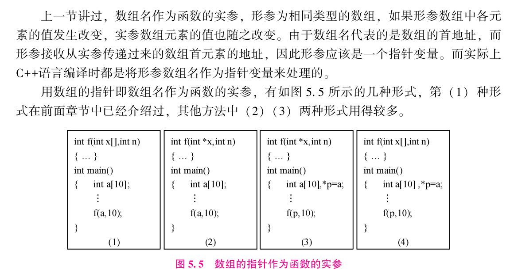


###### 5.3.2.3 指向函数的指针


###### 5.3.2.4 返回函数指针值的函数

##### 5.3.3 引用与函数


##### 5.3.4 默认参数的函数
给函数定义默认参数值，当不提供实参值时，形参就用默认参数作为实参值

实参与形参的结合是从左至右顺序进行的。

> 例5.16 带有默认参数的函数的使用

```cpp
#include <iostream>
using namespace std;
void function(int a=1,int b=3,int c=5){
    cout<<"a="<<a<<"b="<<b<<"c="<<c<<endl;
}
int main(){
    function();
    function(7);
    function(7,8);
    function(1,8,9);
    return 0;
}
```

#### 5.4 内联函数

牺牲空间换时间

编译时所调用函数的代码会嵌入到主函数种，这种函数叫做内联函数。（在调用的地方，将函数的原代码替换）
所有在类内部定义的函数都是内联函数

> inline 函数类型 函数名(形参列表){
> 声明部分
> 语句部分
> }
>

> 例5.17 内联函数的使用
```cpp
# include <bits/stdc++.h>
using namespace std;

inline bool isalp(char c)//判断是不是字母
{
    if(c>='a'&&c<='z'||c>='A'&&c<='Z')
    return true;
    return false;
}
int main(){
    char str[255];
    int cnt;
    cout<<"please input a string:"<<endl;
    cin.getline(str,255);
    //读取一行的输入，遇到换行符时结束
    for(int i=0;str[i]!='\0';++i){
        if(isalp(str[i])){
            cnt++;
        }
    }
    cout<<"the alp of string is:"<<cnt<<endl;

    return 0;
}
```


#### 5.5 函数重载与函数模板

##### 5.5.1 函数重载

C++中，函数重载指完成不同功能能的函数（我的理解可以等价于函数的参数不同，如：参数个数、参数类型）可以具有相同的函数名。C++的编译器会根据函数的实参来确定调用哪一个函数。

> 例 5.18 利用函数重载分别求圆、三角形、矩形的面积

```cpp
#include <iostream>

using std::cout;
using std::cin;
using std::endl;

float getarea(float r1);
float getarea(float a,float h);
int  getarea(int x,int y);

int main(){
    //测试
    //1.圆
    float r1;
    cout<<"please input the round of circle:" ;
    cin>>r1;
        float area1=getarea(r1);
    cout<<"the area of circle is"<<area1<<endl;
    //2.三角形
    float a,h;
    cout<<"please input the a and h of triangle:" ;
    cin>>a>>h;
    float area2=getarea(a,h);
    cout<<"the area of triangle is"<<area2<<endl;
    //3.矩形
    int x,y;
    cout<<"please input the x and y of rectangle:" ;
    cin>>x>>y;
    int  area3=getarea(x,y);
    cout<<"the area of rectangle is"<<area3<<endl;
    return 0;
}


float getarea(float r1){
    return 3.14*r1*r1;
}
float getarea(float a,float h){
    return 0.5*a*h;
}
int  getarea(int x,int y){
    return x*y;
}


```


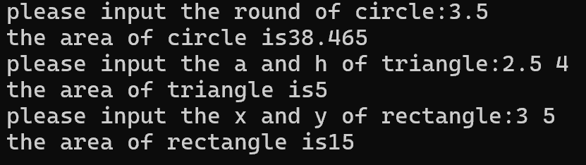

函数重载的参数个数或类型至少有一个不同，函数返回值类型可以相同也可以不同，但不允许出现参数个数和参数类型相同但是函数返回值不同。

如

```cpp
float area(int x,int y);
int  area(int x,int y);
//报错
```


#### 5.5.2 函数模板


> 标准定义形式：
>
> template  <typename T>
>
> 函数类型  函数名 (参数列表){函数体}

函数模板适用于函数参数个数相同而类型不同且函数体相同

> 例5.19 函数模板的使用

```cpp
#include <iostream>

using std::cout;
using std::cin;
using std::endl;

template <typename t1,typename t2>
t1 max(t1 a,t2 b){
    return a>b?a:b;
}

int main(){
    int a=1;
    float b=2.3;
    cout<<max(a,b);
    return 0;
}


```

看到了不，我们还是要指定返回值类型的(t1还是t2)，所以c++11引入了auto


#### 5.6 变量的作用域与生存期

变量的存储属性：生存期、作用域

作用域：变量可以使用的范围叫做变量的作用域

生存期：变量的存在时间叫做变量的生存期


##### 5.6.1 变量的作用域

**内部变量或局部变量**：在一个函数内部定义的变量（只在本函数范围内有效，如主函数中定义的变量只在主函数范围内有效），叫做内部变量或局部变量

**外部变量或全局变量**：在函数外部定义的变量


**局部变量**

- 不同函数中可以使用相同名字的变量，它们代表不同的存储空间，互不干扰
- 形式参数也是局部变量


**语句块**：程序中用花括号括起来的区域叫语句块。（函数体，循环体，分支都是语句块），每个语句块内也可以定义语句块，也只在语句块内有效，我称之为**广义局部变量**

其实，语句块也是定义在函数内部的，在语句块里定义新的变量，也可称为局部变量，但是作用范围要更小，只在语句块内有效。

**全局变量**

定义在函数外部的变量叫做全局变量，作用范围从定义位置开始，到源文件及结束。

一般定义在所有函数之前

> 例 5.20 定义一个函数，求一组（不多于10个）数据的最大值、最小值和平均值，使用全局变量实现


##### 5.6.2 变量的存储类别和生存期


###### 5.6.2.1 局部变量的存储类别

有自动变量（auto)、静态变量（static）、寄存器变量（register）


### 第6章 类和对象

类（class）是对象的抽象，对象（object）是类的具体实例。

#### 6.1 类的声明和对象的定义

C++中，对象的类型称为类，对戏那个相当于该类的具体变量。类是对象的模板。

类是抽象的不占用内存（这其实是不占用堆栈内存）

> 补充
> 内存分为四个区域
> 1. 堆：堆区是我们自己申请的内空间，也要自己释放
> 2. 栈
> 3.


##### 6.1.1 类的声明/定义

> 一般形式
> class 类名
> {
> public:公有数据/成员（成员函数/方法、成员变量也叫属性）
> protected:保护数据
> private:私有数据
> };

public、protected和private被称为成员访问限定符(member access specifier)。

##### 6.1.2 对象

对象的定义

> 1.先声明类，在定义对象
> 类名 对象名; //如 Student stu1;
>
> 2.在声明类的同时定义对象
> class Worker{
> ....
> }work1,work2;
>
> 3.不出现类名，直接定义对象


对象的赋值

同一个类的不同对象之间，以及同一个类的对象指针之间可以相互赋值
> 对象1=对象2;

如:Worker work1,work2;
work1=work2;

对象数组的定义
> 类名 数组名 [<常量表达式>];
如：Worker work[50];

##### 6.1.3 对象的动态建立和释放

c用库函数malloc()和free()来动态分配和释放内存空间。
c++提供了运算符new和delete，比malloc和free执行效率更高

**new运算符**

> 一般格式
> new类型[初值];

返回一个指向申请的空间的指针。

> 例 6.1 用new 和delete 动态分配与释放内存

```cpp
#include <iostream>
#include <string>

using namespace std;

int main(){
    //工号、姓名、工资
    int *sno=new int;
    string *name=new string;
    float *money = new float;
    * sno = 1;
    *name = "小牛";
    *money = 3000;

    cout<<"sno："<<*sno<<" "<<"name："<<*name<<" "<<"money："<<*money<<endl;


    return 0;
}
```

##### 6.1.4 对象的初始化

创建对象时如何初始化
1. 括号法（函数式初始化，Functional Notation）C++98起

> 语法：类名 对象名（初始化参数列表）；
> Address myAddress("123 Main St","City","Country");

2.波形括号法 (Uniform Initialization / Brace Initialization) —— 【现代 C++ 推荐】用{}代替()，也叫列表初始化和统一初始化，C++11起

3.等号赋值法 (Copy Initialization)，通常适用于单参数构造函数，或者C++后的聚合类型。也叫拷贝初始化,C++98起
> 语法：类名 对象名 = 值;
#### 6.2 类的成员变量和成员函数

##### 6.2.1 类的成员变量

成员运算符(.)

> 1)用对象名和成员运算符(.)访问对象成员
>
> 对象名.成员变量名
>
> 2)通过指向对象的指针访问成员变量
>
> 类名 * 对象指针名;
> 2.1) (*对象指针).成员变量
> 2.2） 对象指->成员变量
>
> 3)通过对象的引用访问成员对象的成员变量

>例6.2 通过对象名和成员运算符访问成员变量

```cpp
#include <iostream>
#include <string>

using namespace std;

class Worker{
    public://访问限定符

//	成员（数据）：成员变量（属性）、成员函数（方法）
    //成员变量
    int num;
    string name;
    float salary;
    //成员函数
    void show(){
        cout<<"num:"<<num<<endl;
    cout<<"name:"<<name<<endl;
    cout<<"salary:"<<salary<<endl;
    }
};
int main(){
//	类的实例化->定义对象
    Worker work1;

    //对象的属性初始化，访问成员
    work1.num=1;
    work1.name= "张三";
    work1.salary=4000;
    work1.show();


    return 0;
}

```

> 例 6.3 指向对象的指针访问成员变量

```cpp
#include <iostream>
#include <string>

using namespace std;

class Worker{
    public://访问限定符

//	成员（数据）：成员变量（属性）、成员函数（方法）
    //成员变量
    int num;
    string name;
    float salary;
    //成员函数
    void show(){
        cout<<"num:"<<num<<endl;
    cout<<"name:"<<name<<endl;
    cout<<"salary:"<<salary<<endl;
    }
};
int main(){
//	类的实例化->定义对象
    Worker work1,*p;
    //什么类型的内存空间，用什么类型的指针标识


    //对象的属性初始化，访问成员
    p = &work1;
    p->num=1;
    p->salary=4000;
    p->name = "张三";
    p->show();

    return 0;
}

```

> 例 6.4 通过对象的引用访问成员


```cpp
#include <iostream>
#include <string>

using namespace std;

class Worker{
    public://访问限定符

//	成员（数据）：成员变量（属性）、成员函数（方法）
    //成员变量
    int num;
    string name;
    float salary;
    //成员函数
    void show(){
        cout<<"num:"<<num<<endl;
    cout<<"name:"<<name<<endl;
    cout<<"salary:"<<salary<<endl;
    }
};
int main(){
//	类的实例化->定义对象
    Worker work1;
    Worker &work2=work1;//取别名

    //对象的属性初始化，访问成员
    work2.num=1;
    work2.name= "张三";
    work2.salary=4000;
    work2.show();


    return 0;
}

```

##### 6.2.2 类的成员函数

类的成员函数可以在类中定义（内联函数），也可以在类外定义(类中声明)

> 类外定义的一般形式:
> 返回值类型::成员函数名（形参表）

```cpp
#include <iostream>
#include <string>

using namespace std;

class Worker{
    public:
    void show();
    // inline void show();内联函数

    private:
    int num;
    string name;
    float salary;
};

void Worker::show(){
    cout<<"num:"<<num<<endl;
    cout<<"name:"<<name<<endl;
    cout<<"string:"<<string<<endl;
}
Worker work1,work2;

```
::是作用域限定符或作用域运算符，用于声明是属于哪一个类
Worker::show()表明作用域为Worker类的show函数


###### 6.2.2.3 成员函数的存储方式

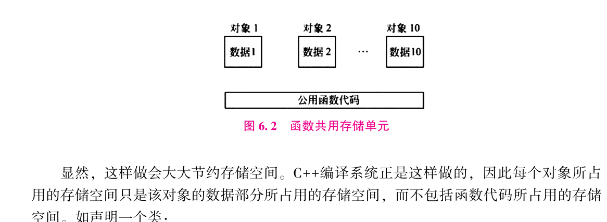


###### 6.2.2.3.1 this指针

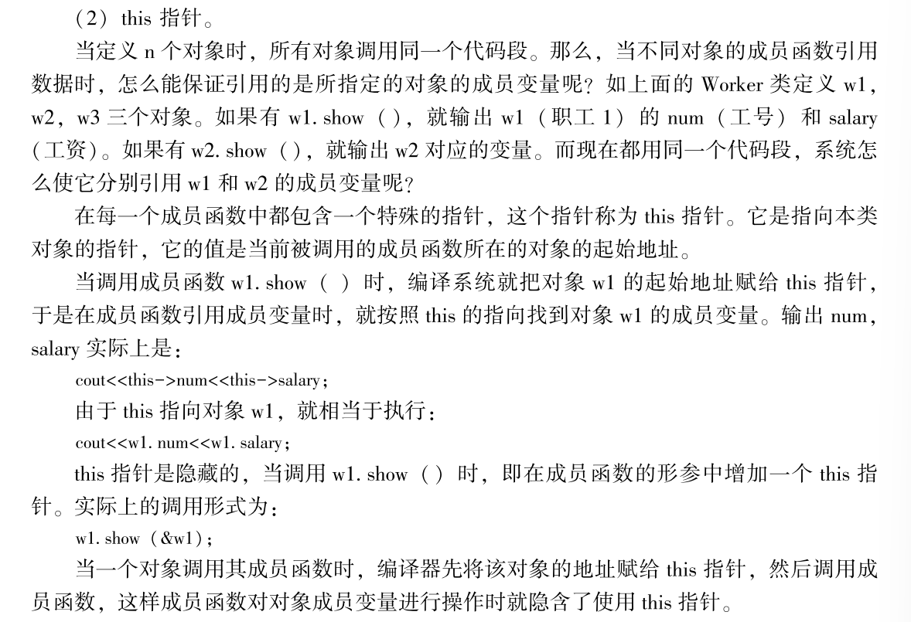

this 指向当前对象

```cpp

class myclass{
    private:
    int data;
    public:
    myclass(int value){
        data=value;//等价于this->data=value
        //构造函数可以重载，即可以根据传入的参数不同选择哪个构造函数
        //当形参与成员变量同名的时候this不可以省略
        //否组会误认为是函数的局部形参变量而成员变量则没有被初始化
    }
}

```
###### 6.2.2.4 指向对象成员函数的指针

#### 6.3 类的封装和信息隐藏

#### 6.4 析构函数和构造函数

构造函数的名称与类的名称完全相同，他不会有任何类型的返回值，void也没有
构造函数用来为某些成员变量设置初始值。
##### 6.4.1 默认构造函数
###### 6.4.1.1 默认（无参）构造函数

类的默认构造函数包括隐式默认构造函数和用户自定义的默认构造函数

（1）隐式默认构造函数

如果类中没有显示地定义构造函数，则编译器会自动提供一个不带参数且函数体为空地默认构造函数。

隐式默认构造函数，编译器会自动生成可以不用写。

```cpp
#include <iostream>

using namespace std;

class A{
    private:
    float x,y;
    public:
    A(){};  //默认隐式构造函数，编译器自动产生可以不写
    float Sum(){
        return x+y;
    }
    void Set(float a,float b){
        x=a;
        y=b;
    }
    void Print(){
        cout<<"x="<<" "<<"y="<<" "<<endl;
    }

};

int main(){
    A a1,a2;
    a1.Set(2,4);
    cout<<"a1:"<<endl;
    a1.Print();
    cout<<"a1.sum="<<a1.Sum()<<endl;
    return 0;
}

```

（2）显式/用户自定义地默认构造函数

如果程序中有自定义的构造函数，则编译器就不会再自动生成隐式默认构造函数，即优先使用自定义的默认构造函数创建对象。

> 例 6.8 用户自定义地默认构造函数

```cpp
#include <iostream>
#include <string>

using namespace std;

class Worker{
    private:
    int num;
    string name;
    float salary;

    public:
    Worker();
    void set(int n,string  name ,float salary);
    void show();
};
    Worker::Worker(){
        cout<<"Object is being created"<<endl;
    }

    void Worker::set(int n,string name ,float salary){
        num=n;
        name=name;
        salary =salary;
    }

    void Worker::show(){
        cout<<"num="<<num<<endl;
        cout<<"name="<<name<<endl;
        cout<<"salary="<<salary<<endl;
    }

int main(){
    Worker work1;
    work1.set(1,"张三",4000);
    work1.show();
    return 0;
}

```


###### 6.4.1.2 带参数的构造函数

> 声明带参数地构造函数的一般格式为：
> 构造函数名（类名） (类型1 形参1.....);

> 对象初始化
>
> 类名 对象名(初始化参数表);
> 法二：类名 对象名=类名(初始化参数表)


> 例 6.9
```cpp
#include <iostream>
#include <string>

using namespace std;

class Worker{
    private:
    int num;
    string name;
    float salary;

    public:
    Worker(int num,string name, float salary);

    void show();
};
    Worker::Worker(int num,string name, float salary){
        num=n;
        name=name;
        salary =salary;
    }

    void Worker::show(){
        cout<<"num="<<num<<endl;
        cout<<"name="<<name<<endl;
        cout<<"salary="<<salary<<endl;
    }

int main(){
    Worker work1(1,"张三",4000);
    //Worker work1=Worker(1,"张三",4000);
    work1.show();
    return 0;
}

```
###### 6.4.1.3 用参数初始化表对成员变量初始化

在原来函数首部的末尾加一个冒号，然后列出参数的初始化表(是对成员变量的初始化，而不是对函数的形参)。

Worker(int n,string name1,float s):num(n),name(name1),salary(s){}


###### 6.4.1.4 构造函数的重载

对构造函数进行重载，这些构造函数具有相同的名字，但是参数个数或参数类型至少有一个不同

> 6.10 构造函数的重载

```cpp
#include <iostream>

using namespace std;

class circle{
    private:
    float radius;

    public:
    circle();
    circle(float r):radius(r){}
    float area(){
        return radius * radius *3.14159;
    }
};

circle::circle(){
    radius=10.0;
}

int main(){
    circle c1(1.0),c2;
    cout<<"c1的面积为："<<c1.area()<<endl;
    cout<<"c2的面积为："<<c2.area()<<endl;
}

```

###### 6.4.1.5 使用默认构造参数的构造函数

```coo
#include <iostream>

using namespace std;

class circle{
    private:
    float radius;

    public:
    circle(float r=1.0);
    float area(){
        return radius * radius *3.14159;
    }
};

circle::circle(float r){
    radius=r;
}

int main(){
    circle c1(1.0),c2;
    cout<<"c1的面积为："<<c1.area()<<endl;
    cout<<"c2的面积为："<<c2.area()<<endl;
}
```

##### 6.4.2 复制构造函数
[拷贝构造函数（复制构造函数）b站](https://www.bilibili.com/video/BV1Wx421D7Tr/?spm_id_from=333.337.search-card.all.click&vd_source=cdc2a34485eb016f95eae1a314b1a620)


```cpp
class myclass{
    private:
    int data;
    public:
    myclass(int value){
        data=value;//等价于this->data=value
        //构造函数可以重载，即可以根据传入的参数不同选择哪个构造函数
        //当形参与成员变量同名的时候this不可以省略
        //否组会误认为是函数的局部形参变量而成员变量则没有被初始化
    }
    myclass(const myclass &other){
        //引用对象，myclass &other
        //常引用const myclass &other可以保护变量

        data=other.data*2;
    }
    int getData() const{
        return data;
    }
};

int main(){
    myclass obj1(5);
    myclass obj2(obj1);
    myclass obj3=obj1;
    cout<<"obj1："<<obj1.getData()<<endl;
    cout<<"obj2："<<obj2.getData()<<endl;
    cout<<"obj3："<<obj3.getData()<<endl;


    return 0;
}
```

##### 6.4.3 转换构造函数


##### 6.4.4 析构函数

destructor析构函数。没有返回类型，没有函数参数，不能被重载。
作用：撤销对象占用的内存之前完成一些清理工作。

如果用户不定义构造函数，系统会自动生成空的构造函数。

> 例 6.15 析构函数和析构函数的使用

```cpp
#include <iostream>
#include <string>

using namespace std;

class  Worker{
    public:
    Worker(int n,string namel,float s);
    ~Worker(){
        cout<<"Destructoring an object"<<name<<endl;
    }

    void show();
    private:
    int num;
    string name;
    float salary;
};
Worker::Worker(int n,string name1,float s){
    num=n;name=name1;salary=s;
}
void Worker::show(){
    cout<<"num:"<<num<<endl;
    cout<<"name:"<<name<<endl;
    cout<<"salary:"<<salary<<endl;
}
int main(){
    Worker work1(1,"张三",4000);
    work1.show();
    static Worker work2(2,"李四",2800);
    //只有main函数结束或者调用exit函数时，才调用static对象的析构函数
    work2.show();
    Worker work3(3,"王五",3800);
    work3.show();

    return 0;
}

```

#### 6.5 类模板


##### 6.5.1 类模板的概念
类模板中的成员变量、 成员函数的参数、 成员函数的返回值可以取不同类型，在实例化成对象时，根据传入的参数类型， 实例化成具体类型的对象。

##### 6.5.2 类模板的定义

> 类模板的一般形式：
> template<class/typename T1,class T2,...>
> class 类模板名{
> 成员函数和成员变量
> };

>例子

```cpp
template <class T1,class T2>
class add{
    private:
    T1 a;
    T2 b;
    public:
    add(T1 a,T2 b){
        x=a;y=b; //构造函数
    }
    T2 num(){
        return x+y;
    }

};
//在类外实现
template <class t1,class t2>
t2 add <t1,t2>::sum(){
    return x+y;
}


```

##### 6.5.3 类模板的实例化

> 类模板名 <模板参数值表> 对象1,对象2,对象...;

```cpp

#include <iostream>

using namespace std;

template <typename t1,typename t2>
class add{
    private:
    t1 x;
    t2 y;
    public:
    add(t1 a,t2 b){
        x=a;y=b;

    }
    t1 sum();
};
template <typename t1,typename t2>//类外定义类模板中的成员函数
t1 add<t1,t2>::sum{
    return x+y;
}
int main(){
add<float,float> (3,4.5);

cout<<a.sum()<<endl;

add <char ,int > b('a',32);
cout<<b.sum()<<endl;
return 0;

}
```
