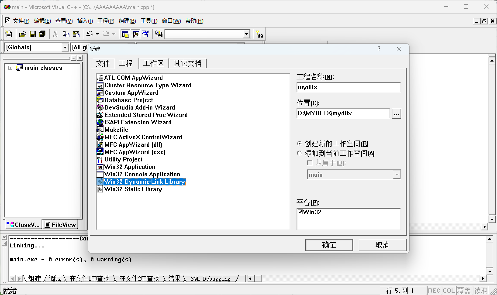
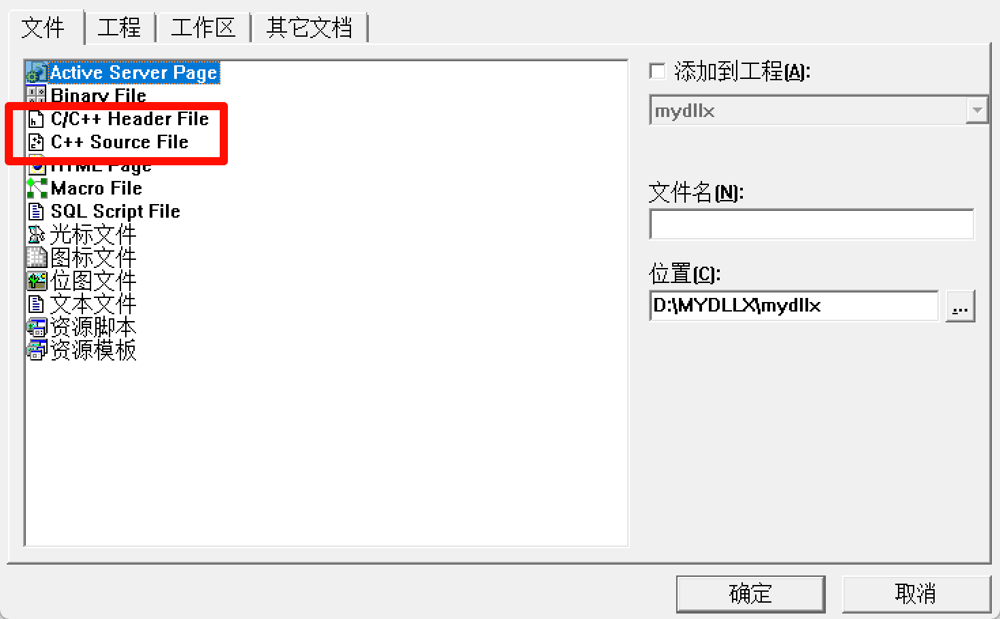
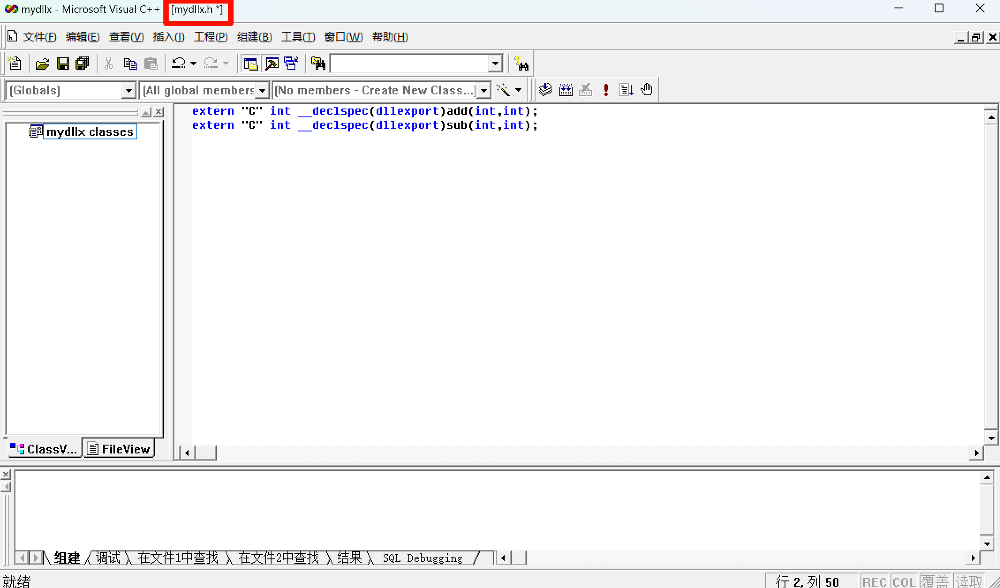
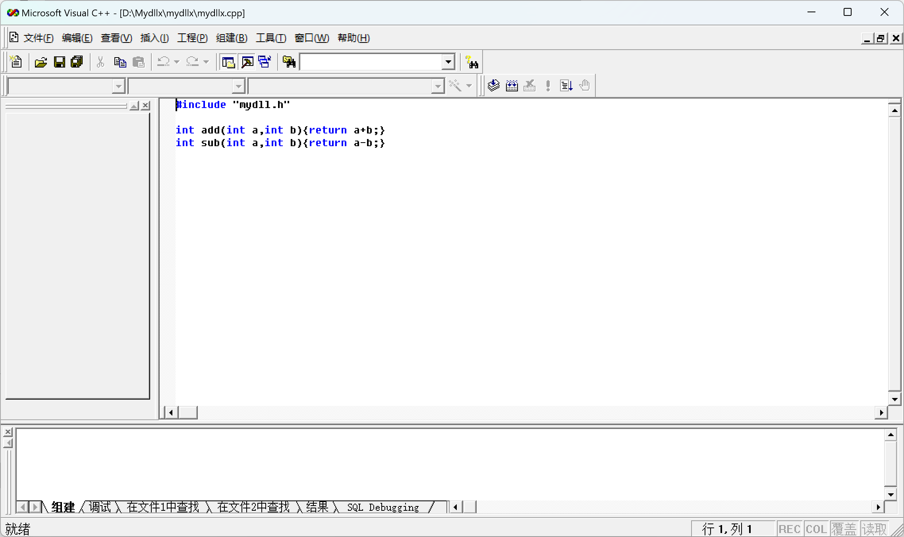
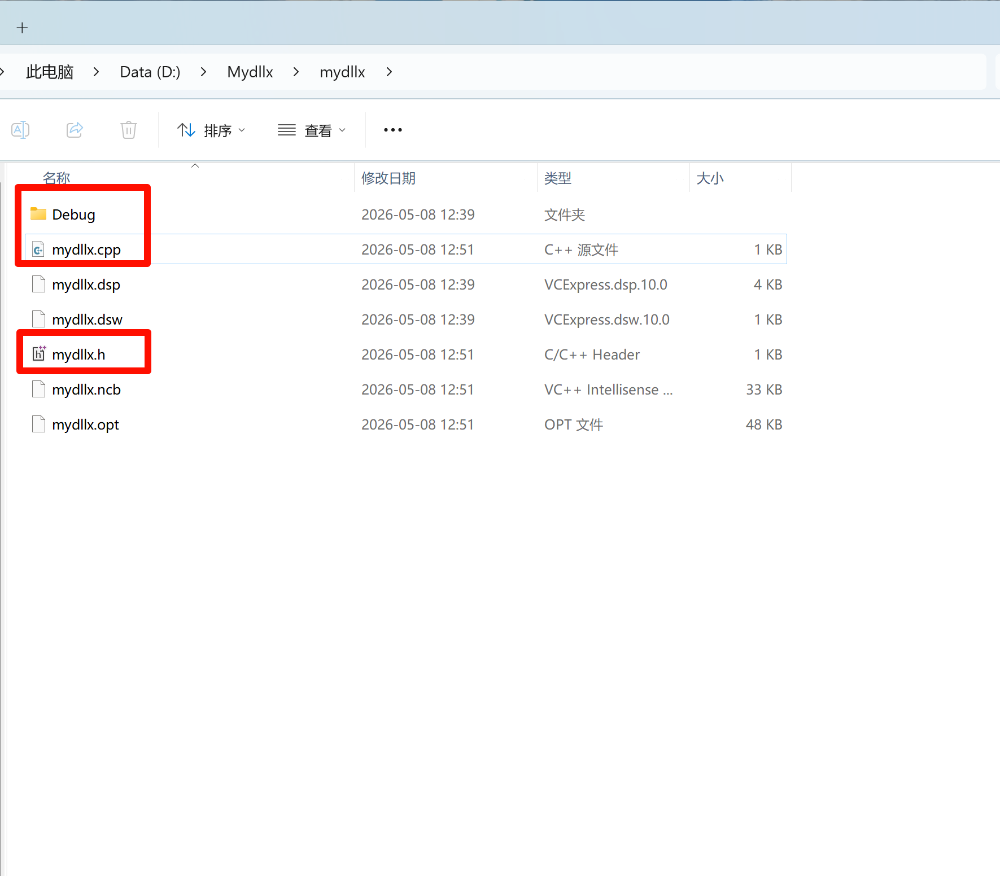
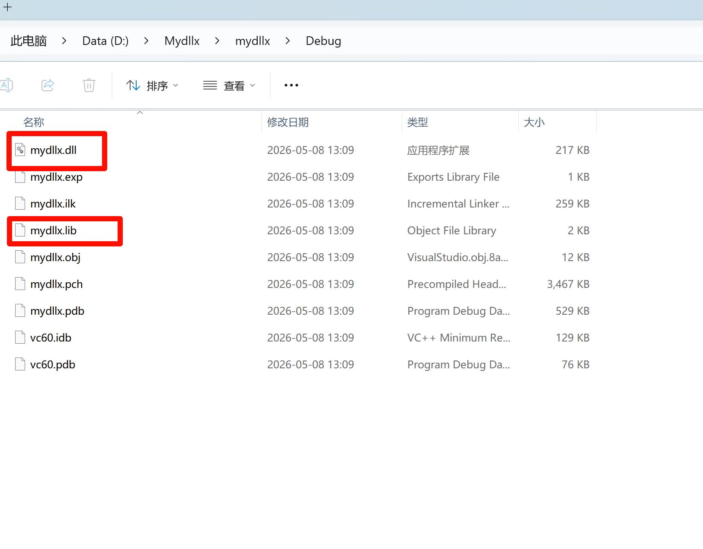
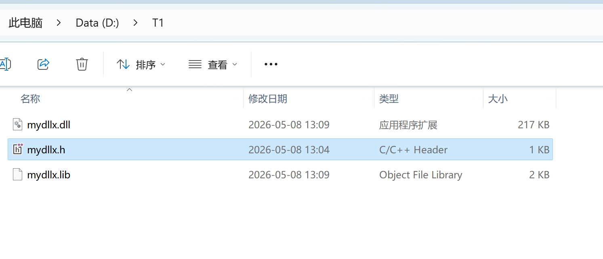

# 动态链接库与系统调用

<!-- 原笔记：第十周周五笔记_动态链接库.md -->

1. system()

system() 是 C 标准库提供的函数，核心作用：让 C 程序直接调用操作系统的命令行指令，简单说就是程序里执行系统命令。

windows.h有阉割版，正版再stdlib.h里


语法格式
system("操作系统命令");


//如：命令行窗口调用计算器
```cpp
#include <stdlib.h>


#include <stdlib.h>
#include <stdio.h>


int main() {

    system("calc.exe");
    printf("看看我有没有出来");
    system("cls"); //清屏  windows下用cls命令清屏  linux下用clear命令清屏
    return 0;
}

```
2. MessageBox()

windows 下win 32的一个api
int MessageBox(
    HWND hWnd,        // 父窗口句柄，没有就填 NULL
    LPCTSTR lpText,   // 弹窗里显示的内容
    LPCTSTR lpCaption,// 弹窗标题
    UINT uType        // 按钮 + 图标样式
);


函数名	编码	字符串格式	说明
MessageBoxA	ANSI（旧）	"普通字符串"	英文系统用
MessageBoxW	Unicode（现代）	L"宽字符串"	Windows 原生、全语言支持

哎呀，直接用老版本吧

```cpp

#include <windows.h>

int main(){
    MessageBox(NULL,"哈哈哈哈是的","顶天立地",1);
    //新版MessageBoxW(NULL,L"哈哈哈哈是的",L"顶天立地",1); //宽字符串格式
    //MessageBoxA(NULL,"哈哈哈哈是的","顶天立地",1); //ANSI字符串格式
    return 0;
return 0;
}

```


3.
```cpp
#pragma comment(lib, "库所在文件路径")
这样就不用手动输入添加了

#ifndef LIB_H
#define LIB_H

#endif

防止重复包含
ifndef =if no define
如果定义了 就跳到 endif 没定义就#define LIB_H

```

4.

动态链接库

隐式api ，.h .dll .lib一起打包给人家
显式API  .h  .dll  打包给人家


创建 动态链接库工程



然后 建立 头文件和源文件




注意一下
DLL中对外用 extern

"C"C系列产品,C一定要大写


命名规范，一般系统级，权限比较高的用__，和java差不多
dllexport 导出
dllimport 导入
然后一如既往的老师认为的雄壮的写法，声明不用给出形参名

头文件


实现


这个有点问题，写完编译应该会有.dll和.lib，但是debug里没有，在project options里设置也正常
改成下面这个，
```
#include "mydllx.h"
#include <windows.h>

// ===================== 关键：VC6.0 DLL 必须的入口 =====================
BOOL APIENTRY DllMain(
    HMODULE hModule,
    DWORD  ul_reason_for_call,
    LPVOID lpReserved
)
{
    switch (ul_reason_for_call)
    {
    case DLL_PROCESS_ATTACH:
    case DLL_THREAD_ATTACH:
    case DLL_THREAD_DETACH:
    case DLL_PROCESS_DETACH:
        break;
    }
    return TRUE;
}
// =====================================================================

// 你的函数实现
int add(int a, int b)
{
    return a + b;
}

int sub(int a, int b)
{
    return a - b;
}
```

看看文件夹吧





然后我们测试


把三个给人家打包过去，然后人家就可以隐式直接调用，就是

```cpp
#include "mydllx.h"
#pragma comment(lib, "mydllx.lib") // 直接链接到 .lib 文件
#include <iostream>
using namespace std;
int main(){
cout<<add(1,2)<<"   "<<sub(3,2)<<endl;
    return 0;
} 

```
然后呢，如果我们不给人家.lib文件，只有.dll和.h文件，那就只能显式调用了，代码如下

语法太难了，不会
```cpp
#include <stdio.h>
#include <windows.h>
typedef int(*lpAddFun)(int, int); //宏定义函数指针类型
int main(int argc, char *argv[])
{
HINSTANCE hDll; //DLL 句柄
lpAddFun addFun; //函数指针
hDll = LoadLibrary("..\\Debug\\dllTest.dll");
if (hDll != NULL)
{
addFun = (lpAddFun)GetProcAddress(hDll, "add");
if (addFun != NULL)
{
int result = addFun(2, 3);
printf("%d", result);
}
FreeLibrary(hDll);
}
return 0;
}

```

然后是一个类的

```cpp

//Rectangle.h
class __declspec(dllexport)Rectangle
{
public:
    Rectangle(double=1,double=1);
    void SetData(double,double);
    double GetArea();
    double GetPeri();
private:
    double length,width;
};


//Rectangle.cpp
#include "Rect.h"


Rectangle::Rectangle(double l, double w)
{
    length = l;
    width = w;
}


void Rectangle::SetData(double l, double w)
{
    length = l;
    width = w;
}

double Rectangle::GetArea()
{
    return length * width;
}

double Rectangle::GetPeri()
{
    return 2 * (length + width);
}

//main.cpp
#include <iostream>
#include "Rect.h"
using namespace std;
#pragma comment(lib,"Rect.lib")
int main()
{
    Rectangle x;
    x.SetData(5,6);
    cout<<x.GetArea()<<" "<<x.GetPeri()<<endl;
    return 0;
}

```
