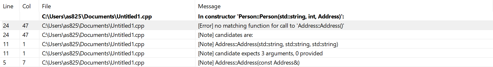

# 对象成员初始化

<!-- 原笔记：对象成员初始化问题.md -->

> 来源B站的一位老师

[如何用ai帮助我们学习编程?](https://www.bilibili.com/video/BV17D421H7Pp/?spm_id_from=333.1387.homepage.video_card.click&vd_source=cdc2a34485eb016f95eae1a314b1a620)

```cpp
#include <iostream>
using namespace std;
#include<string>

class Address {
public:
string street;
string city;
string country;

Address(string street, string city, string country) {
this->street = street;
this->city = city;
this->country = country;
}
};

class Person {
public:
string name;
int age;
Address address; // 对象成员

Person(string name, int age, Address address) {
this->name = name;
this->age = age;
this->address = address;
}

void displayInfo() {
cout << "Name: " << name << endl;
cout << "Age: " << age << endl;
cout << "Address: " << address.street << ", " << address.city << ", " << address.country << endl;
}
};

int main() {
Address myAddress("123 Main St", "Cityville", "Countryland");
Person myPerson("John Doe", 25, myAddress);

myPerson.displayInfo();

return 0;
}

```



ai说，Person类未创建对象前，成员变量必须要先初始化，然后呢基本类型的初始化不是很严格，像int 只要分配4个字节的空间就行了，或者说初始化成了一些随机值。但是对象成员呢就很严格了，要调用构造函数。一开始我的纠结点是，在main函数里adress已经初始化了，为什么还是会报错呢，然后ai说，类必须调用构造函数去初始化。编译的时候我们不创建构造函数，编译器会自动生成无参构造函数，但是我们创建了一个有参的，他就不会自动生成无参的，那我又想了直接用有参构造函数去初始化，随便给值不行吗？ai说不行，至于为什么不行，它的回答是就是这样规定的。最终解决办法推荐加个初始化列表。

**改进后**

```cpp

#include <iostream>
#include <string>
using namespace std;

class Address {
public:
    string street;
    string city;
    string country;

    Address(string street, string city, string country) {
        this->street = street;
        this->city = city;
        this->country = country;
    }
};

class Person {
public:
    string name;
    int age;
    Address address;

    // 使用初始化列表来初始化对象成员 address
    Person(string name, int age, Address address) : address(address) {
        this->name = name;
        this->age = age;
    }

    void displayInfo() {
        cout << "Name: " << name << endl;
        cout << "Age: " << age << endl;
        cout << "Address: " << address.street << ", " << address.city << ", " << address.country << endl;
    }
};

int main() {
    Address myAddress("123 Main St", "Cityville", "Countryland");
    // 这里的 myAddress 会通过拷贝构造函数传递给 Person
    Person myPerson("John Doe", 25, myAddress);

    myPerson.displayInfo();

    return 0;
}
```

说实话，我不知道什么叫初始化成员列表，估计就是个标记作用，告诉编译器你不用给我初始化了，我之后会自己初始化的吗，就不劳您费心了。
