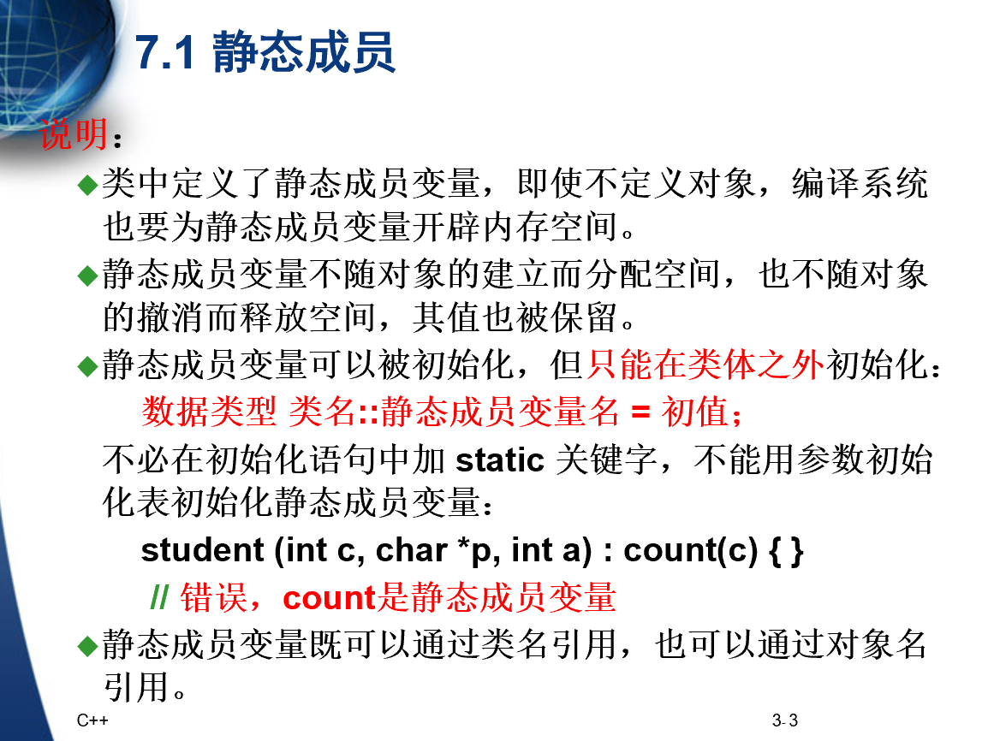
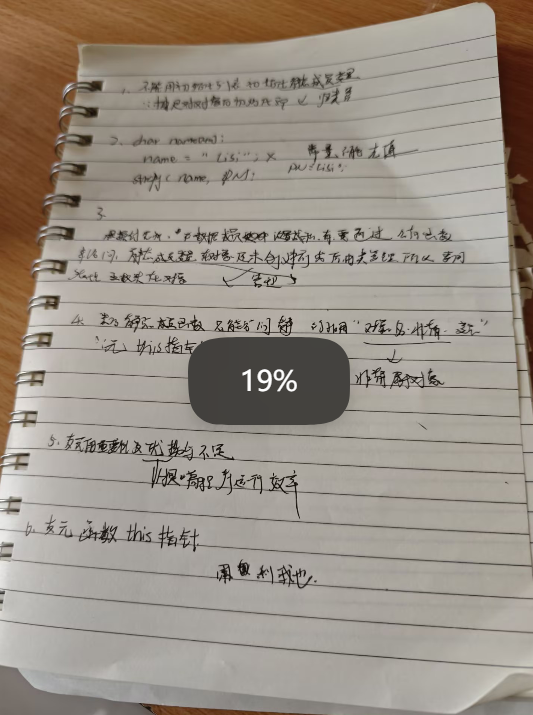

# 第 11、12 课时

<!-- 原笔记：课堂回顾/第11、12课时课堂回顾.md -->

第三周，最后一节面向对象程序设计，很困，没听懂。

开始新篇章  第七章  数据的共享和保护


** 补充一下 c系列的内存划分**

C语言在内存中一共分为如下几个区域，分别是：

1. 内存栈区：仅存放常量字符串和const修饰的全局变量。普通局部变量的值在栈区
2. 内存堆区： 存放new或者malloc出来的对象；
3. 常数区： 存放局部变量或者全局变量的值；
4. 静态/全局区： 用于存放全局变量或者静态变量；注意：这里存放的是静态成员变量的数据，而不是函数本身
5. 代码区：包括所有函数的定义（含静态成员函数）。


[C/C++程序内存的各种变量存储区域和各个区域详解](https://blog.csdn.net/jirryzhang/article/details/79518408)


静态成员：静态成员变量、静态成员函数
**静态成员变量**
放在静态区或者叫全局区



 类中定义了静态成员变量，即使不定义对象，编译系统也要为静态成员变量开辟内存空间。
静态成员变量不随对象的建立而分配空间，也不随对象的撤消而释放空间，其值也被保留。

> 在为对象分配空间时，不分配静态成员变量的空间，因为它不属于任何对象。只要类中定义了静态成员变量，即使不定义对象，编译系统也要为静态成员变量开辟内存空间。

后两点，一个是静态成员变量的初始化问题，一个是引用问题
看个例子
```cpp
#include <iostream.h>
#include <string.h>
class Student
{ public:
    static int count; //静态成员变量
    char name[40];
    Student(char* pN ="no name")
    { cout<<"Create one student "<<pN<<"\n";
       strcpy(name,pN);
       count ++;
       cout<<count<<endl;
    }
    ~Student ( )
    { cout<<"destruct one student “<<name<<"\n";
       count --;
       cout<<count<<endl;
    }
};
int Student::count=0;
void main( )
{Student s1("zhangsan");

  cout<<"Student::count“<<Student::count<<endl;

 Student s2("lisi");

 cout<<"Student::count“<< s1.count<< endl;
}


```

**常量不能做左值**

char name[20];
name="jsif";
错误，数组名是常量，表示的是地址
只能用字符串拷贝函数
strcpy(name,"jsif");


**静态成员函数**

所有的函数的定义均放在代码区

在类的定义中，成员函数前如果加了 static 限定词，该成员函数就成为静态成员函数。例：static int volume( );

用途：静态成员函数的作用不是为了对象之间的沟通，主要是为了引用本类中的静态成员变量。它可以直接引用本类的静态成员变量。

静态成员函数与普通成员函数的区别：静态成员函数没有 this 指针，由此决定静态成员函数不能访问本类中的非静态成员变量，除非用“对象名.非静态成员变量”的形式。


---
然后就是友元了，听不懂

友元函数  类体内声明，类外定义
友元函数是非成员函数
```cpp

#include <iostream>
#include <math.h>
using namespace std;

class Point{
    public:
        Point(double i,double j):x(i),y(j){

        }
        void Getxy(){
            cout<<"("<<x<<","<<y<<")"<<endl;
        }
        friend double Distance (Point a,Point b);
    private:
        double x,y;
};

double Distance(Point a,Point b){
    double dx=a.x-b.x;
    double dy=a.y- b.y;
    return sqrt(dx*dx+dy*dy);
}
int main(){
    double d11=3.0,d12=4.0;
    double d21=6.0,d22=8.0;
    Point P1(d11,d12),P2(d21,d22);
    P1.Getxy( );
    P2.Getxy( );
    double d=Distance(P1,P2);

    cout<<"Distance is"<<d<<endl;


    return 0;
}
```

友元成员函数：friend 函数也可以是另一个类中的成员函数。
```cpp
#include <iostream>
using namespace std;

class two;
class one
{
private:
    int value;

public:
    one(int v)
    {
        value = v;
    }
    void settwo(two &ob);
    void show()
    {
        cout << "class one's private value = “<< value << endl;
    }
};
class two
{
private:
    int value;

public:
    void show()
    {
        cout << "class two's private value = “ << value << endl;
    }
    friend void one::settwo(two &ob);
};

void one::settwo(two &ob)
{
    ob.value = value;
}
void main()
{
    one ob1(2);
    two ob2;
    ob1.settwo(ob2);
    ob1.show();
    ob2.show();
}

```
附件：


