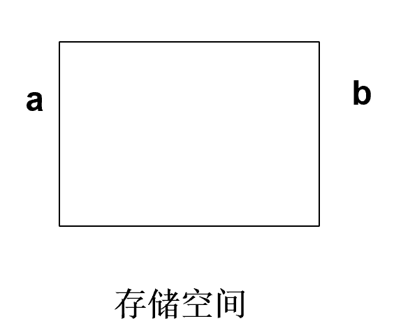

# 第 1、2 课时

<!-- 原笔记：课堂回顾/第1、2课时.md -->

共56课时16节实验课

40课时理论课，也就是20节课

1-6 12节，8-11 8节

这两节课主要讲了C++对C的扩充，回顾了一些C语言的内容，学到了很多细节


1.  iostream 可以叫头文件，也可以叫类，java中，叫包
2. using namespace 标准命名空间
3. cin  cout对象
4. << 流插入运算符  >>流提取/取出运算符
5. const定义常变量，存储在全局数据区

const float PI = 3.1415926;


6. 引用，相当于给原变量取别名

引用是阉割版的指针，是指针出于安全考虑的代替品

```cpp
int a;
int &b=a;
/&叫引用声明符，不是取地址

 void exchange(int & a,int & b){
    int c=a;
    a=b; b=c;
}

//传统写法，传递变量的指针
void swap ( int *p1, int *p2 )
{ int temp;
  temp = *p1;
  *p1 = *p2;
  *p2 = temp;
}
//swap(&i,&j);
```




7. 函数声明，参数可以不指定参数名，但是要指定参数类型
8. 重载：一个标识符有多个用途时，要用到重载

标识符可以是运算符，也可以是函数等

函数重载和运算符重载

9. 函数重载：函数名相同，参数不同（位置，个数，类型）

注意:仅有返回值类型不同时，不会重载

```cpp
int add(int a,int b){return a+b;}
double  add(int a,int b){return a+b;}//会报错
```


10. C中，int型会强制转化位double型，下面这种情况

```cpp
double add(double a,double b){
    return a+b;
}
//调用时
//add(3,4);//会自动转换为double型
```

11. 双精度浮点型，1.0，如果想传给单精度float，要用c中的强转， 1.0f
12. 函数模板

```cpp
template <typename T>
T add(T a,T b){
    return a+b;
}

//add(1,2.0)//这样会报错，当系统不同判断出类型时，要人工指定
add<double> (1,2.5);
```

13. int a=4.5;//会隐式转换，取整数部分，截断，a=4
14. 函数的默认参数要放在最后边

如果第七个参数是默认参数，那么第8，9，10个一定也是默认参数

```cpp
void f1(float a, int b=0, int c, char d=‘a’); //会报错
void f2(float a, int c, int b=0, char d=‘a’);

```

15. 很细的一个题

```cpp
#include <iostream>
using namespace std;
int max(int a, int b, int c=100)
{   if(b>a)   a=b;
     if(c>a)   a=c;
     return a;
}
int max(int a, int b)
{   if(a>b)   return a;
     else        return b;
}
int main()
{   int a=7,b=-4,c;
     cout<<max(a,b,c)<<endl;
     cout<<max(a,b)<<endl;
      return 0;
}

```

cout<<max(a,b,c)<<endl；这段代码，可能输出随机值，c是随机值

max(a,b);会报错，当系统无法判断是用重载函数还是利用默认参数函数时，会报错

16. 内联函数：在编译时将所调用函数的代码嵌入主函数中，这种嵌入到主函数中的函数称为内联函数。注意是在编译时
