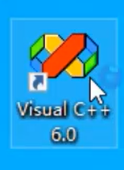

# 第 7、8 课时

<!-- 原笔记：课堂回顾/第7、8课时.md -->

这周1，第5，6课时，第一节讲完数组和指针，这些就不单独做笔记了，比较散的知识点和课堂一些要点有整理，ppt上我也做了标注。

第六课时，20Min讲完第五章函数，有一个函数指针比较难，然后剩下时间开始学第六章，比较重要的是要背八股，应该会考简答题。

7、8课时，讲到了构造函数，这节课十分硬核啊，讲了vs这个ide的一部分功能，讲了些MFC，看了一个按钮啊，信息绑定的代码和原理。map之类的

简答题：
1. 类的封装性，本身角度，对外使用者角度
2. 什么是类和对象，类和对象的联系
3. 对象，消息message绑定，方法
4. 解释存储方式，如：说说成员函数的存储方式，内存四个区及程序在内存中的位置

1. 类的封装性（本身角度 vs 对外使用者角度）
从类本身的角度（内部）：
封装是将数据（成员变量/属性）和操作这些数据的代码（成员函数/方法）绑定在一起，形成一个不可分割的独立单位（即类）。同时，它通过访问控制符（如 private, protected）隐藏了类的内部实现细节，保护内部数据不被外部随意篡改，确保了对象内部状态的完整性和安全性。

从对外使用者的角度（外部）：
封装为使用者提供了一组公开的接口（public 方法）。使用者不需要知道类内部是如何工作的（比如数据是怎么存储的、算法是怎么计算的），只需要知道“这个类能做什么”以及“如何调用这些接口”即可。这大大降低了使用者的学习成本，也降低了模块间的耦合度。

2. 什么是类和对象，类和对象的联系
类（Class）：
类是一组具有相同属性（数据结构）和行为（操作/方法）的对象的抽象描述。它是一个模板或蓝图，属于自定义的数据类型，本身并不占用实际的物理内存（除了代码段中的函数代码）。

对象（Object）：
对象是类的具体实例。它是程序在运行时真实存在的实体，占据具体的内存空间，并拥有自己特定的属性值。

两者的联系：

抽象与具体：类是对象的抽象，对象是类的具体化。

模板与产物：类就像是建造房屋的图纸，而对象就是根据图纸实际建造出来的、可以住人的房屋。

实例化：通过类创建对象的过程称为“实例化”。

3. 对象，消息 (Message) 绑定，方法
这三个概念描述了面向对象系统中程序是如何运行的：

对象（Object）： 运行时的基本实体，既包含状态（数据），又包含行为（代码）。

方法（Method）： 类中定义的函数，是行为的具体实现代码。它决定了对象在接收到特定指令后，具体要执行哪些步骤。

消息与绑定（Message & Binding）：

消息：对象之间交互的途径。向对象发送消息，就是请求该对象执行某个操作（通常包含接收者、方法名和参数）。

消息绑定：将“发送的消息（函数调用）”与“具体的代码实现（方法体）”关联起来的过程。

静态绑定（早绑定）：在编译阶段就决定了调用哪段代码（如普通函数调用、函数重载）。

动态绑定（晚绑定）：在运行阶段根据对象的实际类型来决定调用哪段代码（如 C++ 中的虚函数 virtual，这是实现多态的核心机制）。

4. 内存的四个区及成员函数的存储方式
这是底层机制的重点考题，通常以 C/C++ 的内存模型为基准：

程序在内存中的四个区：

代码区 (Code Segment)： 存放程序编译后的二进制机器指令。该区域是只读的（防止程序被意外修改）且是共享的。

全局/静态区 (Global/Static Segment)： 存放全局变量、静态变量（static）以及常量（如字符串常量）。这部分内存在程序整个运行期间都存在，程序结束后由操作系统释放。

栈区 (Stack)： 由编译器自动分配和释放。主要存放函数的局部变量、函数参数、返回地址等。它的特点是先进后出，分配速度快，但空间有限。

堆区 (Heap)： 由程序员手动申请和释放（在 C++ 中通过 new/delete，在 C 中通过 malloc/free）。用于动态内存分配，空间大但如果不释放会造成内存泄漏。

---
老师上课用 Visual Studio 演示了 GUI（图形用户界面），并且明确提到了 button.click() 和 MFC（Microsoft Foundation Classes），那么这道题的考点就完全不是普通的 C++ 虚函数动态绑定了。

老师想考的是**“事件驱动编程（Event-Driven Programming）”**以及 MFC 特有的“消息映射机制（Message Map）”。这是 C++ 面向对象在 Windows 桌面开发中最经典的实际应用。

我们赶紧把这三个概念切换到 Windows GUI 和 MFC 的语境下来重新梳理，这才是你考试能拿满分的答案：

基于 GUI 和 MFC 语境的“对象、消息、绑定、方法”
在 Windows 程序和 MFC 框架中，程序的运行不再是由 main() 函数从头到尾顺序执行，而是由“消息（事件）”来驱动的。

1. 对象（Object）：界面上的实体
在 GUI 编程中，你看到的每一个窗口、按钮（Button）、文本框、菜单等，都是一个个具体的对象。

例如：在 VS 中拖入一个按钮，它在底层就是一个 CButton 类的实例化对象。

2. 消息（Message）：系统传递的事件通知
当用户与界面发生交互时（例如：用鼠标点击了按钮 button.click()，或者敲击了键盘），Windows 操作系统会捕捉到这个动作，并将其打包成一个**“消息”**发送给当前程序。

例如：点击按钮时，系统会产生一个名为 WM_COMMAND（或具体的 BN_CLICKED）的消息，其中包含了“是谁（哪个按钮ID）被点击了”的信息。

3. 方法（Method）：处理消息的响应函数
方法也就是消息处理函数（Event Handler）。它是定义在窗口类（对象）内部的一段代码，专门用来规定“当收到某个特定消息时，程序该做出什么反应”。

例如：你双击按钮后，VS 自动为你生成的一个函数（如 OnBnClickedButton1()），这就是用来处理点击动作的方法。

4. 消息绑定（Message Binding）：将“消息”与“方法”连线

这是最核心的一步。当操作系统发来一个“按钮被点击”的消息时，程序是怎么知道该去执行哪个方法的呢？这就是绑定的作用。

在 MFC 中，这种绑定被称为“消息映射机制（Message Map）”。

MFC 没有使用 C++ 标准的虚函数（virtual）来实现这种绑定，因为 Windows 消息太多了，如果全用虚函数会导致内存（虚函数表）开销极其巨大。

相反，MFC 使用了一组宏定义（比如 BEGIN_MESSAGE_MAP, ON_BN_CLICKED, END_MESSAGE_MAP）来建立一张“表格”。这张表明确记录了：当产生“按钮1被点击（消息）”时，去调用“OnBnClickedButton1（方法）”。

💡 考前/实验课背诵总结（直接写在卷子上的提炼版）
如果考试遇到这道题，你可以这样作答（拿捏老师的心智）：

答：
在诸如 MFC 的 GUI 编程中，程序是基于事件驱动的。

对象代表了界面上的可视化控件，如按钮（Button）。

消息是用户操作（如点击 click）触发后，由操作系统生成的事件通知。

方法是对象内部定义的、用于响应该操作的具体函数（如事件处理程序）。

消息绑定是指将特定的“Windows 消息”与具体的“处理方法”关联起来的过程。在 MFC 中，为了避免虚函数表带来的巨大内存开销，采用了消息映射机制（Message Map），通过宏定义静态地将消息标识符绑定到对应的成员函数上，从而实现消息的正确路由与响应。

---

1. 成员函数第一个参数是隐藏的默认参数，本类名* this

2. 普通函数也叫全局函数

3. vs的一些用法

工作区
工作空间就是文件夹
工程project   Win32 console Application (缩写APP)

4.变量一般叫ID
5. 类中变量不能赋值

6. iostream.h 不写using namespace std;
iostream 要写using namespace std;

但是vs2026 社区版，不能直接iostream.h
而且vs2026和老师那个操作页面不一样呢，之后要去找找老师用的软件了

原来是visual c++ 6.0

98年的，c++98还是太权威了

还没dev好用
7. 函数声明可以仅给出形式参数的类型，定义时要给出形参名
