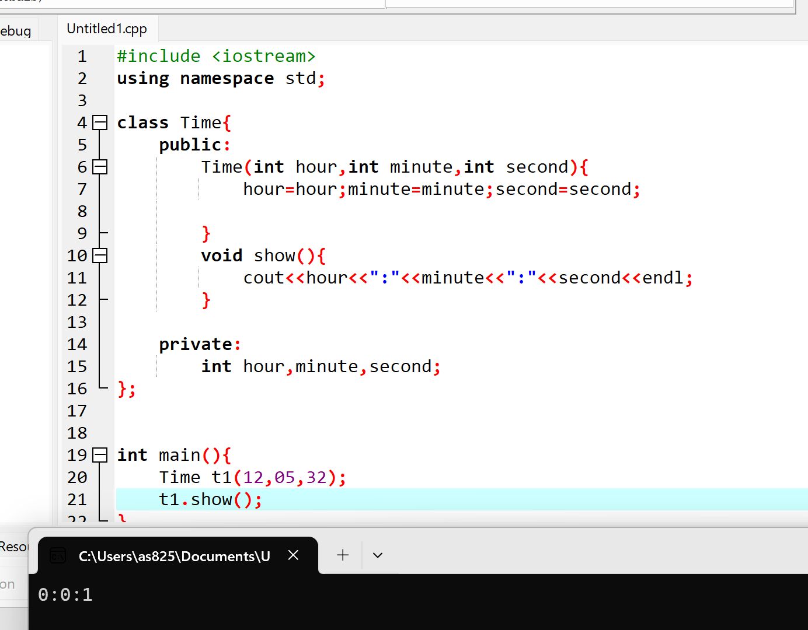
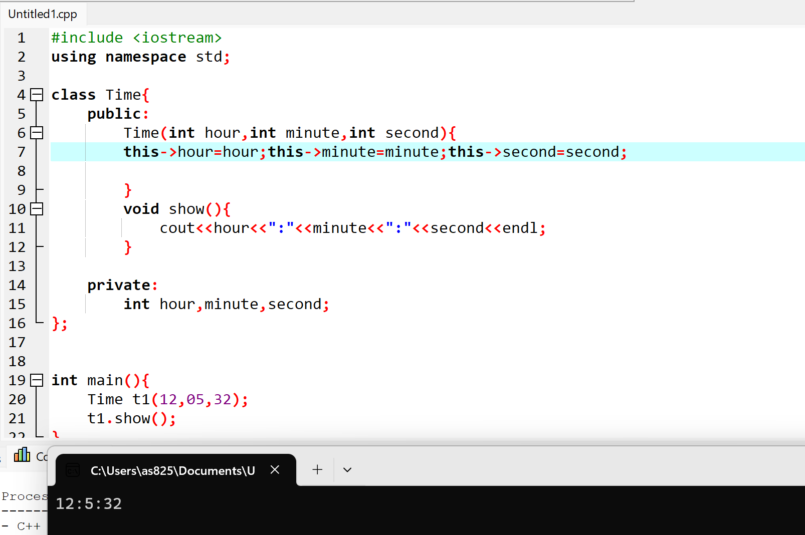
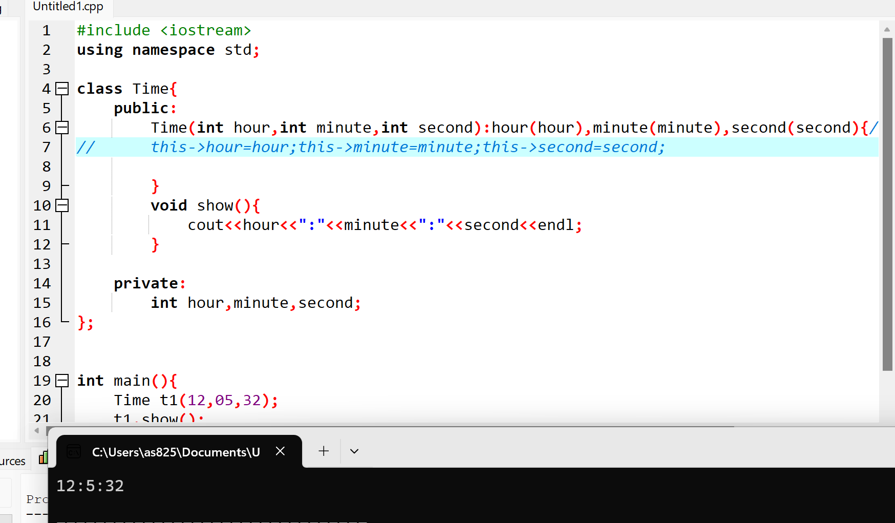
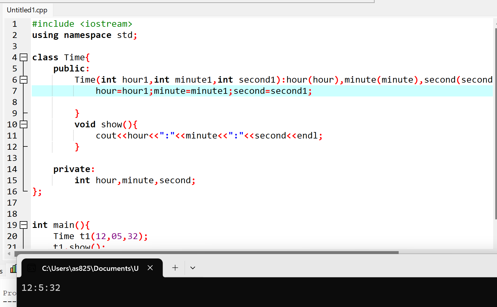

# 第 9、10 课时

<!-- 原笔记：课堂回顾/第9、10课时.md -->

听的云里雾里，析构函数那块，之后学虚函数析构函数然后再去刷题

排序和查找要去复习+刷题


1. 类作用域

在类的作用域内部，所有成员可以直接相互访问，且不受声明顺序的限制（哪怕变量声明在函数之后，函数也能直接用它），也不受访问修饰符（public/private）的限制。

2. 当构造函数的形参与数据成员相同时，会优先用形参


可以看到数据成员是随机值


解决方法
1. 不同名
2. 成员初始化参数列表
3. this 指针






3. 三种情况必须用成员参数初始化列表

**很可能让解释原因，出解答题**
- 数据成员是常量    常变量也算  const int k;
- 引用     注意函数传参是拷贝过来的，也就是引用类型
- 对象成员

4. 数据成员放在代码区，代码区不能赋值
5. 一个类中只有一个默认构造函数（参数为空）

circle r();默认构造函数，对象初始化时不写()，
circle r;

6. 声明戒断可用默认形参值，类外定义不可以


```cpp
circle(float r=1);
circle();
circle(float);

main

circle r(1);

二义性报错
```
