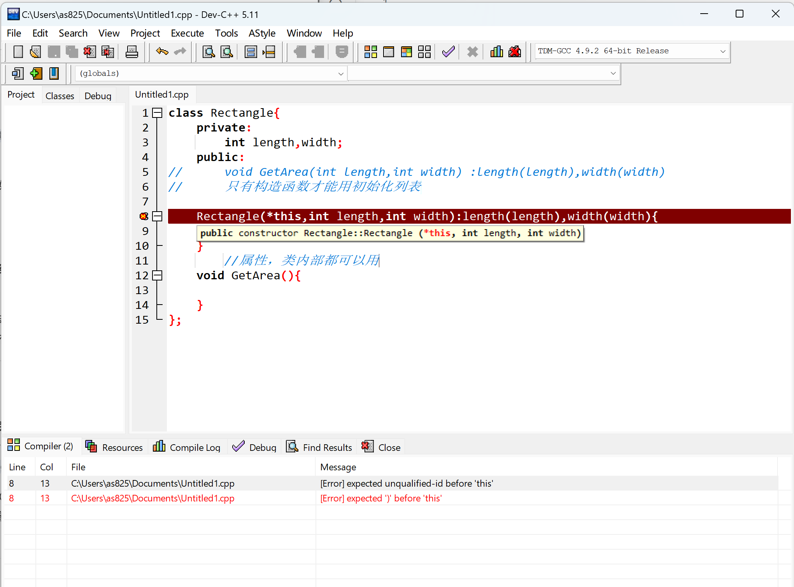
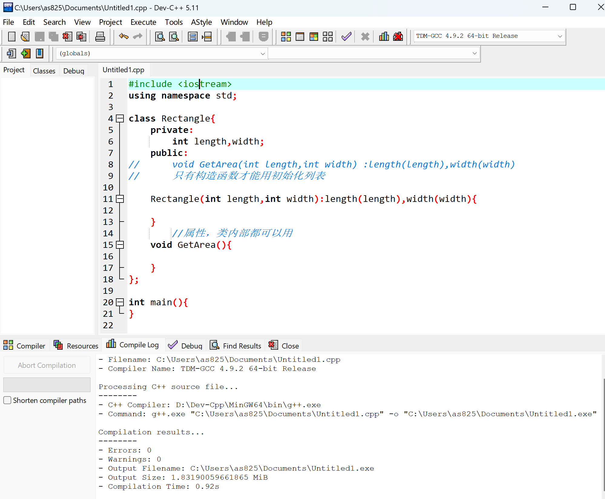
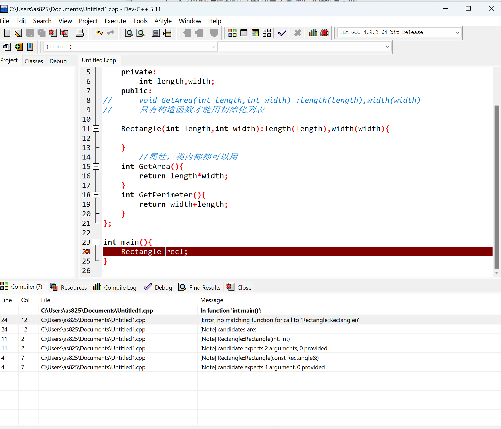
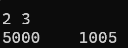
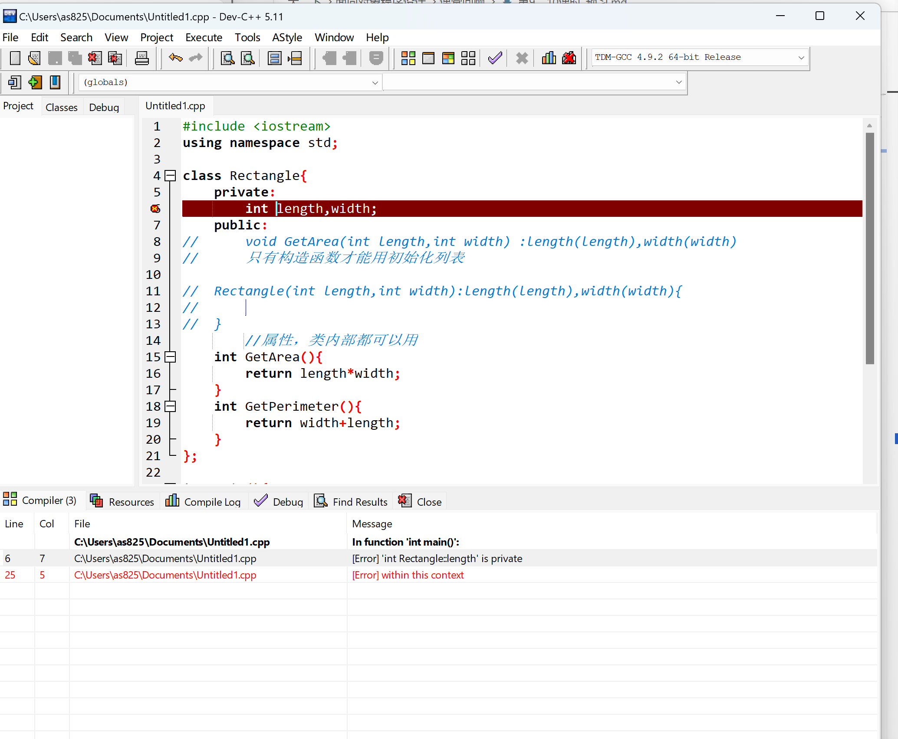
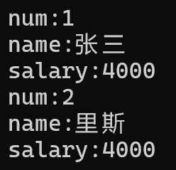
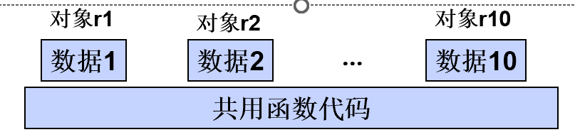
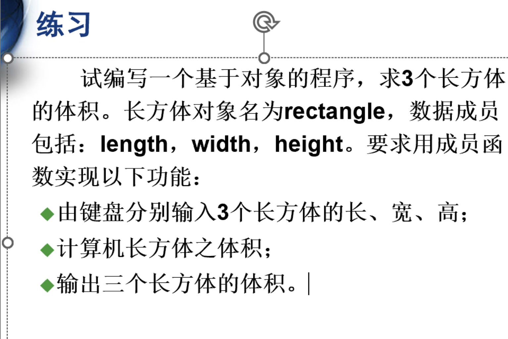

# 第 9、10 课时预习

<!-- 原笔记：课堂回顾/第9、10课时_预习.md -->

第三周 周三上


复习：

八股

> 什么是类？什么是对象？他们之间的关系是什么？
>
> 类是一组具有相同属性和行为的对象的抽象描述。是对象的类型
>对象是描述客观事物的实体，每个对象都有其行为、属性和标识
> 类是对象的抽象，对象是类的具体实例。


可能的题
> 矩形类，实现求面积，周长的功能

tips:java小驼峰，c系列大驼峰



*this 不能显示加上





---

这里复习一下构造函数

分类

- 隐式构造函数
- 用户自定义构造函数
用户自定义构造函数又分为，有参和无参
有参又分为指定默认值和不指定默认值
无参，也可以在函数体内写语句

构造函数可以重载，即一个类可以有多个构造函数

上述报错：用户自定义构造函数，如果有参数，且不含默认参数，船舰对象时必须初始化，和寒假那题差不多
[对象成员初始化问题](https://www.cnblogs.com/yezang/p/19621826)

```cpp

#include <iostream>
using namespace std;

class Rectangle{
    private:
        int length,width;
    public:
//		void GetArea(int length,int width) :length(length),width(width)
//		只有构造函数才能用初始化列表

    Rectangle(int length,int width):length(length),width(width){

    }
        //属性，类内部都可以用
    int GetArea(){
        return length*width;
    }
    int GetPerimeter(){
        return width+length;
    }
};


int main(){
    Rectangle rec1(1,2),rec2(5,1000);
//	Rectangle rec2(5,1000);
    cout<<rec1.GetArea()<<" "<<rec1.GetPerimeter()<<endl;
    cout<<rec2.GetArea()<<"\t"<<rec2.GetPerimeter();
}


```



转义字符
\t制表符


私有化

解决方法
- 构造函数
- 成员函数间接调用
- public中定义数据成员

> 指向对象的指针
> 对象的引用


```cpp
#include <iostream>
#include <string>

using namespace std;

class Worker{
    public:
        int num;
        string name;
        float salary;
        void show(){
            cout<<"num:"<<num<<endl;
            cout<<"name:"<<name<<endl;
            cout<<"salary:"<<salary<<endl;
        }
};


int main(){
    Worker w1,w2,w3;
    Worker *p=&w1;
    Worker &w4=w3;
    p->name="张三";
    p->num=1;
    p->salary=4000;
    p->show();

    w3.name="里斯";
    w3.num=2;
    w3.salary=4000;
    w3.show();

}

```




4000隐式转换成单精度浮点型
4000.0 双精度浮点型
4000.0f  c风格，强转单精度
(float)4000  强转单精度


> 指向对象成员变量的指针

```cpp

int *P;
Worker w2;
p=&w2.salary;
w2.salary=4000;
cout<<*p<<endl;
```

成员函数
1. private public  protected
2. 类中，自动内联，现在内联被淘汰，编译器会自动识别帮助我们内联
3. 类中声明，可以只写参数类型
4. 类中声明，类外定义，  类名::函数名
::域作用符

5. 成员函数的存储方式

同一类定义了多个对象时，每个对象的数据成员各自占据独立的空间，而共享一个共用的函数代码段，不占用对象的存储空间



12
一个主函数文件
一个类的声明头文件--数据成员和成员函数的声明
一个类中成员函数的定义文件


```cpp
// rectangle.h
class rectangle
{ private:
       int  length, width;
  public:
       void Put ( );
       void display ( );  };
// rectangle.cpp
#include <iostream.h>
#include “rectangle.h”
void rectangle::Put ( )
{ length = 5;
  width = 4; }
void rectangle:: display ( )
{ cout <<“area = “
  << length*width << endl; }

// main.cpp
#include <iostream.h>
#include “rectangle.h”

void main ( )
{ rectangle r1;
  r1.display ( );
}

```

然后就是类库，

类库包含两个组成部分
类声明头文件
经过编译的头文件函数的定义的目标文件



```cpp
#include <iostream>
using namespace std;

class Rectangle{
    private:
        double length,width,height;
    public:
     Getter(){
        cout<<"请您输入长宽高"<<endl;
        cin>>length>>width>>height;
            }
        double GetV(){
            return length*width*height;
        }
        double PrintV(){
            cout<<"体积为"<<GetV()<<endl;
        }
};

int main(){
    Rectangle r1;
    r1.Getter();
    r1.PrintV();


}
```
试一下，球体，三角形的
