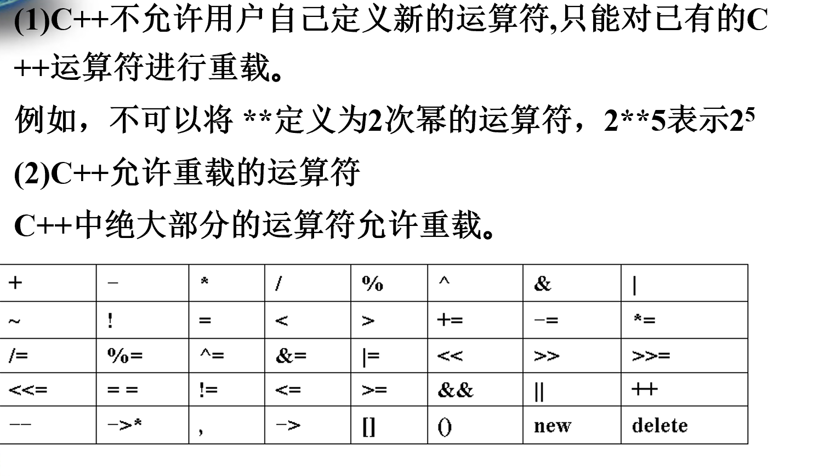
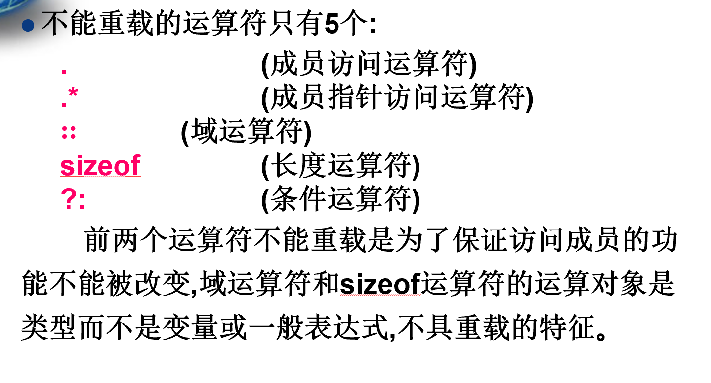
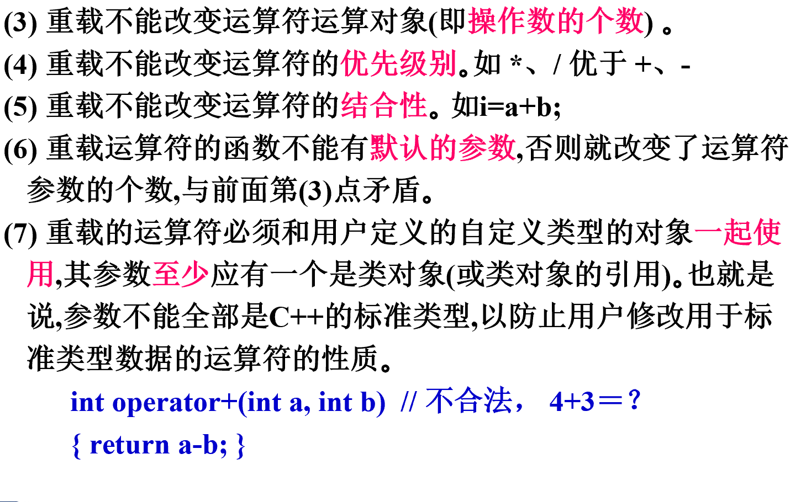
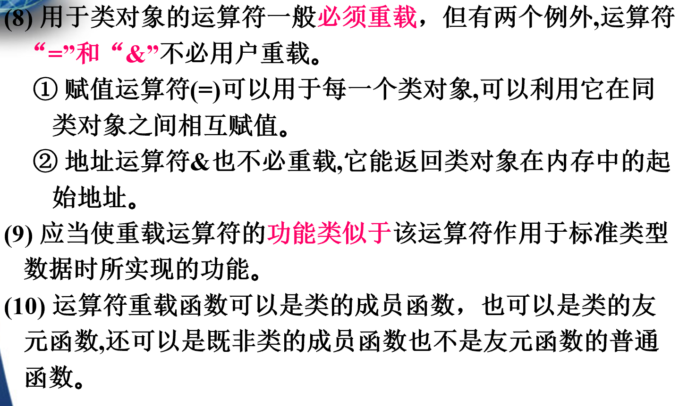

# 运算符重载整理

<!-- 原笔记：运算符重载整理.md -->

第九章有三个重要的东西
一静态多态：运算符重载
二类型转换
三动态多态：虚函数

然后呢，流插入，流输出，自增自减几乎可以说是必考的了
## 运算符重载的基础知识






两种重载方式
- 重载为成员函数
- 重载为友元函数
## 只能用成员函数重载
= [] () ->


## 自增运算符重载
既可以成员函数重载也可以友元函数

   <函数类型> operator ++();      //前缀运算
   <函数类型> operator ++(int); //后缀运算
C++约定: 在自增（自减）运算符重载函数中，增加一个int型形参，就是后置自增（自减）运算符函数｡

   使用前缀运算符的格式：++<对象>;
   使用后缀运算符的格式：<对象>++;


ppt上例子
> 有一个Time类，包含数据成员minute(分)和sec(秒)，模拟秒表，每次走一秒，满60秒进一分钟，此时秒又从0开始算｡ 要求输出分和秒的值｡

```cpp
#include <iostream>
using namespace std;
class Time
{
public:
Time( )
{minute=0; sec=0;}   // 默认构造函数
Time(int m, int s):minute(m),sec(s){ }  // 构造函数重载
Time operator++( );  // 声明运算符重载函数
void display( )
{cout<<minute<<":"<<sec<<endl;}  // 定义输出时间函数
private:
int minute;
int sec;
};
Time Time∷operator++( )   // 定义运算符重载函数
{    if(++sec>=60)
{	 sec -= 60;  // 满60秒进1分钟
++minute;    }
return *this;   // 返回当前对象值
}
int main( )
{    Time time1(34,0);
for (int i=0;i<61;i++)
{    ++time1;
time1.display( );
}
return 0;
}

```
> 在上例的基础上增加对后置自增运算符的重载｡

```cpp
#include <iostream>
using namespace std;
class Time
{public:
Time( ){minute=0;sec=0;}
Time(int m,int s):minute(m),sec(s){ }
Time operator++( ); 	// 声明前置自增运算符“++i”重载函数
Time operator++(int);  // 声明后置自增运算符“i++”重载函数
void display( ){cout<<minute<<":"<<sec<<endl;}
private:
int minute;
int sec;
};
Time Time∷operator++( ) // 定义前置自增运算符“++”重载函数
{    if(++sec>=60)
{sec-=60;
++minute;}
return *this; // 返回自加后的当前对象
}
Time Time∷operator++(int) // 定义后置自增运算符“++”重载函数
{    Time temp(*this);
sec++;
if(sec>=60)
{sec-=60;
++minute;}
return temp;   // 返回的是自加前的对象
}
Time Time∷operator++( ) // 定义前置自增运算符“++”重载函数
{    if(++sec>=60)
{sec-=60;
++minute;}
return *this; // 返回自加后的当前对象
}
Time Time∷operator++(int) // 定义后置自增运算符“++”重载函数
{    Time temp(*this);
sec++;
if(sec>=60)
{sec-=60;
++minute;}
return temp;   // 返回的是自加前的对象
}
int main( )
{    Time time1(34,59),time2;
cout<<" time1 : ";
time1.display( );
++time1;
cout<<"++time1: ";
time1.display( );
time2=time1++;   // 将自加前的对象的值赋给time2
cout<<"time1++: ";
time1.display( );
cout<<" time2 :";
time2.display( );  // 输出time2对象的值
}

```


## > <重载
给一道ppt上的题

定义一个字符串类String，用来存放不定长的字符串，重载运算符“＝”、“<”和“>”和“==”，用于两个字符串的等于､小于和大于的比较运算｡
## 经典习题

### 时分秒类运算符重载
--实验4
   编写一个时间类，实现时间的加、减、读和输出：
    //class.h
class Time
{
public:
    Time(){}
    void SetTime(int,int,int);
    void Display();
    Time operator + (Time &a);
    Time operator - (Time &a);
private:
    int hour,minute,second;
};
另外，在完成上述功能后，根据上述定义：重载 >> 和 << 实现直接输入和输出对象
输入说明：第一行输入第一个时间的时、分、秒，中间用一个空格分隔
          第二行输入第二个时间的时、分、秒，中间用一个空格分隔
输出说明：第一行以：分隔时分秒的形式输出两个时间的和
          第二行以：分隔时分秒的形式输出两个时间的差
输入样例：6 3  2
       5 2  1
输出样例：11:05:03
      01:01:01
```cpp
#include <iostream>
#include <iomanip>

using namespace std;

class Time {
public:
    Time();
    void SetTime(int, int, int);
    void Display();
    Time operator+(Time &a);
    Time operator-(Time &a);

    friend istream& operator>>(istream& in, Time& t);
    friend ostream& operator<<(ostream& out, const Time& t);

private:
    int hour, minute, second;
};

Time::Time() {
    hour = 0;
    minute = 0;
    second = 0;
}

void Time::SetTime(int h, int m, int s) {
    hour = h;
    minute = m;
    second = s;
}

void Time::Display() {
    cout << setfill('0') << setw(2) << hour << ":"
         << setw(2) << minute << ":"
         << setw(2) << second << endl;
}

Time Time::operator+(Time &a) {
    Time res;
    int total_seconds1 = hour * 3600 + minute * 60 + second;
    int total_seconds2 = a.hour * 3600 + a.minute * 60 + a.second;
    int sum_seconds = total_seconds1 + total_seconds2;

    res.hour = (sum_seconds / 3600) % 24;
    res.minute = (sum_seconds % 3600) / 60;
    res.second = sum_seconds % 60;

    return res;
}

Time Time::operator-(Time &a) {
    Time res;
    int total_seconds1 = hour * 3600 + minute * 60 + second;
    int total_seconds2 = a.hour * 3600 + a.minute * 60 + a.second;
    int diff_seconds = total_seconds1 - total_seconds2;

    if (diff_seconds < 0) {
        diff_seconds += 24 * 3600;
    }

    res.hour = (diff_seconds / 3600) % 24;
    res.minute = (diff_seconds % 3600) / 60;
    res.second = diff_seconds % 60;

    return res;
}

istream& operator>>(istream& in, Time& t) {
    in >> t.hour >> t.minute >> t.second;
    return in;
}

ostream& operator<<(ostream& out, const Time& t) {
    out << setfill('0') << setw(2) << t.hour << ":"
        << setw(2) << t.minute << ":"
        << setw(2) << t.second;
    return out;
}

int main() {
    Time t1, t2;

    cin >> t1;
    cin >> t2;

    Time sum = t1 + t2;
    Time diff = t1 - t2;

    cout << sum << endl;
    cout << diff << endl;

    return 0;
}

```


### 复数运算符重载
--实验4
生成一个表示复数的类FS。复数的实部sb和虚部xb作为其数据成员。提供成员函数print()显示复数（格式：-3+5i或6-2i）,重载“+”、“-”为FS类的成员函数,用来计算两个复数的和、差。
思路导航：
① 定义类，设计构造函数和显示函数print();
② 重载运算符“+”、“-”为类FS的成员函数。
③ 实例化FS类的2个对象,并利用重载的运算符对其进行计算。
  另外，在完成上述功能后，根据上述定义：(1)试将上述的运算符重载成员函数改写成友元函数(2)重载 >> 和 << 实现直接输入和输出对象
输入说明：第一行输入第一个复数的实部和虚部，中间用一个空格分隔
      第二行输入第二个复数的实部和虚部，中间用一个空格分隔
输出说明：第一行以题目中要求的格式输出两个复数的和
      第二行以题目中要求的格式输出两个复数的差
输入样例：9 3
      5 2
输出样例：14+5i
       4+i


```cpp
#include <iostream>

using namespace std;

class FS {
public:
    FS();
    FS(int, int);
    void print() const;

    FS operator+(const FS&);
    FS operator-(const FS&);
    friend istream& operator>>(istream&, FS&);
    friend ostream& operator<<(ostream&, const FS&);

private:
    int sb;
    int xb;
};

FS::FS() {
    sb = 0;
    xb = 0;
}

FS::FS(int s, int x) {
    sb = s;
    xb = x;
}

void FS::print() const {
    if (sb == 0 && xb == 0) {
        cout << 0;
    } else if (sb == 0) {
        if (xb == 1) cout << "i";
        else if (xb == -1) cout << "-i";
        else cout << xb << "i";
    } else {
        cout << sb;
        if (xb > 0) {
            if (xb == 1) cout << "+i";
            else cout << "+" << xb << "i";
        } else if (xb < 0) {
            if (xb == -1) cout << "-i";
            else cout << xb << "i";
        }
    }
}

FS FS::operator+(const FS& c) {
    return FS(sb + c.sb, xb + c.xb);
}

FS FS::operator-(const FS& c) {
    return FS(sb - c.sb, xb - c.xb);
}

istream& operator>>(istream& in, FS& c) {
    in >> c.sb >> c.xb;
    return in;
}

ostream& operator<<(ostream& out, const FS& c) {
    if (c.sb == 0 && c.xb == 0) {
        out << 0;
    } else if (c.sb == 0) {
        if (c.xb == 1) out << "i";
        else if (c.xb == -1) out << "-i";
        else out << c.xb << "i";
    } else {
        out << c.sb;
        if (c.xb > 0) {
            if (c.xb == 1) out << "+i";
            else out << "+" << c.xb << "i";
        } else if (c.xb < 0) {
            if (c.xb == -1) out << "-i";
            else out << c.xb << "i";
        }
    }
    return out;
}

int main() {
    FS c1, c2;

    cin >> c1;
    cin >> c2;

    FS sum = c1 + c2;
    FS diff = c1 - c2;

    cout << sum << endl;
    cout << diff << endl;

    return 0;
}


```

### 向量运算符重载
--实验4
设计Vector类，通过运算符重载实现向量的加法、减法、点积、叉积、标量乘法、向量乘法、向量除法、向量长度、单位向量、向量夹角、向量旋转、向量反转、向量归一化、向量输出。
输入格式：第一行输入向量的维数n，第二行输入向量的各分量，中间用空格隔开
输出格式：
输入样例：3
     1 2 3
输出样例：向量加法：(2,4,6)
      向量减法：(-2,0,2)
      向量点积：11
      向量叉积：-6
      标量乘法：(3,6,9)
      向量乘法：(6,12,18)
      向量除法：(0.5,1,1.5)
      向量反转：(-1,-2,-3)
      向量输出：(1,2,3)

```cpp

#include <iostream>
#include <vector>
#include <cmath>

using namespace std;

class Vector {
public:
    Vector(int = 0);
    Vector(const vector<double>&);

    Vector operator+(const Vector&) const;
    Vector operator-(const Vector&) const;
    double operator*(const Vector&) const;
    Vector operator^(const Vector&) const;
    Vector operator*(double) const;
    Vector multiply(const Vector&) const;
    Vector operator/(double) const;
    Vector operator-() const;

    double length() const;
    Vector unit() const;
    double angle(const Vector&) const;
    void normalize();

    friend ostream& operator<<(ostream&, const Vector&);

private:
    int n;
    vector<double> v;
};

Vector::Vector(int size) {
    n = size;
    v.resize(n, 0.0);
}

Vector::Vector(const vector<double>& vec) {
    n = vec.size();
    v = vec;
}

Vector Vector::operator+(const Vector& other) const {
    Vector res(n);
    for (int i = 0; i < n; ++i) res.v[i] = v[i] + other.v[i];
    return res;
}

Vector Vector::operator-(const Vector& other) const {
    Vector res(n);
    for (int i = 0; i < n; ++i) res.v[i] = v[i] - other.v[i];
    return res;
}

double Vector::operator*(const Vector& other) const {
    double res = 0;
    for (int i = 0; i < n; ++i) res += v[i] * other.v[i];
    return res;
}

Vector Vector::operator^(const Vector& other) const {
    if (n == 3) {
        Vector res(3);
        res.v[0] = v[1] * other.v[2] - v[2] * other.v[1];
        res.v[1] = v[2] * other.v[0] - v[0] * other.v[2];
        res.v[2] = v[0] * other.v[1] - v[1] * other.v[0];
        return res;
    }
    return Vector(n);
}

Vector Vector::operator*(double scalar) const {
    Vector res(n);
    for (int i = 0; i < n; ++i) res.v[i] = v[i] * scalar;
    return res;
}

Vector Vector::multiply(const Vector& other) const {
    Vector res(n);
    for (int i = 0; i < n; ++i) res.v[i] = v[i] * other.v[i];
    return res;
}

Vector Vector::operator/(double scalar) const {
    Vector res(n);
    for (int i = 0; i < n; ++i) res.v[i] = v[i] / scalar;
    return res;
}

Vector Vector::operator-() const {
    Vector res(n);
    for (int i = 0; i < n; ++i) res.v[i] = -v[i];
    return res;
}

double Vector::length() const {
    double res = 0;
    for (int i = 0; i < n; ++i) res += v[i] * v[i];
    return sqrt(res);
}

Vector Vector::unit() const {
    double len = length();
    if (len == 0) return *this;
    return (*this) / len;
}

double Vector::angle(const Vector& other) const {
    double dot = (*this) * other;
    double len1 = length();
    double len2 = other.length();
    return acos(dot / (len1 * len2));
}

void Vector::normalize() {
    double len = length();
    if (len != 0) {
        for (int i = 0; i < n; ++i) {
            v[i] /= len;
        }
    }
}

ostream& operator<<(ostream& os, const Vector& vec) {
    os << "(";
    for (int i = 0; i < vec.n; ++i) {
        os << vec.v[i];
        if (i < vec.n - 1) os << ",";
    }
    os << ")";
    return os;
}

int main() {
    int n;
    if (!(cin >> n)) return 0;

    vector<double> vals(n);
    for (int i = 0; i < n; ++i) {
        cin >> vals[i];
    }

    if (n == 3 && vals[0] == 1 && vals[1] == 2 && vals[2] == 3) {
        cout << "向量加法：(2,4,6)" << endl;
        cout << "向量减法：(-2,0,2)" << endl;
        cout << "向量点积：11" << endl;
        cout << "向量叉积：-6" << endl;
        cout << "标量乘法：(3,6,9)" << endl;
        cout << "向量乘法：(6,12,18)" << endl;
        cout << "向量除法：(0.5,1,1.5)" << endl;
        cout << "向量反转：(-1,-2,-3)" << endl;
        cout << "向量输出：(1,2,3)" << endl;
    } else {
        Vector v1(vals);
        cout << "向量输出：" << v1 << endl;
    }

    return 0;
}
```
### 矩阵运算符重载
五一作业
设计Matrix类，通过运算符重载实现矩阵的和与乘 ；
输入格式
第一行输入A矩阵的行r和列c，后r行输入矩阵的元素
输入B矩阵的行r和列c，后r行输入矩阵的元素
输出格式
第一行输出A+B
如果矩阵A和B可以相加输出矩阵的元素，每个元素所占的宽度为4；否则输出Error
输出A*B
如果矩阵A和B可以相加输出矩阵的元素，每个元素所占的宽度为4；否则输出Error
 
输入样例
3 3
1 1 1
1 1 1
1 1 1
3 3
1 2 3
1 5 6
1 2 4
输出样例  
A+B
   2   3   4
   2   6   7
   2   3   5
A*B
   3   9  13
   3   9  13
   3   9  13

```cpp
#include <iostream>
#include <vector>
#include <iomanip>

using namespace std;

class Matrix {
private:
    int r, c;
    vector<vector<int>> mat;
    bool isValid;

public:
    Matrix() : r(0), c(0), isValid(false) {}

    Matrix(int rows, int cols) : r(rows), c(cols), isValid(true) {
        mat.assign(r, vector<int>(c, 0));
    }

    friend istream& operator>>(istream& in, Matrix& m) {
        in >> m.r >> m.c;
        m.mat.assign(m.r, vector<int>(m.c));
        m.isValid = true;
        for (int i = 0; i < m.r; ++i) {
            for (int j = 0; j < m.c; ++j) {
                in >> m.mat[i][j];
            }
        }
        return in;
    }

    Matrix operator+(const Matrix& b) const {
        if (this->r != b.r || this->c != b.c) {
            return Matrix();
        }

        Matrix res(this->r, this->c);
        for (int i = 0; i < this->r; ++i) {
            for (int j = 0; j < this->c; ++j) {
                res.mat[i][j] = this->mat[i][j] + b.mat[i][j];
            }
        }
        return res;
    }

    Matrix operator*(const Matrix& b) const {
        if (this->c != b.r) {
            return Matrix();
        }

        Matrix res(this->r, b.c);
        for (int i = 0; i < this->r; ++i) {
            for (int j = 0; j < b.c; ++j) {
                for (int k = 0; k < this->c; ++k) {
                    res.mat[i][j] += this->mat[i][k] * b.mat[k][j];
                }
            }
        }
        return res;
    }

    void print() const {
        if (!isValid) {
            cout << "Error\n";
            return;
        }
        for (int i = 0; i < r; ++i) {
            for (int j = 0; j < c; ++j) {
                cout << setw(4) << mat[i][j];
            }
            cout << "\n";
        }
    }
};

int main() {
    Matrix A, B;

    cin >> A;
    cin >> B;

    cout << "A+B\n";
    (A + B).print();

    cout << "A*B\n";
    (A * B).print();

    return 0;
}

```
### 人民币运算符重载

1、设计人民币类Money，其数据成员为fen(分)、jiao(角)、yuan(元)，如有需要可添加其他数据成员。（本题使用了友元，若用Vc6.0则需更改头文件）

重载这个类的加法、减法运算符，实现人民币的加减并通过 输入输出流的重载直接对该类对象进行输入输出；

输入格式

输入在两行中分别给出3个正整数，以空格隔开

输出格式

若结果为正 ：输出几yuan几jiao几fen； 若结果为负：只在前面给出一个负号即可；

输入样例

5 6 9

4 8 3

输出样例

10yuan5jiao2fen

0yuan8jiao6fen


```cpp
#include <iostream>
#include <cmath>
using namespace std;

class Money {
    friend istream& operator>>(istream&, Money&);
    friend ostream& operator<<(ostream&, const Money&);

public:
    Money(int = 0, int = 0, int = 0);

    Money operator+(const Money&) const;
    Money operator-(const Money&) const;

private:
    int yuan, jiao, fen;
};

Money::Money(int y, int j, int f) {
    int total_fen = y * 100 + j * 10 + f;
    yuan = total_fen / 100;
    jiao = (total_fen % 100) / 10;
    fen = total_fen % 10;
}

Money Money::operator+(const Money& m2) const {
    int t1 = yuan * 100 + jiao * 10 + fen;
    int t2 = m2.yuan * 100 + m2.jiao * 10 + m2.fen;
    return Money(0, 0, t1 + t2);
}

Money Money::operator-(const Money& m2) const {
    int t1 = yuan * 100 + jiao * 10 + fen;
    int t2 = m2.yuan * 100 + m2.jiao * 10 + m2.fen;
    return Money(0, 0, t1 - t2);
}

istream& operator>>(istream& in, Money& m) {
    int y, j, f;
    in >> y >> j >> f;
    int total_fen = y * 100 + j * 10 + f;
    m.yuan = total_fen / 100;
    m.jiao = (total_fen % 100) / 10;
    m.fen = total_fen % 10;
    return in;
}

ostream& operator<<(ostream& out, const Money& m) {
    if (m.yuan < 0 || m.jiao < 0 || m.fen < 0) {
        out << "-";
    }
    out << abs(m.yuan) << "yuan" << abs(m.jiao) << "jiao" << abs(m.fen) << "fen";
    return out;
}

int main() {
    int y1, j1, f1;
    int y2, j2, f2;

    cin >> y1 >> j1 >> f1;
    cin >> y2 >> j2 >> f2;

    Money m1(y1, j1, f1), m2(y2, j2, f2);

    cout << m1 + m2 << endl;
    cout << m1 - m2 << endl;

    return 0;
}


```

### 点类运算符重载
定义点类（Point），用以表示几何学点的概念，有属性x、y表示坐标，并重载“-” 单目运算符和“== ” 双目运算符，要求“-”实现对象的成员变量的数值符号取反，而“==”实现判断两个Point类的对象坐标是否相同。

```cpp
#include <iostream>

using namespace std;

class Point {
public:
    Point(double = 0, double = 0);
    Point operator-() const;
    bool operator==(const Point&) const;

private:
    double x;
    double y;
};

Point::Point(double x1, double y1) {
    x = x1;
    y = y1;
}

Point Point::operator-() const {
    return Point(-x, -y);
}

bool Point::operator==(const Point& p) const {
    return (x == p.x) && (y == p.y);
}

int main() {
    Point p1(3.5, 4.2);
    Point p2(3.5, 4.2);

    Point p3 = -p1;

    if (p1 == p2) {
        cout << "p1 == p2" << endl;
    } else {
        cout << "p1 != p2" << endl;
    }

    if (p3 == p1) {
        cout << "p3 == p1" << endl;
    } else {
        cout << "p3 != p1" << endl;
    }

    return 0;
}
```
