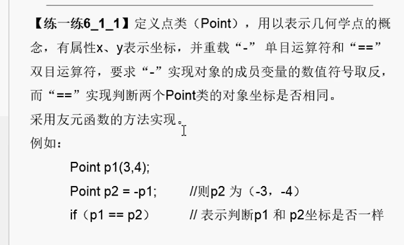
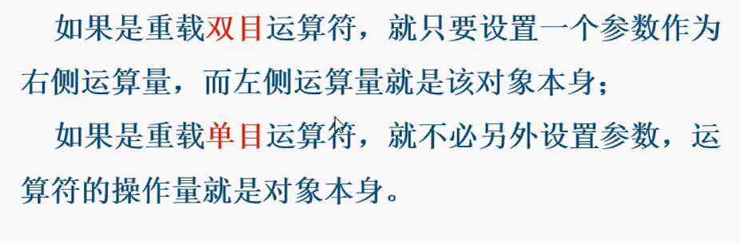
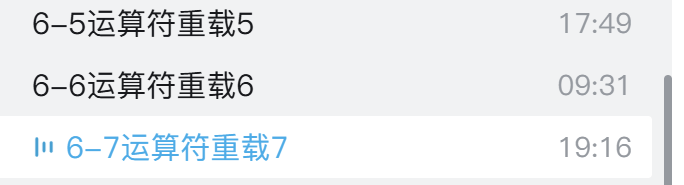

# 运算符重载课堂笔记

<!-- 原笔记：运算符重载.md -->

## 多态性


多态性从实现角度可以分为两类：静态多态性和动态多态性

静态多态性主要应用于函数重载和运算符重载

动态多态性主要应用于虚函数

运算符重载就是定义函数

    运算符重载为成员函数
    运算符重载为友元函数


【引例】定义一个复数类，实现复数的加法功能。


## 方法一：定义一个复数类的 ADD() 成员函数
错误一:把ADD()当作全局函数来用了，他是类的成员函数，要通过对象打点调用

```cpp

#include <iostream>

using namespace std;

class Complex{
    public:
        Complex(int,int);
        Complex();
        void show();
        Complex Add(const Complex&,const Complex &);
    private:
        int real,image;
};
    Complex::Complex(){
    }
    Complex::Complex(int real,int image):real(real),image(image)
    {
    }
    void Complex::show(){
        //输出该复数
        //先考虑虚部
        if(image>0){
            if(image==1)
            cout<<real<<"+"<<"i"<<endl;
            else
            cout<<real<<"+"<<image<<"i"<<endl;
        }
        else if(image<0){
            if(image == -1)
            cout<<real<<"-"<<"i"<<endl;
            cout<<real<<image<<"i"<<endl;
        }
        else
        cout<<real<<endl;

    }
    Complex Complex::Add(const Complex & c1,const Complex & c2){
        Complex res;
        res.real=c1.real+c2.real;
        res.image=c1.image+c2.image;
        return res;
    }

int main(){


    Complex c1(1,-1),c2(2,3);
    Complex c3=Add(c1,c2);
    c1.show();
    c2.show();
    c3.show();

    return 0;
}


```

改正后
```cpp

#include <iostream>

using namespace std;

class Complex{
    public:
        Complex(int,int);
        Complex();
        void show();
        Complex Add(const Complex &);
    private:
        int real,image;
};
    Complex::Complex(){
    }
    Complex::Complex(int real,int image):real(real),image(image)
    {
    }
    void Complex::show(){
        //输出该复数
        //先考虑虚部
        if(image>0){
            if(image==1)
            cout<<real<<"+"<<"i"<<endl;
            else
            cout<<real<<"+"<<image<<"i"<<endl;
        }
        else if(image<0){
            if(image == -1)
            cout<<real<<"-"<<"i"<<endl;
            else
            cout<<real<<image<<"i"<<endl;
        }
        else
        cout<<real<<endl;

    }
    Complex Complex::Add(const Complex & c2){
        Complex temp;
        temp.real = this->real+c2.real;
        temp.image= this->image+c2.image;
        return temp;

    }

int main(){


    Complex c1(1,-1),c2(2,3);
    Complex c3=c1.Add(c2);
    c1.show();
    c2.show();
    c3.show();

    return 0;
}


```

## 方法二：重载为友元函数

重载运算符的规则

返回类型 operator @ (参数表)
{
    重载函数体
}


```cpp
//重载为友元函数

#include <iostream>

using namespace std;

class Complex{
    public:
        Complex(int,int);
        Complex();
        void show();
        friend Complex operator+(const Complex&,const Complex &);
    private:
        int real,image;
};
    Complex::Complex(){
    }
    Complex::Complex(int real,int image):real(real),image(image)
    {
    }
    void Complex::show(){
        //输出该复数
        //先考虑虚部
        if(image>0){
            if(image==1)
            cout<<real<<"+"<<"i"<<endl;
            else
            cout<<real<<"+"<<image<<"i"<<endl;
        }
        else if(image<0){
            if(image == -1)
            cout<<real<<"-"<<"i"<<endl;
            else
            cout<<real<<image<<"i"<<endl;
        }
        else
        cout<<real<<endl;

    }
    Complex operator+(const Complex & c1,const Complex &c2){
        Complex temp;
        temp.real=c1.real+c2.real;
        temp.image=c1.image+c2.image;
        return temp;
    }

int main(){


    Complex c1(1,-1),c2(2,3);
    Complex c3=c1+c2;   //隐式调用
    c3=operator+(c1,c2);  //显式调用
    c1.show();
    c2.show();
    c3.show();

    return 0;
}


```

临时插入一道题，判断两个复数是否相等
```cpp


#include <iostream>

using namespace std;

class Complex{
    public:
        Complex(int,int);
        Complex();
        void show();
        friend bool operator == (const Complex & ,const Complex & );
    private:
        int real,image;
};
    Complex::Complex(){
    }
    Complex::Complex(int real,int image):real(real),image(image)
    {
    }
    void Complex::show(){
        //输出该复数
        //先考虑虚部
        if(image>0){
            if(image==1)
            cout<<real<<"+"<<"i"<<endl;
            else
            cout<<real<<"+"<<image<<"i"<<endl;
        }
        else if(image<0){
            if(image == -1)
            cout<<real<<"-"<<"i"<<endl;
            else
            cout<<real<<image<<"i"<<endl;
        }
        else
        cout<<real<<endl;

    }
    bool operator == (const Complex & c1,const Complex & c2 ){
        if(c1.real==c2.real&&c1.image==c2.image)return true;
        return false;
    }

int main(){


    Complex c1(1,-1),c2(2,3);
    if(c1 == c2 )
    cout<<"c1和c2相等"<<endl;
    else
    cout<<"c1和c2不相等"<<endl;
    return 0;
}


```

小练习



## 方法三：重载为成员函数



```cpp


#include <iostream>

using namespace std;

class Complex{
    public:
        Complex(int,int);
        Complex();
        void show();
         bool  operator == ( const Complex &  );
         Complex operator + (const Complex & );
    private:
        int real,image;
};
    Complex::Complex(){
    }
    Complex::Complex(int real,int image):real(real),image(image)
    {
    }
    void Complex::show(){
        //输出该复数
        //先考虑虚部
        if(image>0){
            if(image==1)
            cout<<real<<"+"<<"i"<<endl;
            else
            cout<<real<<"+"<<image<<"i"<<endl;
        }
        else if(image<0){
            if(image == -1)
            cout<<real<<"-"<<"i"<<endl;
            else
            cout<<real<<image<<"i"<<endl;
        }
        else
        cout<<real<<endl;

    }
bool Complex::operator == ( const Complex & c2 ){
    // 直接比较：this是当前对象（c1），c2是传入对象
    return (real == c2.real) && (image == c2.image);
}


    Complex Complex::operator + (const Complex & c2){
        Complex temp;
        temp.real=this->real+c2.real;
        temp.image=this->image+c2.image;
        return temp;
    }

int main(){


    Complex c1(1,-1),c2(1,-1);
    if(c1.operator ==(c2))
    cout<<"c1和c2相等"<<endl;
    else
    cout<<"c1和c2不相等"<<endl;
    Complex c3 = c1.operator +(c2);
    c3.show();
    return 0;
}


```


## 几种常用运算符的重载


